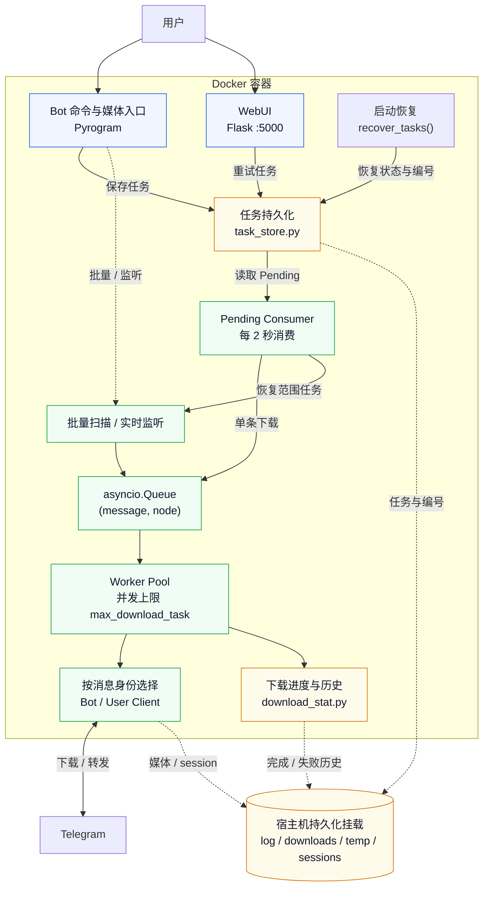
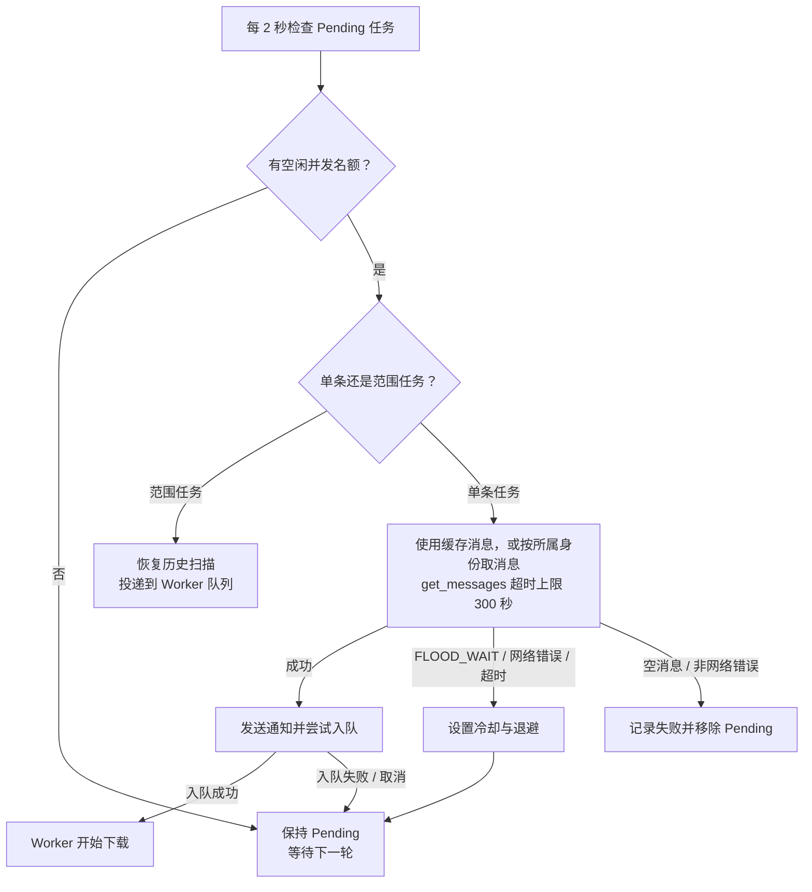
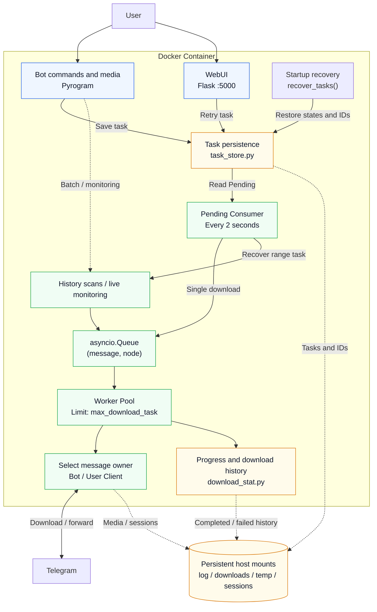
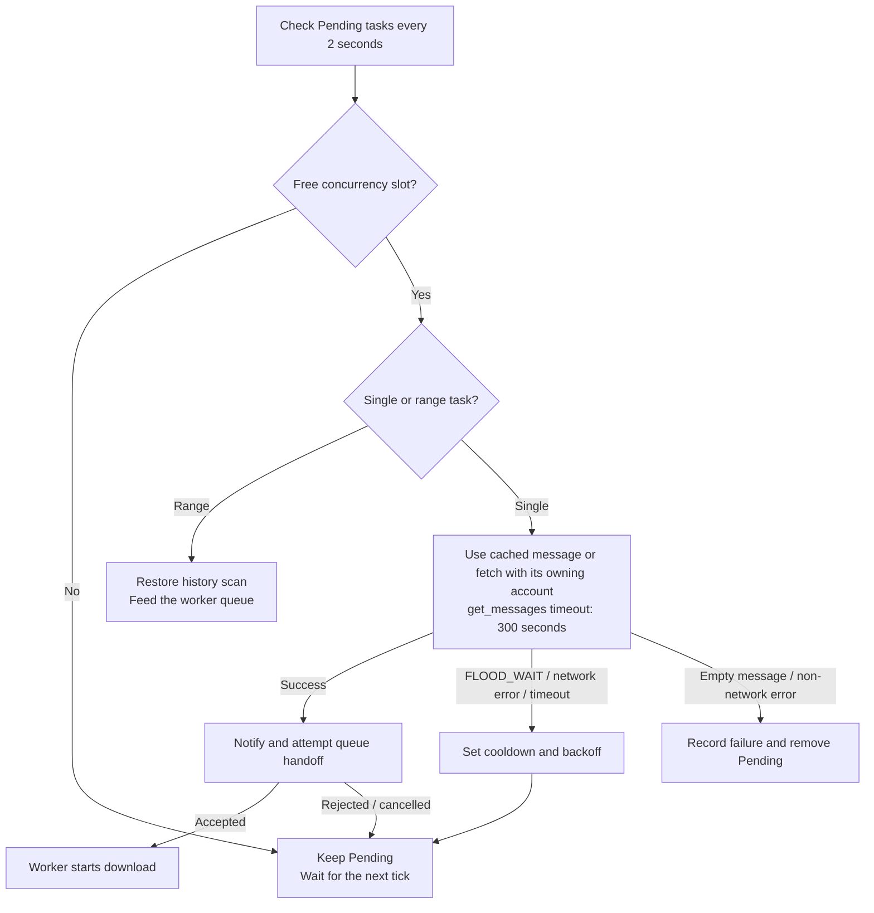

<h1 align="center">Telegram Media Downloader</h1>

<p align="center">
<strong>Telegram media download / forward / listen tool with task persistence, crash recovery, and modern WebUI</strong>
</p>

<p align="center">
<a href="https://github.com/smilekevin/telegram-media-downloader/blob/master/LICENSE"></a>
<a href="https://github.com/smilekevin/telegram-media-downloader/releases"></a>
<a href="https://www.python.org/downloads/"></a>
<a href="https://github.com/smilekevin/telegram-media-downloader/actions/workflows/docker-build.yml"></a>
</p>

<!-- BEGIN CHINESE README -->
<details>
<summary>🇨🇳 展开中文说明 / Chinese documentation</summary>

<p align="center">
  <a href="#features">English</a> ·
  <a href="#功能特性">功能特性</a> ·
  <a href="#快速开始">快速开始</a> ·
  <a href="#配置说明">配置说明</a> ·
  <a href="#bot-命令">Bot 命令</a> ·
  <a href="#web-api">Web API</a> ·
  <a href="#docker-数据持久化">Docker 数据持久化</a> ·
  <a href="#架构设计">架构设计</a> ·
  <a href="#相比上游的改动">相比上游的改动</a>
</p>

## 功能特性

### 下载

- **单文件多流并行加速下载** — 配置单文件并发 worker 数与固定切片大小，worker 下载完一片后自动领取下一片；支持暂停和中断续传，进度统一汇总
- **多类型媒体下载** — audio / document / photo / video / voice / animation / video_note
- **批量下载** — 指定消息 ID 范围 `[start, end]`，支持过滤器
- **单条下载** — 直接发送 `t.me` 链接给 Bot 即可下载
- **转发媒体下载** — 转发一条媒体消息给 Bot，自动从源频道下载
- **断点续传** — 文件大小 ≥ 已下载大小即判定为已完成，跳过重复下载
- **大小不匹配重下** — 已有文件但大小不符时，备份原文件后重新下载
- **3 次重试** — 每个文件最多重试 3 次，含指数退避（连接错误 10s/20s/40s）
- **文件引用过期处理** — BadRequest 时自动 fetch_message 刷新引用
- **临时文件清理** — 删除或取消正在下载的任务时清理其临时文件和分片目录；暂停、断网和程序退出保留断点

### 转发

- **跨频道转发** — 支持普通频道和受保护频道（has_protected_content）
- **受保护频道** — 自动切换为下载再上传模式
- **评论区转发** — `/forward_to_comments` 转发媒体到指定帖子评论区
- **实时监听转发** — `/listen_forward` 基于 NewMessage 事件驱动，频道有新消息立即触发下载/转发（非轮询）
- **config.yaml 频道监控** — 配置文件中的 chat 列表也会自动监听新消息，启动后实时更新

### 广告过滤

- **关键词过滤** — `/add_ad` 添加广告关键词，转发时自动跳过包含这些关键词的消息
- **关键词移除** — `/remove_ad` 移除广告关键词
- **内容替换** — `/add_replace_ad` 添加替换规则，自动从 caption 中删除匹配的广告文字
- **替换移除** — `/remove_replace_ad` 移除替换规则
- **群组广告** — `/set_ad` 为特定群组设置追加广告文字，转发时自动添加到 caption 末尾

### 任务管理

- **任务持久化** — 所有下载/转发任务写入 `log/bot_tasks.json`，容器重启不丢任务
- **崩溃恢复** — 重启后所有未完成任务统一进入 pending 队列，逐个消费
- **任务 ID** — `MMDD-序号` 格式（如 `0628-1`），每日序号重置，持久化计数器
- **Pending 队列** — 任务先入 pending 状态，由消费循环逐个喂给 worker 池；内存占位区分已入队等待 worker 的任务
- **下载进度持久化** — 每 50 条消息自动保存 `last_read_message_id`，中断不丢进度
- **下载历史持久化** — 完成/失败记录写入 `log/download_history.json`
- **手动终止** — 停止任务时未完成文件记入失败列表（原因：手动终止）

### FLOOD_WAIT 处理

- **非阻塞式等待** — 设置冷却时间戳，不 sleep，不卡死整个队列
- **Pending 消费者限速** — get_messages 遇到 FloodWait 时全局冷却，任务保持 pending
- **下载限速** — 累计 FloodWait > 600 秒则跳过该文件
- **消息编辑限速** — edit_message 遇到 FloodWait 时设置 node 级冷却
- **用户通知** — 限速暂停时发送 Telegram 通知告知用户
- **静默限速检测** — 检测 TG 静默限速（速度 < 200 KB/s 持续 120 秒），无 FloodWait 错误码也能识别，WebUI 横幅显示已限速时长 + TG 通知（触发和解除各一次）

### WebUI

- **现代浅色主题** — 移除 layui，纯原生 HTML/CSS/JS，响应式设计
- **四个标签页**：
  - 📥 **进行中** — 活跃下载，实时进度/速度/ETA
  - ✅ **已完成** — 无限滚动，服务端搜索
  - ❌ **失败** — 失败原因 + 源消息链接，支持重试
  - ⏳ **待执行** — pending/queued 队列，等待时间显示，区分等待中/排队中状态
- **操作** — 暂停/恢复、删除（单个/批量）、重试（单个/批量）
- **实时数据** — 总速度 = 所有活跃任务速度之和，3 秒无回调判为过期归零
- **粘性导航栏** — 滚动时标签页固定在顶部

### 通知

- **进度通知** — 每 20% 进度里程碑发送一次 Bot 消息更新
- **完成通知** — 任务完成时立即发送最终状态（从 _download_result 重新计数，避免竞态）
- **失败通知** — 列出每个失败文件及具体错误原因
- **限速通知** — FLOOD_WAIT 暂停时通知用户等待时长
- **静默限速** — TG 静默限速检测（速度 < 200 KB/s 持续 120 秒），WebUI 横幅显示已限速时长 + TG 通知（触发和解除各一次）
- **恢复通知** — 重启后恢复中断/待执行任务时通知用户
- **重试通知** — WebUI 重试任务加入队列时通知用户

### 其他

- **多语言** — 中文 / 英文 / 俄语 / 乌克兰语
- **rclone 云盘上传** — 下载完成后可选上传到云盘
- **代理支持** — Pyrogram 原生代理 + Docker 环境变量代理
- **本地开发模式** — `run_local.py` 无需 Telegram 账号，Mock 数据调试 WebUI
- **日志分离** — `tdl.log`（主日志）+ `download.log`（下载日志），10MB 轮转，保留 30 天

---

## 快速开始

Docker 部署使用本 fork 发布的 `ghcr.io/smilekevin/telegram-media-downloader:latest`，由 GitHub Release 发布流程更新。

### 部署前准备：API 凭据与 Bot Token

以下说明适用于镜像、Docker Compose 和手动部署；本地 Mock 开发模式无需 Telegram 登录。

**获取 `api_id` 和 `api_hash`**

1. 使用已有 Telegram 账号的手机号登录 [my.telegram.org](https://my.telegram.org)。
2. 打开 [API development tools](https://my.telegram.org/apps)，填写应用信息并创建应用。
3. 将页面显示的 `api_id` 和 `api_hash` 填入本地 `config.yaml`。手机号登录和 Bot Token 登录都需要这两个字段，请妥善保存，不要提交到公开仓库。详见 [Telegram 官方说明](https://core.telegram.org/api/obtaining_api_id)。

**获取 Bot Token**

1. 在 Telegram 中打开 [@BotFather](https://t.me/BotFather)，发送 `/newbot`。
2. 按提示设置 Bot 名称和用户名，创建成功后复制 BotFather 返回的完整 Token。
3. 将 Token 填入 `config.yaml` 的 `bot_token`，用于命令交互和通知 Bot。详见 [Telegram 官方说明](https://core.telegram.org/bots/features#botfather)。

主下载客户端可以选择手机号或 Bot Token 登录；仅填写配置中的 `bot_token` 不会代替主下载客户端的首次登录。使用 Bot 身份下载时，下载范围取决于该 Bot 对目标消息的访问权限。各部署方式的首次登录和 session 丢失后的重新登录步骤见下文，两种登录方式的背景说明见 [Pyrogram 官方文档](https://docs.pyrogram.org/start/auth)。

### Docker 镜像部署

服务器或 NAS 已安装 Docker 后，可以直接运行本 fork 的预构建镜像。

1. **准备配置和数据目录**：从本仓库下载 [config.yaml.example](./config.yaml.example)，复制为 `config.yaml`，并创建运行数据文件和持久化目录。下面的命令会保留已有的 `config.yaml` 和 `data.yaml`。

```bash
mkdir -p telegram-media-downloader
cd telegram-media-downloader
mkdir -p downloads log sessions temp

curl -fL https://raw.githubusercontent.com/smilekevin/telegram-media-downloader/master/config.yaml.example \
  -o config.yaml.example
[ -f config.yaml ] || cp config.yaml.example config.yaml
[ -f data.yaml ] || printf '{}\n' > data.yaml
```

2. **填写配置**：使用文本编辑器打开 `config.yaml`，填写 `api_id`、`api_hash` 和 `bot_token`，按[配置说明](#配置说明)设置媒体类型、权限和并发数。模板自带示例代理，请按自己的环境修改 `proxy`；无需代理时设为 `proxy: {}`。使用下面的挂载和端口映射时，保留 `save_path: /app/downloads`、`web_host: 0.0.0.0` 和 `web_port: 5000`。

3. **拉取镜像并首次启动**：挂载配置、运行数据、下载、日志、session 和临时目录，以交互模式完成 Telegram 登录。

```bash
docker pull ghcr.io/smilekevin/telegram-media-downloader:latest

docker run -it \
  --name telegam-media-downloader \
  --restart unless-stopped \
  -p 5000:5000 \
  -e TZ=Asia/Shanghai \
  -v "$PWD/config.yaml:/app/config.yaml" \
  -v "$PWD/data.yaml:/app/data.yaml" \
  -v "$PWD/downloads:/app/downloads" \
  -v "$PWD/log:/app/log" \
  -v "$PWD/sessions:/app/sessions" \
  -v "$PWD/temp:/app/temp" \
  ghcr.io/smilekevin/telegram-media-downloader:latest
```

4. **首次登录（或需要重新登录时，比如 session 失效）**：**此处登录的账号为实际下载用户**，程序以该 Telegram 用户或 Bot 账号的身份访问并下载消息，下载权限取决于该账号。在终端出现 `Enter phone number or bot token:` 时，选择一种方式输入，并在确认提示时输入 `y`：

- **手机号**：输入带国家区号的手机号（例如 `+8613812345678`），再输入 Telegram 发送的验证码；启用两步验证时还需输入密码。
- **Bot Token**：输入在[部署前准备](#部署前准备api-凭据与-bot-token)中获取的完整 Token，无需手机号验证码。

登录成功后，按 `Ctrl+C` 停止当前前台运行。session 保存在挂载的 `sessions/`，保留有效 session 后重启无需再次登录。任务与下载历史保存在 `log/`；各挂载目录的用途见[Docker 数据持久化](#docker-数据持久化)。

5. **后台启动并访问 WebUI**：执行以下命令，停止容器后用 [`docker start`](https://docs.docker.com/reference/cli/docker/container/start/) 在后台启动已有容器：

```bash
docker stop telegam-media-downloader
docker start telegam-media-downloader
```

启动后，在浏览器中访问 `http://服务器IP:5000`。

### Docker 部署

使用仓库中提供的 `docker-compose.yaml` 部署：

```bash
git clone https://github.com/smilekevin/telegram-media-downloader.git
cd telegram-media-downloader

# 复制配置
cp config.yaml.example config.yaml
# 编辑 config.yaml，填入 api_id / api_hash / bot_token

# 拉取已发布的 Release 镜像
docker-compose pull
```

**首次登录（或需要重新登录时，比如 session 失效）**：**此处登录的账号为实际下载用户**，程序以该 Telegram 用户或 Bot 账号的身份访问并下载消息，下载权限取决于该账号。使用交互终端启动一次性容器；如果后台服务正在运行，先停止它：

```bash
docker-compose stop telegam-media-downloader
docker-compose run --rm telegam-media-downloader
```

出现 `Enter phone number or bot token:` 时，输入带国家区号的手机号或完整 Bot Token，并在确认提示时输入 `y`。手机号登录还需输入验证码，以及两步验证密码（如已启用）；Bot Token 登录无需手机号验证码。登录成功后按 `Ctrl+C` 停止此次前台运行，再启动后台服务：

```bash
docker-compose up -d

# 查看日志
docker-compose logs -f
```

Compose 将 session 保存在宿主机的 `sessions/`；`--rm` 只删除一次性容器，不会删除挂载目录。保留有效 session 后，后续启动无需再次登录。

### 手动安装

```bash
git clone https://github.com/smilekevin/telegram-media-downloader.git
cd telegram-media-downloader
pip install -r requirements.txt

cp config.yaml.example config.yaml
# 编辑 config.yaml...
```

**首次登录（或需要重新登录时，比如 session 失效）**：**此处登录的账号为实际下载用户**，程序以该 Telegram 用户或 Bot 账号的身份访问并下载消息，下载权限取决于该账号。如果下载程序正在运行，先停止它，再从项目目录在交互终端中执行：

```bash
python media_downloader.py
```

出现 `Enter phone number or bot token:` 时，输入带国家区号的手机号或完整 Bot Token，并在确认提示时输入 `y`。手机号登录还需输入验证码，以及两步验证密码（如已启用）；Bot Token 登录无需手机号验证码。登录成功后程序继续运行，session 保存在项目的 `sessions/`。保留有效 session 后，后续启动无需再次登录。

### 本地开发模式

```bash
# 无需 Telegram 账号，Mock 数据启动 WebUI
python run_local.py
# 访问 http://localhost:5000
```

---

## 配置说明

### config.yaml

```yaml
# Telegram API 凭证（必填）
api_id: your_api_id
api_hash: your_api_hash
bot_token: your_bot_token  # Bot Token，用于 Bot 命令交互

# 媒体类型
media_types:
  - audio
  - document
  - photo
  - video
  - voice
  - animation

# 文件格式过滤（all = 所有格式）
file_formats:
  audio:
    - all
  document:
    - pdf
    - epub
  video:
    - mp4

# 下载设置
save_path: /app/downloads
file_path_prefix:
  - chat_title
  - media_datetime
file_name_prefix:
  - file_name
hide_file_name: false

# 并发控制
max_download_task: 5  # worker 数量
file_download_concurrency: 4  # 每个文件的并发下载 worker 数
download_part_size_mb: 64  # 固定切片大小（MiB），最后一片按剩余大小下载

# WebUI
web_host: 0.0.0.0
web_port: 5000
web_login_secret: "replace-with-a-long-password"  # WebUI 访问密码；设为 "" 关闭登录

# 权限
allowed_user_ids:
  - 'me'  # 'me' = 当前登录账号

# 其他
language: ZH
date_format: '%Y_%m'
enable_download_txt: false
log_level: DEBUG

# 代理（Docker 内访问宿主机代理）
proxy:
  scheme: http
  hostname: 172.17.0.1
  port: 20172
```

### 配置参数说明

| 参数 | 说明 | 默认值 |
|------|------|--------|
| `api_id` | Telegram API ID（[my.telegram.org](https://my.telegram.org/apps)） | — |
| `api_hash` | Telegram API Hash | — |
| `bot_token` | 命令交互和通知 Bot 的 Token（[@BotFather](https://t.me/BotFather)） | — |
| `media_types` | 下载的媒体类型列表 | — |
| `file_formats` | 各类型文件格式过滤 | — |
| `save_path` | 文件保存路径 | `./downloads` |
| `max_download_task` | 并发下载 worker 数 | `5` |
| `file_download_concurrency` | 单文件并发下载 worker 数 | `1` |
| `download_part_size_mb` | 固定切片大小，单位 MiB，必须为正整数 | `64` |
| `web_port` | WebUI 端口 | `5000` |
| `web_login_secret` | WebUI 访问密码；非空时首页和所有接口均需登录，空字符串关闭登录 | `""` |
| `allowed_user_ids` | 允许使用 Bot 的用户 ID（`'me'` = 自己） | `[]` |
| `language` | 界面语言（`ZH` / `EN` / `RU` / `UA`） | `EN` |
| `proxy` | 代理配置（scheme / hostname / port） | `{}` |
| `log_level` | 日志级别 | `INFO` |
| `hide_file_name` | 隐藏文件名（UI 显示 `****.mp4`） | `false` |
| `enable_download_txt` | 纯文本消息保存为 .txt | `false` |
| `date_format` | 日期目录格式 | `%Y_%m` |

文件按 `download_part_size_mb` 切成固定大小的切片，最后一片为剩余大小。
例如每片 64 MiB 时，40 MiB 文件为 1 片，100 MiB 为 2 片，500 MiB 为 8 片。
每个文件启动最多 `file_download_concurrency` 个 worker；每个 worker 下载完一片后从队列领取下一片，直到全部完成，再按切片顺序合并。
每个 worker 使用独立的 Telegram 下载 TCP 连接，并在连续下载后续切片时沿用自己的连接；不同 worker 和文件不共用下载连接。
暂停时保留连接，完成、取消或客户端重启时关闭连接。
通过网页、Web API 或 Bot 取消正在下载的任务时，先关闭连接，再清理该文件在 `temp/` 中的临时文件和 `.parts/` 目录；已完成文件按原来的“同时删除本地文件”选项处理。
同时下载的文件数仍由 `max_download_task` 控制；5 个文件各 4 个 worker 时，最多有 20 个并发下载 worker，没有额外的总并发配置。
切片大小和 worker 数在文件首次开始时保存，暂停、重试和程序重启后继续使用该计划，不重复下载已完成切片。
进度条汇总所有切片的已下载字节，续传恢复的已有字节不计入新传输速度。
旧版分片断点仍可续传。旧 `download_min_part_size_mb` 在没有新字段时作为切片大小的兼容值读取，保存配置时迁移为 `download_part_size_mb`；旧 `download_concurrency` 已移除。

分片断点保存在 `temp/…/文件名.parts/` 中，部署时应持久化整个 `temp` 目录。
多分片合并期间临时空间最高约为文件大小的两倍，单分片直接移动文件，无需额外完整副本。
离线验证和真实下载验收步骤见 [分片下载测试说明](docs/parallel-download-testing.md)。
`log/tdl.log` 和 `log/download.log` 中的 `Opened independent download connection #…` 记录独立下载连接的打开，包含文件名和 worker 编号；对应的 `Closed independent download connection #…` 记录连接关闭。

---

## Bot 命令

| 命令 | 说明 | 示例 |
|------|------|------|
| `/download <link> <start> <end> [filter]` | 批量下载消息 | `/download https://t.me/c/123 1 100` |
| `/forward <src> <dst> <start> <end> [filter]` | 转发消息到目标群组 | `/forward https://t.me/c/A https://t.me/c/B 1 500` |
| `/forward_to_comments <src> <dst> <start> <end>` | 转发媒体到评论区 | `/forward_to_comments https://t.me/c/A https://t.me/c/B 1 10` |
| `/listen_forward <src> <dst> [filter]` | 实时监听并自动转发 | `/listen_forward https://t.me/c/A https://t.me/c/B` |
| `/get_info <link>` | 获取群组/频道/消息信息 | `/get_info https://t.me/c/123/456` |
| `/add_filter <filter>` | 设置下载过滤器 | `/add_filter message_date >= 2024-01-01` |
| `/add_ad <keyword>` | 添加广告关键词（转发时跳过） | `/add_ad 推广` |
| `/remove_ad <keyword>` | 移除广告关键词 | `/remove_ad 推广` |
| `/add_replace_ad <msg_link> <keyword>` | 添加替换规则（从 caption 删除） | `/add_replace_ad https://t.me/c/123/456 广告` |
| `/remove_replace_ad <msg_link> <keyword>` | 移除替换规则 | `/remove_replace_ad https://t.me/c/123/456 广告` |
| `/set_ad <msg_link> <ad_text>` | 设置群组追加广告（空文本删除） | `/set_ad https://t.me/c/123 关注我` |
| `/set_language <lang>` | 设置语言（en/ru/zh/ua） | `/set_language zh` |
| `/stop` | 停止下载/转发/监听（交互式按钮） | `/stop` |
| `/help` `/start` | 显示帮助 | — |

### 快捷操作（无需命令）

- **发送 `t.me` 链接** → 下载单条消息
- **转发媒体消息给 Bot** → 下载该媒体（优先从源频道下载）

### 消息 ID 说明

- `start_id = 1` → 从最早的消息开始
- `end_id = 0` → 直到最新消息
- `[filter]` 可选，支持日期/文件名等过滤

---

## Web API

| 端点 | 方法 | 说明 |
|------|------|------|
| `/` | GET | WebUI 主页 |
| `/get_download_list` | GET | 下载列表（`already_down=true` 已完成，`false` 进行中） |
| `/get_download_list?offset=0&limit=50&search=keyword` | GET | 已完成列表（分页 + 搜索） |
| `/get_pending_list` | GET | Pending 队列 |
| `/get_failed_downloads` | GET | 失败列表 |
| `/get_download_status` | GET | 总下载速度 |
| `/get_download_state` | GET | 全局下载状态（downloading / paused） |
| `/get_completed_count` | GET | 已完成数量（轻量轮询） |
| `/get_flood_wait` | GET | FloodWait 冷却状态 + 剩余秒数 |
| `/get_app_version` | GET | 应用版本 |
| `/check_file_exists` | POST | 检查已完成任务的本地文件是否存在 |
| `/set_download_state` | POST | 全局暂停/恢复（`state=pause` / `state=continue`） |
| `/pause_task` | POST | 暂停单个任务 |
| `/resume_task` | POST | 恢复单个任务 |
| `/delete_task` | POST | 删除任务（活跃或失败） |
| `/batch_delete` | POST | 批量删除（JSON: `{"task_ids": [...]}`） |
| `/retry_task` | POST | 重试失败任务 |
| `/batch_retry` | POST | 批量重试（JSON: `{"task_ids": [...]}`） |
| `/remove_pending` | POST | 移除 pending 任务 |

---

## Docker 数据持久化

| 路径 | 说明 |
|------|------|
| `./downloads/` | 下载的文件 |
| `./config.yaml` | 配置文件 |
| `./data.yaml` | 运行时数据（ids_to_retry 等） |
| `./log/` | 日志 + 任务持久化（bot_tasks.json / task_counter.json / download_history.json） |
| `./sessions/` | Telegram session 文件 |
| `./temp/` | 下载临时文件 |

---

## 架构设计



实线表示任务与媒体处理，虚线表示持久化或批量/监听入口。单条任务先持久化，再由 Consumer 投递到 Worker 队列；范围扫描和实时监听也使用同一个队列。下载进度与历史同时供 WebUI 显示和 Bot 通知使用。

### 核心流程

1. **用户提交单条下载** → Bot handler 创建 TaskNode → `save_task()` 保存 Pending → Consumer 取得消息 → `add_download_task()` 入队
2. **Worker 从队列取任务** → `download_task()` → `download_media()` → Pyrogram 下载
3. **进度回调** → `update_download_status()` 更新 `_download_result` → 20% 里程碑触发 Bot 通知
4. **下载完成** → `complete_task()` 从持久化移除 → `save_downloads()` 写入历史
5. **下载失败** → `add_failed_download()` 记入失败列表 → WebUI 可重试
6. **容器重启** → `recover_tasks()` 读取未完成任务 → 全部重置为 pending → 消费循环逐个喂入 worker

### Pending 消费者机制

重启时所有未完成任务统一进入 pending 队列，而非直接恢复。这解决了旧版本重启时 100+ 任务同时恢复导致 FLOOD_WAIT 风暴的问题。



并发名额由活跃 Worker 和正在消费/排队的任务共同占用；同一任务不会重复消费。网络问题保留 Pending，冷却结束后重试；入队失败或取消会释放占位。

### TCP 超时补丁

Pyrogram 默认 `TCP.TIMEOUT=10s`，在 TG 限速时导致连接拆除 + MTProto 重新握手，产生大量上传流量。补丁改为 900 秒：

```python
from pyrogram.connection.transport.tcp import TCP as _TCP
_TCP.TIMEOUT = 900
```

---

## 相比上游的改动

本 fork 的直接上游是 [MangoIsIllegal/hermes-telegram-downloader](https://github.com/MangoIsIllegal/hermes-telegram-downloader)。下面先列出相对该项目的修复，再保留它基于 tangyoha v2.2.6 的原有改造说明。

### 本 fork 的修复

上游已提供任务持久化、Pending 队列和 Worker 池，本 fork 在此基础上修复恢复与下载问题，并增加镜像发布和回归测试。

- **Pending Consumer 生命周期**：修复上游 `recover_tasks()` 无历史任务时提前返回、导致 Consumer 未启动的问题；空任务启动也会运行唯一的周期 Consumer，退出时取消并等待结束；恢复状态和任务编号在注册 Bot handler 前完成。
- **恢复与队列交接**：排除正在消费和已经入队的任务；入队失败或取消后释放占位并保持 Pending，供下次重试。通知有 30 秒超时，避免阻塞消费循环。
- **批量下载与转发恢复**：恢复没有单条 message_id 的历史范围任务；下载重新扫描原始范围以找回重启丢失的内存队列，已有文件由下载历史跳过。普通转发从检查点继续，受保护频道使用下载再上传；保留目标频道、主题和任务显示编号。
- **Worker 计数**：Worker 与 Consumer 共享并发计数；空闲取消和缩容哨兵不扣减下载计数，每个 Worker 只计入和退出一次，重试重新入队时保留占位。
- **依赖安装**：将上游的 `PyTgCrypto==1.2.6` 更新为 `PyTgCrypto==1.2.12`，提供 Python 3.11 的 Alpine x86_64 和 ARM64 安装包。
- **Bot 媒体身份与引用刷新**：Bot 私聊媒体使用 Bot 身份下载和刷新引用；新任务保存消息所属身份，旧私聊任务、重启恢复和 WebUI 重试也使用正确身份。空消息返回会正常记录失败原因，避免 `NoneType.id` 异常。
- **Docker 构建**：CI 在 PR、master 推送或手动运行时构建验证镜像，测试通过后发布 SHA 标签并在 Summary 提供拉取地址；**Build Release Docker Image** 只在发布 GitHub Release 时运行，发布版本标签并更新 `latest`。镜像推送成功后，自动在 Release notes 中补充版本拉取命令、digest 地址和支持的平台；保留原有说明，重新运行时更新同一区块。

分支验证：本仓库的 PR 会自动运行 **Telegram Media Downloader CI**，也可在 Actions 手动选择分支运行 CI。成功后从 Summary 的 **CI image for verification** 复制 `docker pull` 命令或 Compose 的 `image:` 配置。CI 只发布 SHA 标签，`latest` 仅由 Release 工作流更新。

#### 回归测试

无需 Telegram 账号或网络连接；测试用临时任务文件和模拟 Telegram 响应验证真实 Consumer、持久化和 Worker 队列代码。

Release notes 回写测试还需要 Node.js 24，用于执行工作流中的实际脚本；CI 会自动配置该运行环境。

```bash
python -m pip install -r requirements.txt
python -m unittest discover -s tests -v
```

PR 检查运行这些测试，并验证 Alpine Docker 镜像在 amd64 和 arm64 上的构建。真实 Telegram 下载及 NAS 容器重启仍需部署后验证。

### MangoIsIllegal 的原有改造（相比 tangyoha v2.2.6）

以下内容保留自 [MangoIsIllegal/hermes-telegram-downloader](https://github.com/MangoIsIllegal/hermes-telegram-downloader) 的 README，说明其相对 tangyoha 的改造；这些功能由本 fork 继承。

基于 [tangyoha/telegram_media_downloader](https://github.com/tangyoha/telegram_media_downloader) v2.2.6 深度改造。

#### 新增模块

| 模块 | 说明 |
|------|------|
| `module/task_store.py` | 任务持久化 + 崩溃恢复，JSON 存储，原子写入，线程安全 |
| `run_local.py` | 本地开发模式，Mock 数据，无需 Telegram |

#### 核心改动

| 改动 | tangyoha v2.2.6 | MangoIsIllegal 的改造 |
|------|------|--------|
| **任务持久化** | 无（重启丢任务） | `bot_tasks.json` + `task_counter.json`，崩溃后自动恢复 |
| **下载历史** | 无 | `download_history.json`，完成/失败记录持久化 |
| **任务 ID** | 纯递增整数 | `MMDD-序号` 格式，每日重置，持久化计数器 |
| **Web UI** | layui 框架 | 纯原生 HTML/CSS/JS，浅色主题，响应式 |
| **WebUI 功能** | 基础列表 | 4 标签页 + 暂停/恢复 + 删除 + 重试 + 搜索 + 无限滚动 |
| **Pending 队列** | 无 | 重启任务统一入 pending，逐个消费，防 FLOOD_WAIT 风暴 |
| **FLOOD_WAIT** | 阻塞 sleep | 非阻塞冷却时间戳，不卡死队列 |
| **静默限速** | 不检测 | 速度 < 200 KB/s 持续 120 秒 → WebUI 横幅 + TG 通知（触发和解除各一次） |
| **并发任务数** | 固定（config） | WebUI 下拉框动态调整 1-6，实时生效 |
| **进度通知** | 定时轮询 | 20% 里程碑触发 + 完成立即通知 + 从 _download_result 重计数 |
| **失败处理** | 仅日志 | 失败列表持久化 + 错误原因 + 源链接 + WebUI 重试 |
| **停止任务** | 直接停止 | 未完成文件记入失败列表（手动终止），不留残留 |
| **TCP 超时** | 10s（默认） | 900s，防止限速时 reconnect 风暴 |
| **下载重试** | 3 次 5s 间隔 | 3 次，OSError 指数退避（10s/20s/40s） |
| **大小不匹配** | 直接覆盖 | 备份 .bak 后重下，成功删备份 |
| **文件引用过期** | 日志记录 | 自动 fetch_message 刷新引用 |
| **Queue 初始化** | 模块导入时 | 事件循环启动后，避免 loop 不匹配 |
| **日志** | 单文件 | `tdl.log` + `download.log`，10MB 轮转，30 天保留 |
| **Bot 通知** | 简单状态 | 下载进度 + 完成文件列表 + 失败原因 + 限速暂停 + 恢复通知 |
| **Docker** | 单阶段 | 多阶段构建（alpine），rclone 内置 |
| **版本号** | v2.2.6 | v1.0.0（独立版本线） |

---

## 作者与维护者

本项目 fork 自 [MangoIsIllegal/hermes-telegram-downloader](https://github.com/MangoIsIllegal/hermes-telegram-downloader)。

- **上游作者**：[MangoIsIllegal](https://github.com/MangoIsIllegal)
- **本 fork 维护者**：[smilekevin](https://github.com/smilekevin)
- 更早的基础项目：[tangyoha/telegram_media_downloader](https://github.com/tangyoha/telegram_media_downloader)

---

## License

[MIT](./LICENSE)

---

## 致谢

- 原项目：[tangyoha/telegram_media_downloader](https://github.com/tangyoha/telegram_media_downloader)
- Pyrogram：[pyrogram](https://github.com/pyrogram/pyrogram)

</details>
<!-- END CHINESE README -->

<p align="center">
  <a href="#features">Features</a> ·
  <a href="#quick-start">Quick Start</a> ·
  <a href="#configuration">Configuration</a> ·
  <a href="#bot-commands">Bot Commands</a> ·
  <a href="#web-api-1">Web API</a> ·
  <a href="#docker-data-persistence">Docker Data Persistence</a> ·
  <a href="#architecture">Architecture</a> ·
  <a href="#changes-from-upstream">Changes from Upstream</a>
</p>

---

## Features

### Download

- **Parallel streams for faster single-file downloads** — configure per-file workers and fixed part size; workers take the next part when finished, with pause/resume, interruption recovery and aggregate progress
- **Multi-type media** — audio / document / photo / video / voice / animation / video_note
- **Batch download** — specify message ID range `[start, end]` with optional filter
- **Single download** — send a `t.me` link to the Bot
- **Forwarded media** — forward a media message to the Bot, downloads from source channel
- **Skip detection** — file size ≥ downloaded size = already complete, skip
- **Size mismatch** — backs up existing file (.bak), re-downloads, deletes backup on success
- **3 retries** — per file, with exponential backoff for connection errors (10s/20s/40s)
- **File reference refresh** — auto fetch_message on BadRequest
- **Temp file cleanup** — deleting or cancelling an active download removes its staging files and part directory; pauses, network interruptions and process exit retain checkpoints

### Forward

- **Cross-channel forward** — normal and protected channels (has_protected_content)
- **Protected channels** — auto-switch to download-then-upload mode
- **Comments forward** — `/forward_to_comments` forwards media to a post's comment section
- **Listen forward** — `/listen_forward` uses NewMessage event-driven, triggers download/forward immediately on new channel messages (not polling)
- **Config.yaml monitoring** — chats in config file also auto-monitor new messages, real-time updates after startup

### Ad Filtering

- **Keyword filtering** — `/add_ad` adds ad keywords, auto-skips messages containing these keywords during forwarding
- **Keyword removal** — `/remove_ad` removes ad keywords
- **Content replacement** — `/add_replace_ad` adds replacement rules, auto-removes matching ad text from caption
- **Replacement removal** — `/remove_replace_ad` removes replacement rules
- **Group ads** — `/set_ad` sets appended ad text for specific groups, auto-added to caption during forwarding

### Task Management

- **Task persistence** — all download/forward tasks written to `log/bot_tasks.json`, survive container restarts
- **Crash recovery** — incomplete tasks re-enter pending queue on restart, consumed one by one
- **Task ID** — `MMDD-N` format (e.g. `0628-1`), resets daily, persistent counter
- **Pending queue** — tasks enter pending state first, fed to workers by consumer loop; in-memory reservations distinguish tasks waiting for worker pickup
- **Download progress persistence** — auto-saves `last_read_message_id` every 50 messages, no progress loss on interruption
- **Download history** — completed/failed records in `log/download_history.json`
- **Manual stop** — stopped tasks' incomplete files recorded as failed (reason: manually stopped)

### FLOOD_WAIT Handling

- **Non-blocking** — sets a cooldown timestamp instead of sleeping, doesn't block the queue
- **Pending consumer throttling** — get_messages FloodWait triggers global cooldown, task stays pending
- **Download throttling** — cumulative FloodWait > 600s = skip file
- **Message edit throttling** — edit_message FloodWait sets node-level cooldown
- **User notification** — sends Telegram message when rate-limited
- **Silent throttle detection** — detects TG silent rate-limiting (speed < 200 KB/s for 120s) without explicit FloodWait error, shows WebUI banner with elapsed timer + sends TG notification (trigger & recovery, once each)

### WebUI

- **Modern light theme** — no layui, pure HTML/CSS/JS, responsive
- **Four tabs**:
  - 📥 **Active** — live progress / speed / ETA
  - ✅ **Completed** — infinite scroll, server-side search
  - ❌ **Failed** — error reason + source link, retry supported
  - ⏳ **Pending** — queue with wait time
- **Actions** — pause/resume, delete (single/batch), retry (single/batch)
- **Real-time** — total speed = sum of active task speeds, 3s stale check
- **Sticky nav** — tabs stay visible while scrolling

### Notifications

- **Progress** — Bot message update at every 20% milestone
- **Completion** — immediate final status (re-counted from _download_result to avoid races)
- **Failure** — lists each failed file with specific error reason
- **Rate limit** — FLOOD_WAIT pause notification with wait duration
- **Silent throttle** — TG silent rate-limit detection (speed < 200 KB/s for 120s), WebUI banner with elapsed timer + TG notification (trigger & recovery, once each)
- **Recovery** — notifies user when interrupted/pending tasks are restored on restart
- **Retry** — notifies user when a retried task enters the download queue

### Other

- **Multilingual** — Chinese / English / Russian / Ukrainian
- **rclone cloud upload** — optional post-download cloud drive upload
- **Proxy** — Pyrogram native proxy + Docker environment variable proxy
- **Local dev mode** — `run_local.py` with mock data, no Telegram account needed
- **Log separation** — `tdl.log` + `download.log`, 10MB rotation, 30-day retention

---

## Quick Start

Docker deployment uses this fork's `ghcr.io/smilekevin/telegram-media-downloader:latest` image, updated when GitHub Releases are published.

### Before You Deploy: API Credentials and Bot Token

These steps apply to image, Docker Compose and manual deployments. Local mock development mode does not require Telegram login.

**Get `api_id` and `api_hash`**

1. Sign in to [my.telegram.org](https://my.telegram.org) with the phone number of an existing Telegram account.
2. Open [API development tools](https://my.telegram.org/apps), fill in the application details and create an application.
3. Copy the displayed `api_id` and `api_hash` into your local `config.yaml`. Both phone and Bot Token login require these fields. Keep them private and out of public repositories. See [Telegram's official instructions](https://core.telegram.org/api/obtaining_api_id).

**Get a Bot Token**

1. Open [@BotFather](https://t.me/BotFather) in Telegram and send `/newbot`.
2. Follow the prompts to set the bot's name and username, then copy the complete Token returned by BotFather.
3. Enter the Token in `config.yaml` as `bot_token` for the command and notification bot. See [Telegram's official instructions](https://core.telegram.org/bots/features#botfather).

The main download client supports phone or Bot Token login. Setting `bot_token` in the configuration does not replace the main client's first login. When downloading as a bot, it must have access to the target messages. First login and login after session loss are described under each deployment method below. See [Pyrogram's authentication documentation](https://docs.pyrogram.org/start/auth) for background on both login methods.

### Docker Image Deployment

With Docker installed on your server or NAS, run this fork's prebuilt image directly.

1. **Prepare configuration and persistent data**: download [config.yaml.example](./config.yaml.example) from this repository, copy it to `config.yaml`, and create the runtime data file and persistent directories. These commands preserve existing `config.yaml` and `data.yaml` files.

```bash
mkdir -p telegram-media-downloader
cd telegram-media-downloader
mkdir -p downloads log sessions temp

curl -fL https://raw.githubusercontent.com/smilekevin/telegram-media-downloader/master/config.yaml.example \
  -o config.yaml.example
[ -f config.yaml ] || cp config.yaml.example config.yaml
[ -f data.yaml ] || printf '{}\n' > data.yaml
```

2. **Edit the configuration**: open `config.yaml` in a text editor and enter `api_id`, `api_hash` and `bot_token`. See [Configuration](#configuration) for media types, permissions and concurrency. The template includes an example proxy; adjust `proxy` for your environment or set `proxy: {}` if you do not need one. With the mounts and port mapping below, keep `save_path: /app/downloads`, `web_host: 0.0.0.0` and `web_port: 5000`.

3. **Pull the image and start it for the first time**: mount configuration, runtime data, downloads, logs, sessions and temporary files, and use interactive mode for Telegram login.

```bash
docker pull ghcr.io/smilekevin/telegram-media-downloader:latest

docker run -it \
  --name telegam-media-downloader \
  --restart unless-stopped \
  -p 5000:5000 \
  -e TZ=Asia/Shanghai \
  -v "$PWD/config.yaml:/app/config.yaml" \
  -v "$PWD/data.yaml:/app/data.yaml" \
  -v "$PWD/downloads:/app/downloads" \
  -v "$PWD/log:/app/log" \
  -v "$PWD/sessions:/app/sessions" \
  -v "$PWD/temp:/app/temp" \
  ghcr.io/smilekevin/telegram-media-downloader:latest
```

4. **First login (or when login is needed again, such as after session expiry)**: **The account signed in here performs the actual downloads**. The program accesses and downloads messages as that Telegram user or bot, using that account's permissions. When `Enter phone number or bot token:` appears in the terminal, choose either option and confirm with `y` when prompted:

- **Phone**: enter your phone number with its country code (for example, `+8613812345678`), then the verification code sent by Telegram. Enter your two-step verification password if enabled.
- **Bot Token**: enter the complete Token obtained in [Before You Deploy](#before-you-deploy-api-credentials-and-bot-token). No phone verification code is needed.

After login succeeds, press `Ctrl+C` to stop the current foreground run. The session persists in the mounted `sessions/` directory; a valid saved session avoids repeat login on restart. Tasks and download history persist in `log/`. See [Docker Data Persistence](#docker-data-persistence) for mount details.

5. **Start in the background and access WebUI**: run the following commands to stop the container and use [`docker start`](https://docs.docker.com/reference/cli/docker/container/start/) to start the existing container in the background:

```bash
docker stop telegam-media-downloader
docker start telegam-media-downloader
```

Once started, open `http://SERVER_IP:5000` in your browser.

### Docker

Deploy with the repository's `docker-compose.yaml`:

```bash
git clone https://github.com/smilekevin/telegram-media-downloader.git
cd telegram-media-downloader

cp config.yaml.example config.yaml
# Edit config.yaml with your api_id / api_hash / bot_token

# Pull a published Release image
docker-compose pull
```

**First login (or when login is needed again, such as after session expiry)**: **The account signed in here performs the actual downloads**. The program accesses and downloads messages as that Telegram user or bot, using that account's permissions. Start a one-off container in an interactive terminal, stopping the background service first if it is running:

```bash
docker-compose stop telegam-media-downloader
docker-compose run --rm telegam-media-downloader
```

At `Enter phone number or bot token:`, enter your phone number with its country code or a complete Bot Token, and confirm with `y`. Phone login also requires a verification code and your two-step verification password if enabled; Bot Token login does not require a phone verification code. After login succeeds, press `Ctrl+C` to stop this foreground run, then start the background service:

```bash
docker-compose up -d

# View logs
docker-compose logs -f
```

Compose saves the session in the host's `sessions/` directory. `--rm` removes only the one-off container, leaving mounted directories intact. A valid saved session avoids repeat login on later starts.

### Manual Install

```bash
git clone https://github.com/smilekevin/telegram-media-downloader.git
cd telegram-media-downloader
pip install -r requirements.txt

cp config.yaml.example config.yaml
# Edit config.yaml...
```

**First login (or when login is needed again, such as after session expiry)**: **The account signed in here performs the actual downloads**. The program accesses and downloads messages as that Telegram user or bot, using that account's permissions. Stop any running downloader process, then run the following command from the project directory in an interactive terminal:

```bash
python media_downloader.py
```

At `Enter phone number or bot token:`, enter your phone number with its country code or a complete Bot Token, and confirm with `y`. Phone login also requires a verification code and your two-step verification password if enabled; Bot Token login does not require a phone verification code. The program continues running after login. The session is saved in the project's `sessions/` directory. A valid saved session avoids repeat login on later starts.

### Local Dev Mode

```bash
# No Telegram account needed, mock data for WebUI debugging
python run_local.py
# Open http://localhost:5000
```

---

## Configuration

### config.yaml

```yaml
# Telegram API credentials (required)
api_id: your_api_id
api_hash: your_api_hash
bot_token: your_bot_token

# Media types
media_types:
  - audio
  - document
  - photo
  - video
  - voice
  - animation

# File format filter (all = all formats)
file_formats:
  audio:
    - all
  document:
    - pdf
    - epub
  video:
    - mp4

# Download settings
save_path: /app/downloads
file_path_prefix:
  - chat_title
  - media_datetime
file_name_prefix:
  - file_name
hide_file_name: false

# Concurrency
max_download_task: 5  # number of workers
file_download_concurrency: 4  # concurrent download workers per file
download_part_size_mb: 64  # fixed part size in MiB; the final part uses the remaining size

# WebUI
web_host: 0.0.0.0
web_port: 5000
web_login_secret: "replace-with-a-long-password"  # WebUI password; "" disables login

# Permissions
allowed_user_ids:
  - 'me'  # 'me' = currently logged-in account

# Other
language: ZH
date_format: '%Y_%m'
enable_download_txt: false
log_level: DEBUG

# Proxy (Docker: access host proxy)
proxy:
  scheme: http
  hostname: 172.17.0.1
  port: 20172
```

### Parameters

| Parameter | Description | Default |
|-----------|-------------|---------|
| `api_id` | Telegram API ID ([my.telegram.org](https://my.telegram.org/apps)) | — |
| `api_hash` | Telegram API Hash | — |
| `bot_token` | Command and notification bot Token ([@BotFather](https://t.me/BotFather)) | — |
| `media_types` | Media types to download | — |
| `file_formats` | Format filter per type | — |
| `save_path` | File save path | `./downloads` |
| `max_download_task` | Concurrent download workers | `5` |
| `file_download_concurrency` | Concurrent download workers per file | `1` |
| `download_part_size_mb` | Fixed part size in MiB; positive integer | `64` |
| `web_port` | WebUI port | `5000` |
| `web_login_secret` | WebUI password; a non-empty value protects the dashboard and all APIs, an empty string disables login | `""` |
| `allowed_user_ids` | Allowed Bot users (`'me'` = self) | `[]` |
| `language` | UI language (`ZH` / `EN` / `RU` / `UA`) | `EN` |
| `proxy` | Proxy config (scheme / hostname / port) | `{}` |
| `log_level` | Log level | `INFO` |
| `hide_file_name` | Hide filenames in UI | `false` |
| `enable_download_txt` | Save text-only messages as .txt | `false` |
| `date_format` | Date directory format | `%Y_%m` |

Files are split into fixed-size parts using `download_part_size_mb`; the final part contains the remaining bytes.
At 64 MiB per part, a 40 MiB file has one part, a 100 MiB file has two and a 500 MiB file has eight.
Each file starts up to `file_download_concurrency` workers. Finished workers take the next queued part until
all parts are complete, then the parts are merged in order. Each worker owns an independent Telegram download
TCP connection and uses it for successive parts; different workers and files do not share download connections.
Pauses retain connections; completion, cancellation and client restart close them. `max_download_task` limits
simultaneous files: five files with four workers each can run up to twenty concurrent workers, without an additional global concurrency setting.
Cancelling an active download through WebUI, the Web API or the bot closes its connections before removing
its staging files and `.parts/` directory in `temp/`. Completed files still follow the existing option to delete local files.
The initial part size and worker count are saved. Pauses, retries and process restarts reuse this plan and skip completed parts.
Progress sums downloaded bytes across all parts; resumed bytes do not count toward new transfer speed.
Legacy checkpoints remain resumable. If the new field is absent, `download_min_part_size_mb` is accepted as a
legacy part-size value and migrated to `download_part_size_mb` when saving. The earlier `download_concurrency` setting has been removed.

Persist the entire `temp` directory, including `filename.parts/` checkpoints. Merging multiple parts may
temporarily require twice the file size in disk space; a single part is moved without a full extra copy.
See the [download test guide](docs/parallel-download-testing.md) for offline and live acceptance checks.
In `log/tdl.log` and `log/download.log`, `Opened independent download connection #…` records a connection opening
with its file and worker number; the matching `Closed independent download connection #…` records its closure.

---

## Bot Commands

| Command | Description | Example |
|---------|-------------|---------|
| `/download <link> <start> <end> [filter]` | Batch download | `/download https://t.me/c/123 1 100` |
| `/forward <src> <dst> <start> <end> [filter]` | Forward messages | `/forward https://t.me/c/A https://t.me/c/B 1 500` |
| `/forward_to_comments <src> <dst> <start> <end>` | Forward to comments | `/forward_to_comments https://t.me/c/A https://t.me/c/B 1 10` |
| `/listen_forward <src> <dst> [filter]` | Listen and auto-forward | `/listen_forward https://t.me/c/A https://t.me/c/B` |
| `/get_info <link>` | Get chat/message info | `/get_info https://t.me/c/123/456` |
| `/add_filter <filter>` | Set download filter | `/add_filter message_date >= 2024-01-01` |
| `/add_ad <keyword>` | Add ad keyword (skip during forward) | `/add_ad 推广` |
| `/remove_ad <keyword>` | Remove ad keyword | `/remove_ad 推广` |
| `/add_replace_ad <msg_link> <keyword>` | Add replacement rule (remove from caption) | `/add_replace_ad https://t.me/c/123/456 广告` |
| `/remove_replace_ad <msg_link> <keyword>` | Remove replacement rule | `/remove_replace_ad https://t.me/c/123/456 广告` |
| `/set_ad <msg_link> <ad_text>` | Set group append ad (empty to delete) | `/set_ad https://t.me/c/123 关注我` |
| `/set_language <lang>` | Set language (en/ru/zh/ua) | `/set_language zh` |
| `/stop` | Stop download/forward/listen (interactive) | `/stop` |
| `/help` `/start` | Show help | — |

### Shortcuts (no command needed)

- **Send a `t.me` link** → downloads single message
- **Forward media to Bot** → downloads from source channel

### Message IDs

- `start_id = 1` → from the earliest message
- `end_id = 0` → up to the latest message
- `[filter]` is optional

---

## Web API

| Endpoint | Method | Description |
|----------|--------|-------------|
| `/` | GET | WebUI page |
| `/get_download_list` | GET | Download list (`already_down=true` completed, `false` active) |
| `/get_download_list?offset=0&limit=50&search=keyword` | GET | Completed list (pagination + search) |
| `/get_pending_list` | GET | Pending queue |
| `/get_failed_downloads` | GET | Failed list |
| `/get_download_status` | GET | Total download speed |
| `/get_download_state` | GET | Global state (downloading / paused) |
| `/get_completed_count` | GET | Completed count (lightweight polling) |
| `/get_flood_wait` | GET | FloodWait cooldown status + remaining seconds |
| `/get_app_version` | GET | App version |
| `/check_file_exists` | POST | Check if local file exists for a completed task |
| `/set_download_state` | POST | Global pause/resume (`state=pause` / `state=continue`) |
| `/pause_task` | POST | Pause a task |
| `/resume_task` | POST | Resume a task |
| `/delete_task` | POST | Delete a task (active or failed) |
| `/batch_delete` | POST | Batch delete (JSON: `{"task_ids": [...]}`) |
| `/retry_task` | POST | Retry a failed task |
| `/batch_retry` | POST | Batch retry (JSON: `{"task_ids": [...]}`) |
| `/remove_pending` | POST | Remove a pending task |

---

## Docker Data Persistence

| Path | Description |
|------|-------------|
| `./downloads/` | Downloaded files |
| `./config.yaml` | Config file |
| `./data.yaml` | Runtime data (ids_to_retry, etc.) |
| `./log/` | Logs + task persistence (bot_tasks.json / task_counter.json / download_history.json) |
| `./sessions/` | Telegram session files |
| `./temp/` | Download temp files |

---

## Architecture



Solid edges show task and media processing. Dashed edges show persistence or batch/monitoring entry points. Single downloads are persisted before the consumer feeds the worker queue; history scans and live monitoring feed the same queue. Progress and history also supply WebUI views and Bot notifications.

### Core Flow

1. **User submits a single download** → Bot handler creates TaskNode → `save_task()` persists Pending → consumer fetches message → `add_download_task()` enqueues
2. **Worker dequeues** → `download_task()` → `download_media()` → Pyrogram download
3. **Progress callback** → `update_download_status()` updates `_download_result` → 20% milestone triggers Bot notification
4. **Download complete** → `complete_task()` removes from store → `save_downloads()` writes history
5. **Download failed** → `add_failed_download()` records to failed list → WebUI retry available
6. **Container restart** → `recover_tasks()` reads incomplete tasks → resets all to pending → consumer loop feeds workers

### Pending Consumer

On restart, all incomplete tasks enter the pending queue instead of resuming directly. This prevents FLOOD_WAIT storms from 100+ tasks resuming simultaneously.



Active workers and fetching/queued reservations share the concurrency limit; each task is consumed once. Network errors leave tasks Pending for retry after cooldown. Rejected or cancelled queue handoffs release their reservations.

### TCP Timeout Patch

Pyrogram's default `TCP.TIMEOUT=10s` causes reconnect storms when Telegram throttles downloads. Patched to 900s:

```python
from pyrogram.connection.transport.tcp import TCP as _TCP
_TCP.TIMEOUT = 900
```

---

## Changes from Upstream

This fork is based directly on [MangoIsIllegal/hermes-telegram-downloader](https://github.com/MangoIsIllegal/hermes-telegram-downloader). The first section describes fixes relative to that project; the second preserves its original changes relative to tangyoha v2.2.6.

### Fixes in This Fork

Upstream already provides task persistence, a Pending queue and a worker pool. This fork fixes recovery and download issues in those mechanisms and adds image publishing and regression tests.

- **Pending consumer lifecycle**: fix the upstream early return in `recover_tasks()` that leaves the consumer unstarted when there are no historical tasks. Start one periodic consumer even with an empty store, cancel and await it at shutdown, and restore states and task IDs before registering Bot handlers.
- **Recovery and queue handoff**: exclude tasks being consumed or already queued; release reservations on rejected or cancelled handoffs so Pending tasks can retry. Bound notifications to 30 seconds.
- **Batch downloads and forwards**: restore history-range tasks without a single message_id. Rescan download ranges to recover files lost from the in-memory queue; existing files are skipped by download history. Resume normal forwards from their checkpoint and use download/upload for protected channels, preserving destination, topic and display ID.
- **Worker accounting**: share active counts with the consumer, avoid decrements for idle cancellation or resize sentinels, count worker entry/exit once, and reserve requeued retries.
- **Dependencies**: update the upstream `PyTgCrypto==1.2.6` pin to `PyTgCrypto==1.2.12`, which includes Python 3.11 Alpine wheels for x86_64 and ARM64.
- **Bot media identity and reference refresh**: download and refresh Bot inbox media with the Bot account, persist ownership for new tasks, and restore it for legacy inbox tasks and WebUI retries. Empty responses record a normal failure reason instead of raising `NoneType.id`.
- **Docker builds**: CI tests and publishes SHA verification images for PRs, master pushes and manual runs, with pull references in its Summary. **Build Release Docker Image** runs only when a GitHub Release is published, publishing version tags and updating `latest`. After pushing the image successfully, it adds version and digest pull commands and supported platforms to the Release notes, preserving the existing description and updating the same section on reruns.

For branch verification, this repository's PRs automatically run **Telegram Media Downloader CI**. You can also select a branch and run CI manually in Actions. After success, copy the `docker pull` command or Compose `image:` configuration from **CI image for verification** in the Summary. CI publishes only SHA tags; only the Release workflow updates `latest`.

#### Regression Tests

The tests need no Telegram account or network access. They use temporary persistence files and mocked Telegram responses with the real consumer and worker queue code.

Release notes tests also require Node.js 24 to execute the workflow's actual script; CI sets up this runtime automatically.

```bash
python -m pip install -r requirements.txt
python -m unittest discover -s tests -v
```

PR checks run the tests and build the Alpine Docker image for amd64 and arm64. Live Telegram downloads and NAS container restarts still need deployment validation.

### MangoIsIllegal's Original Changes (Compared with tangyoha v2.2.6)

The following content is retained from the README of [MangoIsIllegal/hermes-telegram-downloader](https://github.com/MangoIsIllegal/hermes-telegram-downloader). It describes that project's changes relative to tangyoha, inherited by this fork.

Based on [tangyoha/telegram_media_downloader](https://github.com/tangyoha/telegram_media_downloader) v2.2.6, heavily modified.

#### New Modules

| Module | Description |
|--------|-------------|
| `module/task_store.py` | Task persistence + crash recovery, JSON storage, atomic writes, thread-safe |
| `run_local.py` | Local dev mode with mock data, no Telegram needed |

#### Core Changes

| Change | tangyoha v2.2.6 | MangoIsIllegal's Changes |
|--------|---------|--------------|
| **Task persistence** | None (lost on restart) | `bot_tasks.json` + `task_counter.json`, auto-recovery |
| **Download history** | None | `download_history.json`, completed/failed records |
| **Task ID** | Incrementing int | `MMDD-N` format, daily reset, persistent counter |
| **Web UI** | layui framework | Pure HTML/CSS/JS, light theme, responsive |
| **WebUI features** | Basic list | 4 tabs + pause/resume + delete + retry + search + infinite scroll |
| **Pending queue** | None | Restart tasks enter pending, consumed one by one, prevents FLOOD_WAIT storm |
| **FLOOD_WAIT** | Blocking sleep | Non-blocking cooldown timestamp |
| **Silent throttle** | Not detected | Speed < 200 KB/s for 120s → WebUI banner + TG notification (trigger & recovery) |
| **Worker count** | Fixed (config) | WebUI dropdown 1-6, dynamically adjusts concurrency |
| **Progress notification** | Timed polling | 20% milestone + immediate completion + re-counted from _download_result |
| **Failure handling** | Log only | Failed list persisted + error reason + source link + WebUI retry |
| **Stop task** | Direct stop | Incomplete files recorded as failed (manually stopped) |
| **TCP timeout** | 10s (default) | 900s, prevents reconnect storm during throttling |
| **Download retry** | 3x 5s interval | 3x, OSError exponential backoff (10s/20s/40s) |
| **Size mismatch** | Overwrite | Backup .bak, re-download, delete backup on success |
| **File reference** | Log only | Auto fetch_message to refresh |
| **Queue init** | Module import time | After event loop starts, avoids loop mismatch |
| **Logging** | Single file | `tdl.log` + `download.log`, 10MB rotation, 30-day retention |
| **Bot notifications** | Simple status | Progress + completed file list + failure reasons + rate limit + recovery |
| **Docker** | Single stage | Multi-stage build (alpine), rclone built-in |
| **Version** | v2.2.6 | v1.0.0 (independent line) |

---

## Authors and Maintainers

This repository is forked from [MangoIsIllegal/hermes-telegram-downloader](https://github.com/MangoIsIllegal/hermes-telegram-downloader).

- **Upstream author**: [MangoIsIllegal](https://github.com/MangoIsIllegal)
- **This fork's maintainer**: [smilekevin](https://github.com/smilekevin)
- Earlier foundation: [tangyoha/telegram_media_downloader](https://github.com/tangyoha/telegram_media_downloader)

---

## License

[MIT](./LICENSE)

---

## Acknowledgements

- Upstream: [tangyoha/telegram_media_downloader](https://github.com/tangyoha/telegram_media_downloader)
- Pyrogram: [pyrogram](https://github.com/pyrogram/pyrogram)
