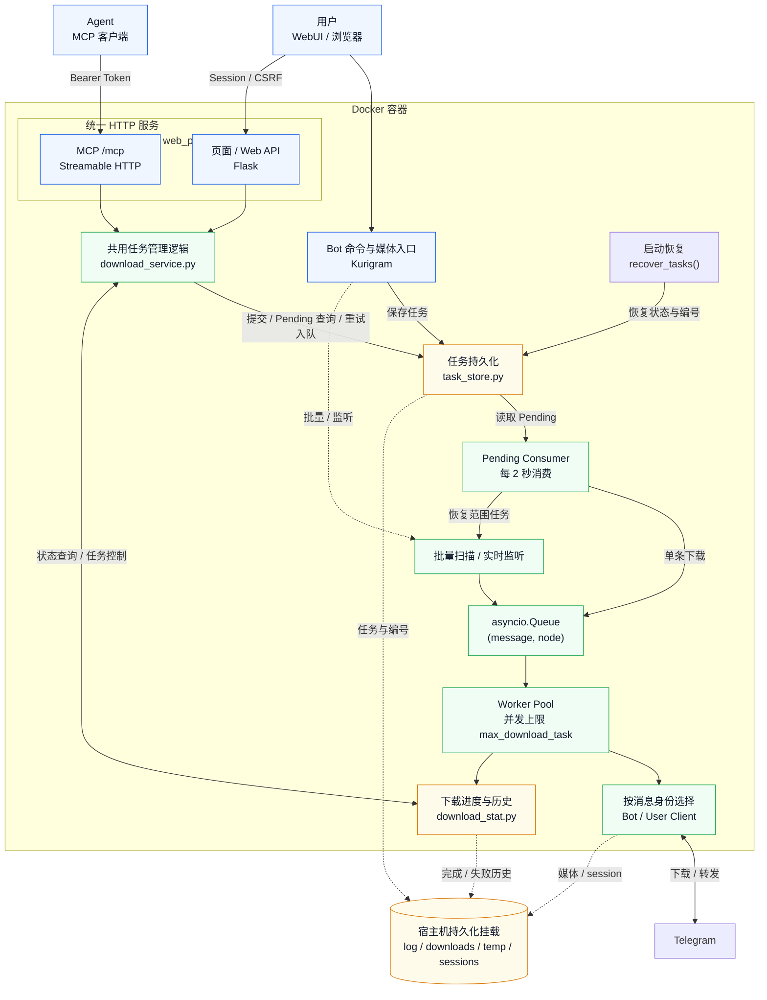
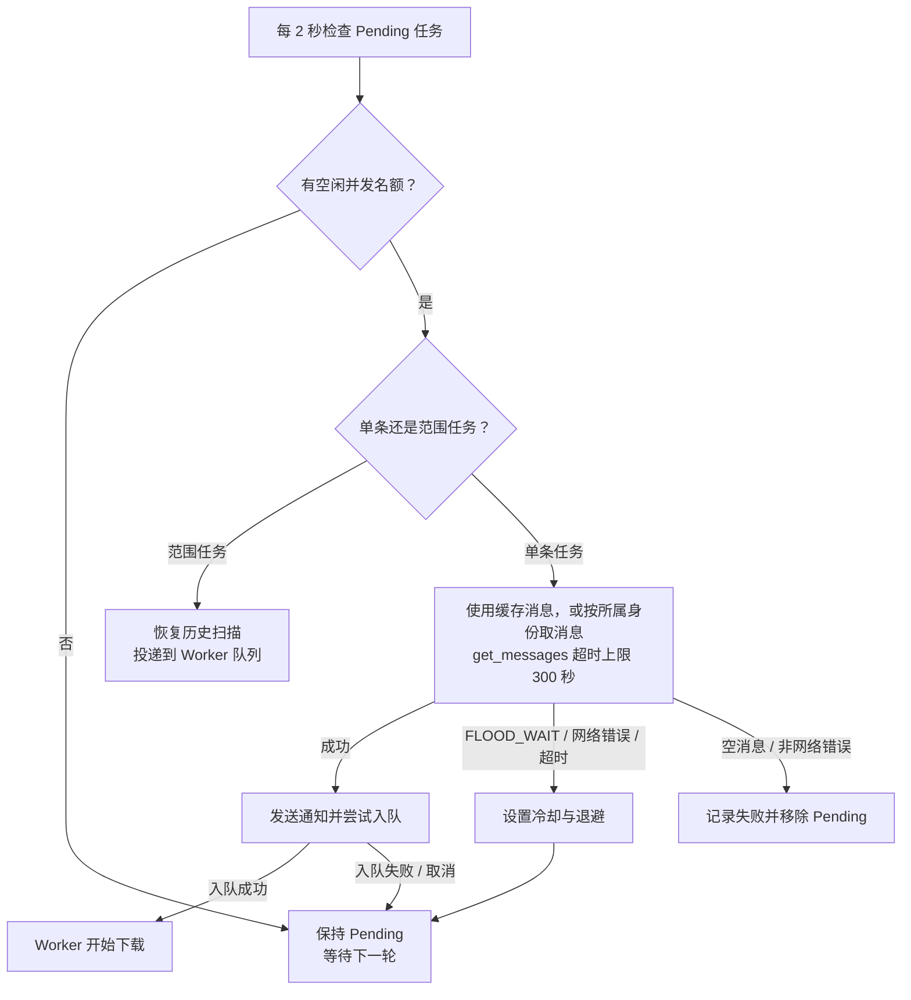
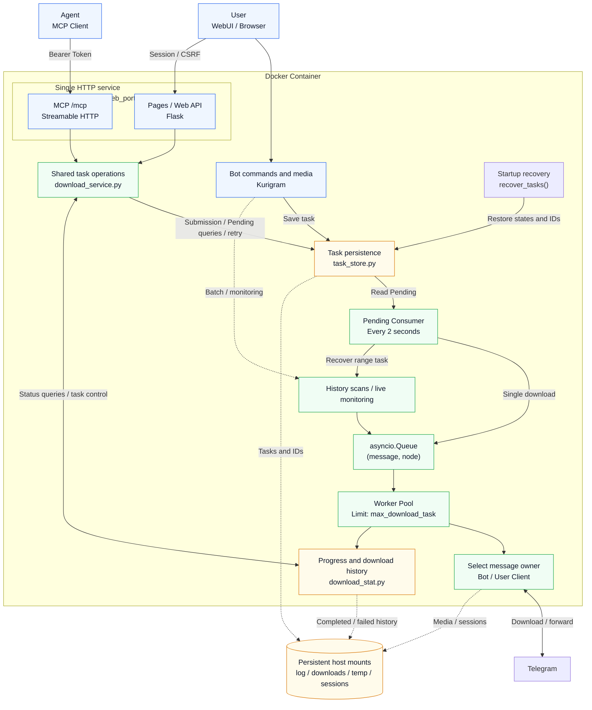
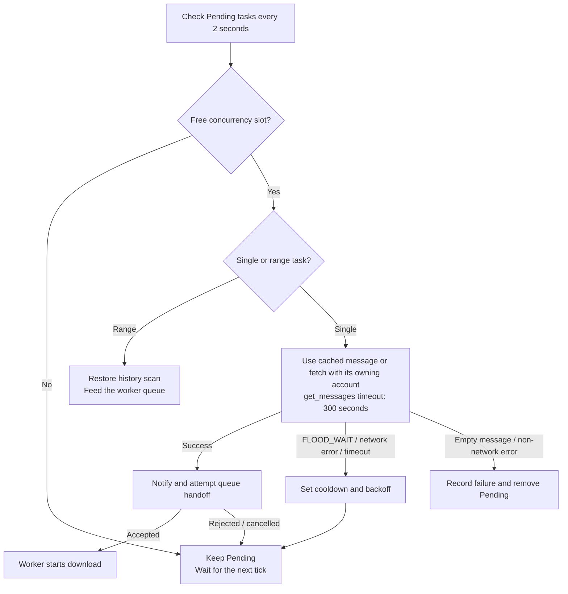

<h1 align="center">TG Porter</h1>

<p align="center">
<strong>Telegram media download / forward / listen tool with task persistence, crash recovery, and modern WebUI</strong>
</p>

<p align="center">
<a href="https://github.com/smilekevin/TGPorter/blob/master/LICENSE"></a>
<a href="https://github.com/smilekevin/TGPorter/releases"></a>
<a href="https://www.python.org/downloads/"></a>
<a href="https://github.com/smilekevin/TGPorter/actions/workflows/docker-build.yml"></a>
</p>

<!-- BEGIN CHINESE README -->
<details>
<summary>🇨🇳 展开中文说明 / Chinese documentation</summary>

<p align="center">
  <a href="#features">English</a> ·
  <a href="#功能特性">功能特性</a> ·
  <a href="#快速开始">快速开始</a> ·
  <a href="./DEPLOY.md">部署指南</a> ·
  <a href="#bot-命令">Bot 命令</a> ·
  <a href="#web-api">Web API</a> ·
  <a href="#架构设计">架构设计</a> ·
  <a href="#相比上游的改动">相比上游的改动</a>
</p>

## 功能特性

### 下载

- **单文件多流并行加速下载** — 配置单文件并发 worker 数与固定切片大小，worker 下载完一片后自动领取下一片；支持暂停和中断续传，进度统一汇总
- **多类型媒体下载** — audio / document / photo / video / voice / animation / video_note
- **批量下载** — 指定消息 ID 范围 `[start, end]`，支持过滤器
- **单条下载** — 直接发送 `t.me` 链接给 Bot 即可下载
- **转发媒体下载** — 转发一条媒体消息给 Bot，自动从源频道下载
- **断点续传** — 文件大小 ≥ 已下载大小即判定为已完成，跳过重复下载
- **大小不匹配重下** — 已有文件但大小不符时，备份原文件后重新下载
- **3 次重试** — 每个文件最多尝试 3 次，连接错误采用随机递增退避（10–15s / 30s / 30s）；分片网络错误先在该分片内最多尝试 3 次，失败后才消耗文件级次数；FLOOD_WAIT 等待不消耗尝试次数
- **文件引用过期处理** — BadRequest 时自动 fetch_message 刷新引用
- **临时文件清理** — 删除或取消正在下载的任务时清理其临时文件和分片目录；暂停、断网和程序退出保留断点

### 转发

- **跨频道转发** — 支持普通频道和受保护频道（has_protected_content）
- **受保护频道** — 自动切换为下载再上传模式
- **评论区转发** — `/forward_to_comments` 转发媒体到指定帖子评论区
- **实时监听转发** — `/listen_forward` 基于 NewMessage 事件驱动，频道有新消息立即触发下载/转发（非轮询）
- **config.yaml 频道监控** — 配置文件中的 chat 列表也会自动监听新消息，启动后实时更新

### 广告过滤

- **关键词过滤** — `/add_ad` 添加广告关键词，转发时自动跳过包含这些关键词的消息
- **关键词移除** — `/remove_ad` 移除广告关键词
- **内容替换** — `/add_replace_ad` 添加替换规则，自动从 caption 中删除匹配的广告文字
- **替换移除** — `/remove_replace_ad` 移除替换规则
- **群组广告** — `/set_ad` 为特定群组设置追加广告文字，转发时自动添加到 caption 末尾

### 任务管理

- **任务持久化** — 所有下载/转发任务写入 `log/bot_tasks.json`，容器重启不丢任务
- **崩溃恢复** — 重启后所有未完成任务统一进入 pending 队列，逐个消费
- **任务 ID** — `MMDD-序号` 格式（如 `0628-1`），每日序号重置，持久化计数器
- **Pending 队列** — 任务先入 pending 状态，由消费循环逐个喂给 worker 池；内存占位区分已入队等待 worker 的任务
- **下载进度持久化** — 每 50 条消息自动保存 `last_read_message_id`，中断不丢进度
- **下载历史持久化** — 完成/失败记录写入 `log/download_history.json`
- **手动终止** — 停止任务时未完成文件记入失败列表（原因：手动终止）

### FLOOD_WAIT 处理

- **非阻塞式等待** — 设置冷却时间戳，不 sleep，不卡死整个队列
- **Pending 消费者限速** — get_messages 遇到 FloodWait 时全局冷却，任务保持 pending
- **下载限速** — 单次 FLOOD_WAIT 超过 600 秒时暂停该文件并保留断点，不记为失败；需手动恢复，且仍须遵守服务端冷却时间
- **消息编辑限速** — edit_message 遇到 FloodWait 时设置 node 级冷却
- **用户通知** — 限速暂停时发送 Telegram 通知告知用户
- **静默限速检测** — 检测 TG 静默限速（速度 < 200 KB/s 持续 120 秒），无 FloodWait 错误码也能识别，WebUI 横幅显示已限速时长 + TG 通知（触发和解除各一次）

### WebUI

- **现代浅色主题** — 原生 HTML/CSS/JS，统一标签样式和任务搜索、响应式布局和减少动态效果支持
- **按需刷新** — 首屏并行加载，避免重复初始化和轮询重叠；隐藏页面暂停轮询，返回后立即刷新
- **任务搜索** — 按任务 ID 或文件名筛选当前标签，切换标签保留关键词；Pending 和已完成在服务端搜索完整列表，清空搜索恢复列表
- **四个标签页**：
  - 📥 **进行中** — 活跃下载，实时进度/速度/ETA
  - ✅ **已完成** — 无限滚动，服务端搜索
  - ❌ **失败** — 失败原因 + 源消息链接，支持重试
  - ⏳ **待执行** — pending/queued 队列，等待时间显示，区分等待中/排队中状态
- **批量操作按状态显示** — 下载中支持状态筛选和选择全部/下载中/已暂停，同选下载中可暂停、同选已暂停可恢复，混选时禁用二者；Pending 可取消所选排队任务；已完成只提供删除；失败可重试或删除
- **操作** — 暂停/恢复、删除（单个/批量）、重试（单个/批量）；删除确认会识别本地文件和下载缓存
- **实时数据** — 总速度 = 所有活跃任务速度之和，3 秒无回调判为过期归零
- **粘性导航栏** — 滚动时标签页固定在顶部
- **密码登录** — 网页和 Web API 使用登录 Session，可选记住登录 7 天，修改状态需 CSRF Token
- **网页提交** — 提交单条 Telegram 消息链接，使用服务端已登录账号进入持久化下载队列

### Agent 接入

- **MCP 工具** — 13 个工具支持提交下载、任务查询、暂停、恢复、重试、删除和并发设置；支持不配置 Bot 的 MCP 独立运行模式
- **接入方式** — Streamable HTTP，与主服务共用端口和镜像，使用独立 Token 鉴权
- **只读模式** — 可仅开放查询工具

### 通知

- **进度通知** — 每 20% 进度里程碑发送一次 Bot 消息更新
- **完成通知** — 任务完成时立即发送最终状态（从 _download_result 重新计数，避免竞态）
- **失败通知** — 列出每个失败文件及具体错误原因
- **限速通知** — FLOOD_WAIT 暂停时通知用户等待时长
- **静默限速** — TG 静默限速检测（速度 < 200 KB/s 持续 120 秒），WebUI 横幅显示已限速时长 + TG 通知（触发和解除各一次）
- **恢复通知** — 重启后恢复中断/待执行任务时通知用户
- **重试通知** — WebUI 重试任务加入队列时通知用户

### 其他

- **多语言** — Bot 与网页共用 `lang/` JSON 词典，英语只保存词条列表，其他语言保存翻译映射，支持简体中文 / 繁体中文 / 英语 / 日语 / 西班牙语 / 法语 / 俄语 / 乌克兰语；网页自动匹配浏览器并记住选择，Bot 由 `language` 独立配置。源码、配置示例注释和 PWA 应用名称使用英语，测试可保留必要的语言数据。新增语言见[语言包指南](docs/languages.md)，配置见[部署指南](DEPLOY.md)
- **rclone 云盘上传** — 下载完成后可选上传到云盘
- **Bot 授权** — `allowed_user_ids` 中的数字用户 ID 直接参与权限判断，无需预先解析联系人；用户名仍需解析。
- **代理支持** — Kurigram 原生代理 + Docker 环境变量代理；`proxy: {}` 可禁用 Telegram 代理
- **依赖管理** — Python 依赖统一由 `requirements.txt` 管理，WebUI 无需 npm 安装或构建；Starlette、Uvicorn、Pydantic 固定版本；完整安装步骤见[部署指南](DEPLOY.md#手动安装)。
- **本地开发模式** — `run_local.py` 无需 Telegram 账号，Mock 数据调试 WebUI
- **日志分离** — `tdl.log`（主日志）+ `download.log`（下载日志），10MB 轮转，保留 30 天

---

## 快速开始

推荐使用本 fork 的预构建镜像 `ghcr.io/smilekevin/tgporter:latest`，由 GitHub Release 发布流程更新。准备 Telegram API 凭据与 Bot Token，配置下载参数和 WebUI 密码，首次在终端登录后切换为后台运行。

| 运行方式 | 说明 | 操作指南 |
|----------|------|----------|
| Docker 镜像 | 直接运行预构建镜像，适合服务器 / NAS | [镜像部署](./DEPLOY.md#docker-镜像部署) |
| Docker Compose | 使用仓库中的 Compose 文件管理服务 | [Compose 部署](./DEPLOY.md#docker-compose-部署) |
| 手动安装 | 使用 Python 3.14 与 Kurigram 运行 | [手动安装](./DEPLOY.md#手动安装) |
| 本地开发 | 使用 Mock 数据调试 WebUI，无需 Telegram 账号 | [本地开发模式](./DEPLOY.md#本地开发模式) |
| Agent / MCP | 用 MCP Token 提交和管理下载任务 | [MCP 配置与部署](./DEPLOY.md#mcp-agent-接入) |

凭据获取、首次登录、完整配置、并行下载与分片续传、镜像更新、代理和数据持久化统一维护在 [DEPLOY.md](./DEPLOY.md)。

---

## Bot 命令

| 命令 | 说明 | 示例 |
|------|------|------|
| `/download <link> <start> <end> [filter]` | 批量下载消息 | `/download https://t.me/c/123 1 100` |
| `/forward <src> <dst> <start> <end> [filter]` | 转发消息到目标群组 | `/forward https://t.me/c/A https://t.me/c/B 1 500` |
| `/forward_to_comments <src> <dst> <start> <end>` | 转发媒体到评论区 | `/forward_to_comments https://t.me/c/A https://t.me/c/B 1 10` |
| `/listen_forward <src> <dst> [filter]` | 实时监听并自动转发 | `/listen_forward https://t.me/c/A https://t.me/c/B` |
| `/get_info <link>` | 获取群组/频道/消息信息 | `/get_info https://t.me/c/123/456` |
| `/add_filter <filter>` | 设置下载过滤器 | `/add_filter message_date >= 2024-01-01 00:00:00` |
| `/add_ad <keyword>` | 添加广告关键词（转发时跳过） | `/add_ad 推广` |
| `/remove_ad <keyword>` | 移除广告关键词 | `/remove_ad 推广` |
| `/add_replace_ad <msg_link> <keyword>` | 添加替换规则（从 caption 删除） | `/add_replace_ad https://t.me/c/123/456 广告` |
| `/remove_replace_ad <msg_link> <keyword>` | 移除替换规则 | `/remove_replace_ad https://t.me/c/123/456 广告` |
| `/set_ad <msg_link> <ad_text>` | 设置群组追加广告（空文本删除） | `/set_ad https://t.me/c/123 关注我` |
| `/set_language <lang>` | 设置语言（en/zh-cn/zh-tw/ja/es/fr/ru/uk，兼容 zh/ua） | `/set_language zh-cn` |
| `/stop` | 停止下载/转发/监听（交互式按钮） | `/stop` |
| `/help` `/start` | 显示帮助 | — |

### 快捷操作（无需命令）

- **发送 `t.me` 链接** → 下载单条消息
- **转发媒体消息给 Bot** → 下载该媒体（优先从源频道下载）

### 消息 ID 说明

- `start_id = 1` → 从最早的消息开始
- `end_id = 0` → 直到最新消息
- `[filter]` 可选，由 Lark 解析，支持日期、文件名、正则、大小单位、括号和逻辑运算；例如 `media_file_size > 100MB and media_duration < 60`。日期应包含时间，例如 `2024-01-01 00:00:00`。非法字符会明确报错。

---

## Web API

### API 鉴权与 MCP

配置非空 `web_login_secret` 后，网页与 Web API 只接受密码登录建立的 Session Cookie；修改状态的请求还需 CSRF Token，由网页自动携带。Bearer Token 不能代替 Session 或 CSRF。空密码保留网页与 Web API 的免登录模式。[WebUI 登录与部署](./DEPLOY.md#webui-登录)。

Agent 可通过主服务同端口的 `/mcp` 获取结构化结果和明确的参数、错误说明。MCP 直接调用内部任务管理逻辑，使用 `mcp_token` 鉴权，无需额外镜像或容器；默认关闭，开启后每个请求始终要求 Token，额外的 Host 白名单按需配置。13 个工具覆盖提交下载、查询、暂停、恢复、重试、删除和并发设置；`submit_download` 可提交单条 Telegram 消息链接，持久化进入现有下载队列。[MCP 接入与部署](./DEPLOY.md#mcp-agent-接入) / [MCP 工具参考](./docs/mcp.md)。

| 端点 | 方法 | 说明 |
|------|------|------|
| `/` | GET | WebUI 主页 |
| `/submit_download` | POST | 提交单条 HTTPS `t.me` 消息链接（JSON: `{"url": "https://t.me/channel/123"}`）；返回持久化入队结果，非下载完成 |
| `/get_download_list` | GET | 下载列表（`already_down=true` 已完成，`false` 进行中） |
| `/get_download_list?offset=0&limit=50&search=keyword` | GET | 已完成列表（分页 + 搜索） |
| `/get_pending_list` | GET | Pending 队列，支持 `offset` / `limit` 分页及 `search` 按任务 ID/文件名搜索 |
| `/get_failed_downloads` | GET | 失败列表 |
| `/get_download_status` | GET | 总下载速度 |
| `/get_download_state` | GET | 全局下载状态（downloading / paused） |
| `/get_completed_count` | GET | 已完成数量（轻量轮询） |
| `/get_flood_wait` | GET | FloodWait 冷却状态 + 剩余秒数 |
| `/get_app_version` | GET | 应用版本 |
| `/get_max_workers` | GET | 当前同时下载的文件数 |
| `/set_max_workers` | POST | 设置同时下载的文件数（`n=1`–`6`） |
| `/check_file_exists` | POST | 检查本地文件或活动/失败任务断点，分别返回 `output_exists`、`cache_exists` 和 `cache_paths`；删除确认只提示缓存存在 |
| `/set_download_state` | POST | 全局暂停/恢复（`state=pause` / `state=continue`） |
| `/pause_task` | POST | 暂停单个任务 |
| `/resume_task` | POST | 恢复单个任务 |
| `/delete_task` | POST | 删除任务（`task_id`，可选 `delete_file=true` 删除文件与临时数据） |
| `/batch_delete` | POST | 批量删除（JSON: `{"task_ids": [...], "delete_file": false}`） |
| `/retry_task` | POST | 重试失败任务 |
| `/batch_retry` | POST | 批量重试（JSON: `{"task_ids": [...]}`） |
| `/remove_pending` | POST | 移除 pending 任务 |

---

## 架构设计



实线表示请求、任务与媒体处理，虚线表示持久化或批量/监听入口。用户与 Agent 是并列调用方：用户通过浏览器中的 WebUI 访问 Web API，Agent 通过 MCP 客户端访问 `/mcp`；两条入口直接调用相同的内部任务管理逻辑。网页、Web API 与 MCP 由同一个 HTTP 服务监听 `web_port`，MCP 不调用 WebUI 或通过 HTTP 调用 Web API。图中 Session / CSRF 对应已开启网页密码的模式。单条任务先持久化，再由 Consumer 投递到 Worker 队列；范围扫描和实时监听也使用同一个队列。下载进度与历史同时供 WebUI 显示和 Bot 通知使用。

### 核心流程

1. **用户提交单条下载** → Bot handler 创建 TaskNode → `save_task()` 保存 Pending → Consumer 取得消息 → `add_download_task()` 入队
2. **Worker 从队列取任务** → `download_task()` → `download_media()` → Kurigram 下载
3. **进度回调** → `update_download_status()` 更新 `_download_result` → 20% 里程碑触发 Bot 通知
4. **下载完成** → `complete_task()` 从持久化移除 → `save_downloads()` 写入历史
5. **下载失败** → `add_failed_download()` 记入失败列表 → WebUI 可重试
6. **容器重启** → `recover_tasks()` 读取未完成任务 → 全部重置为 pending → 消费循环逐个喂入 worker

### Pending 消费者机制

重启时所有未完成任务统一进入 pending 队列，而非直接恢复。这解决了旧版本重启时 100+ 任务同时恢复导致 FLOOD_WAIT 风暴的问题。



并发名额由活跃 Worker 和正在消费/排队的任务共同占用；同一任务不会重复消费。网络问题保留 Pending，冷却结束后重试；入队失败或取消会释放占位。

### TCP 超时补丁

Kurigram 默认 `TCP.TIMEOUT=10s`，在 TG 限速时导致连接拆除 + MTProto 重新握手，产生大量上传流量。补丁改为 900 秒：

```python
from pyrogram.connection.transport.tcp import TCP as _TCP
_TCP.TIMEOUT = 900
```

---

## 相比上游的改动

本 fork 的直接上游是 [MangoIsIllegal/hermes-telegram-downloader](https://github.com/MangoIsIllegal/hermes-telegram-downloader)。下面列出相对该项目的新增功能与修复，并保留它基于 tangyoha v2.2.6 的原有改造说明。

### 本 fork 的新增功能

- **单文件多流并行下载**：多个独立连接并行下载固定大小的切片，可分别配置同时下载的文件数、每个文件的并发数和切片大小。暂停、断网或重启后继续已有分片，不重复下载已完成切片；WebUI 为每个文件汇总显示一条进度。[下载配置与断点说明](./DEPLOY.md#配置参数说明)。
- **MCP Agent 接入**：13 个工具支持提交单条 Telegram 消息下载、查询状态、暂停/恢复、重试、删除和调整并发。与 WebUI 共用端口和镜像，支持独立 Token、只读模式，以及不配置 Bot 的运行方式。[MCP 配置与部署](./DEPLOY.md#mcp-agent-接入)。
- **预构建多架构镜像**：提供 amd64 / arm64 镜像，发布 GitHub Release 后可按版本标签或 digest 部署，Release notes 提供拉取地址；CI 另提供 SHA 标签的验证镜像。[镜像部署](./DEPLOY.md#docker-镜像部署)。

### 本 fork 的修复

上游已提供任务持久化、Pending 队列和 Worker 池，本 fork 在此基础上修复恢复与下载问题，并补充离线回归测试。

- **Pending Consumer 生命周期**：修复上游 `recover_tasks()` 无历史任务时提前返回、导致 Consumer 未启动的问题；空任务启动也会运行唯一的周期 Consumer，退出时取消并等待结束；恢复状态和任务编号在注册 Bot handler 前完成。
- **恢复与队列交接**：排除正在消费和已经入队的任务；入队失败或取消后释放占位并保持 Pending，供下次重试。通知有 30 秒超时，避免阻塞消费循环。
- **批量下载与转发恢复**：恢复没有单条 message_id 的历史范围任务；下载重新扫描原始范围以找回重启丢失的内存队列，已有文件由下载历史跳过。普通转发从检查点继续，受保护频道使用下载再上传；保留目标频道、主题和任务显示编号。
- **Worker 计数**：Worker 与 Consumer 共享并发计数；空闲取消和缩容哨兵不扣减下载计数，每个 Worker 只计入和退出一次，重试重新入队时保留占位。
- **依赖安装**：将上游的 `PyTgCrypto==1.2.6` 更新为 `PyTgCrypto==1.2.12`，提供 Python 3.14 的 Alpine x86_64 和 ARM64 安装包。
- **Bot 媒体身份与引用刷新**：Bot 私聊媒体使用 Bot 身份下载和刷新引用；新任务保存消息所属身份，旧私聊任务、重启恢复和 WebUI 重试也使用正确身份。空消息返回会正常记录失败原因，避免 `NoneType.id` 异常。

分支验证：本仓库的 PR 会自动运行 **TG Porter CI**，也可在 Actions 手动选择分支运行 CI。成功后从 Summary 的 **CI image for verification** 复制 `docker pull` 命令或 Compose 的 `image:` 配置。CI 只发布 SHA 标签，`latest` 仅由 Release 工作流更新。

#### 回归测试

无需 Telegram 账号或网络连接；测试用临时任务文件和模拟 Telegram 响应验证真实 Consumer、持久化和 Worker 队列代码。

Release notes 回写测试还需要 Node.js 24，用于执行工作流中的实际脚本；CI 会自动配置该运行环境。

```bash
python -m pip install -r requirements.txt
python -m unittest discover -s tests -v
```

PR 检查运行这些测试，并验证 Alpine Docker 镜像在 amd64 和 arm64 上的构建。真实 Telegram 下载及 NAS 容器重启仍需部署后验证。

### MangoIsIllegal 的原有改造（相比 tangyoha v2.2.6）

以下内容保留自 [MangoIsIllegal/hermes-telegram-downloader](https://github.com/MangoIsIllegal/hermes-telegram-downloader) 的 README，说明其相对 tangyoha 的改造；这些功能由本 fork 继承。

基于 [tangyoha/telegram_media_downloader](https://github.com/tangyoha/telegram_media_downloader) v2.2.6 深度改造。

#### 新增模块

| 模块 | 说明 |
|------|------|
| `module/task_store.py` | 任务持久化 + 崩溃恢复，JSON 存储，原子写入，线程安全 |
| `run_local.py` | 本地开发模式，Mock 数据，无需 Telegram |

#### 核心改动

| 改动 | tangyoha v2.2.6 | MangoIsIllegal 的改造 |
|------|------|--------|
| **任务持久化** | 无（重启丢任务） | `bot_tasks.json` + `task_counter.json`，崩溃后自动恢复 |
| **下载历史** | 无 | `download_history.json`，完成/失败记录持久化 |
| **任务 ID** | 纯递增整数 | `MMDD-序号` 格式，每日重置，持久化计数器 |
| **Web UI** | layui 框架 | 纯原生 HTML/CSS/JS，浅色主题，响应式 |
| **WebUI 功能** | 基础列表 | 4 标签页 + 暂停/恢复 + 删除 + 重试 + 搜索 + 无限滚动 |
| **Pending 队列** | 无 | 重启任务统一入 pending，逐个消费，防 FLOOD_WAIT 风暴 |
| **FLOOD_WAIT** | 阻塞 sleep | 非阻塞冷却时间戳，不卡死队列 |
| **静默限速** | 不检测 | 速度 < 200 KB/s 持续 120 秒 → WebUI 横幅 + TG 通知（触发和解除各一次） |
| **并发任务数** | 固定（config） | WebUI 下拉框动态调整 1-6，实时生效 |
| **进度通知** | 定时轮询 | 20% 里程碑触发 + 完成立即通知 + 从 _download_result 重计数 |
| **失败处理** | 仅日志 | 失败列表持久化 + 错误原因 + 源链接 + WebUI 重试 |
| **停止任务** | 直接停止 | 未完成文件记入失败列表（手动终止），不留残留 |
| **TCP 超时** | 10s（默认） | 900s，防止限速时 reconnect 风暴 |
| **下载重试** | 3 次 5s 间隔 | 最多尝试 3 次，连接错误随机退避（10–15s / 30s / 30s） |
| **大小不匹配** | 直接覆盖 | 备份 .bak 后重下，成功删备份 |
| **文件引用过期** | 日志记录 | 自动 fetch_message 刷新引用 |
| **Queue 初始化** | 模块导入时 | 事件循环启动后，避免 loop 不匹配 |
| **日志** | 单文件 | `tdl.log` + `download.log`，10MB 轮转，30 天保留 |
| **Bot 通知** | 简单状态 | 下载进度 + 完成文件列表 + 失败原因 + 限速暂停 + 恢复通知 |
| **Docker** | 单阶段 | 多阶段构建（alpine），rclone 内置 |
| **版本号** | v2.2.6 | v1.0.0（独立版本线） |

---

## 作者与维护者

本项目 fork 自 [MangoIsIllegal/hermes-telegram-downloader](https://github.com/MangoIsIllegal/hermes-telegram-downloader)。

- **上游作者**：[MangoIsIllegal](https://github.com/MangoIsIllegal)
- **本 fork 维护者**：[smilekevin](https://github.com/smilekevin)
- 更早的基础项目：[tangyoha/telegram_media_downloader](https://github.com/tangyoha/telegram_media_downloader)

---

## License

[MIT](./LICENSE)

---

## 致谢

- 原项目：[tangyoha/telegram_media_downloader](https://github.com/tangyoha/telegram_media_downloader)
- Telegram SDK：[Kurigram](https://github.com/kurigram-org/kurigram)（提供 `pyrogram` 导入命名空间）

</details>
<!-- END CHINESE README -->

<p align="center">
  <a href="#features">Features</a> ·
  <a href="#quick-start">Quick Start</a> ·
  <a href="./DEPLOY.md#prerequisites">Deployment Guide</a> ·
  <a href="#bot-commands">Bot Commands</a> ·
  <a href="#web-api-1">Web API</a> ·
  <a href="#architecture">Architecture</a> ·
  <a href="#changes-from-upstream">Changes from Upstream</a>
</p>

---

## Features

### Download

- **Parallel streams for faster single-file downloads** — configure per-file workers and fixed part size; workers take the next part when finished, with pause/resume, interruption recovery and aggregate progress
- **Multi-type media** — audio / document / photo / video / voice / animation / video_note
- **Batch download** — specify message ID range `[start, end]` with optional filter
- **Single download** — send a `t.me` link to the Bot
- **Forwarded media** — forward a media message to the Bot, downloads from source channel
- **Skip detection** — file size ≥ downloaded size = already complete, skip
- **Size mismatch** — backs up existing file (.bak), re-downloads, deletes backup on success
- **Download retries** — up to 3 attempts, with randomized connection backoff (10–15s / 30s / 30s); part network errors get up to 3 local attempts before consuming a file attempt; FLOOD_WAIT waits without consuming attempts
- **File reference refresh** — auto fetch_message on BadRequest
- **Temp file cleanup** — deleting or cancelling an active download removes its staging files and part directory; pauses, network interruptions and process exit retain checkpoints

### Forward

- **Cross-channel forward** — normal and protected channels (has_protected_content)
- **Protected channels** — auto-switch to download-then-upload mode
- **Comments forward** — `/forward_to_comments` forwards media to a post's comment section
- **Listen forward** — `/listen_forward` uses NewMessage event-driven, triggers download/forward immediately on new channel messages (not polling)
- **Config.yaml monitoring** — chats in config file also auto-monitor new messages, real-time updates after startup

### Ad Filtering

- **Keyword filtering** — `/add_ad` adds ad keywords, auto-skips messages containing these keywords during forwarding
- **Keyword removal** — `/remove_ad` removes ad keywords
- **Content replacement** — `/add_replace_ad` adds replacement rules, auto-removes matching ad text from caption
- **Replacement removal** — `/remove_replace_ad` removes replacement rules
- **Group ads** — `/set_ad` sets appended ad text for specific groups, auto-added to caption during forwarding

### Task Management

- **Task persistence** — all download/forward tasks written to `log/bot_tasks.json`, survive container restarts
- **Crash recovery** — incomplete tasks re-enter pending queue on restart, consumed one by one
- **Task ID** — `MMDD-N` format (e.g. `0628-1`), resets daily, persistent counter
- **Pending queue** — tasks enter pending state first, fed to workers by consumer loop; in-memory reservations distinguish tasks waiting for worker pickup
- **Download progress persistence** — auto-saves `last_read_message_id` every 50 messages, no progress loss on interruption
- **Download history** — completed/failed records in `log/download_history.json`
- **Manual stop** — stopped tasks' incomplete files recorded as failed (reason: manually stopped)

### FLOOD_WAIT Handling

- **Non-blocking** — sets a cooldown timestamp instead of sleeping, doesn't block the queue
- **Pending consumer throttling** — get_messages FloodWait triggers global cooldown, task stays pending
- **Download throttling** — a single FLOOD_WAIT over 600s pauses the file with checkpoints retained, without marking it failed; manual resume is required and still honors the server cooldown
- **Message edit throttling** — edit_message FloodWait sets node-level cooldown
- **User notification** — sends Telegram message when rate-limited
- **Silent throttle detection** — detects TG silent rate-limiting (speed < 200 KB/s for 120s) without explicit FloodWait error, shows WebUI banner with elapsed timer + sends TG notification (trigger & recovery, once each)

### WebUI

- **Modern light theme** — native HTML/CSS/JS with consistent tabs, task search, responsive layouts and reduced-motion support
- **Efficient refresh** — parallel initial loading, one initialization and no overlapping poll cycles; polling pauses in hidden pages and refreshes immediately on return
- **Task search** — filter the current tab by task ID or filename and retain the query across tabs; Pending and Completed search the full list on the server, and clearing search restores the list
- **Four tabs**:
  - 📥 **Active** — live progress / speed / ETA
  - ✅ **Completed** — infinite scroll, server-side search
  - ❌ **Failed** — error reason + source link, retry supported
  - ⏳ **Pending** — queue with wait time
- **Contextual batch actions** — filter downloads by status and select all/running/paused tasks; pause running selections or resume paused selections, with both disabled for mixed states; cancel queued Pending tasks, delete Completed tasks, and retry/delete Failed tasks
- **Actions** — pause/resume, delete (single/batch), retry (single/batch); deletion confirmation identifies local files and download cache
- **Real-time** — total speed = sum of active task speeds, 3s stale check
- **Sticky nav** — tabs stay visible while scrolling
- **Password login** — WebUI and Web APIs use login sessions with an optional seven-day remember-me cookie; state changes require a CSRF token
- **Web submissions** — Submit one Telegram post link to the durable queue using the server’s existing account

### Agent Integration

- **MCP tools** — 13 tools for download submission, task queries, pause/resume, retry, deletion and worker settings; MCP-only mode runs without a configured Bot
- **Connection** — Streamable HTTP on the main service's port and image, authenticated with a separate token
- **Read-only mode** — optionally expose query tools only

### Notifications

- **Progress** — Bot message update at every 20% milestone
- **Completion** — immediate final status (re-counted from _download_result to avoid races)
- **Failure** — lists each failed file with specific error reason
- **Rate limit** — FLOOD_WAIT pause notification with wait duration
- **Silent throttle** — TG silent rate-limit detection (speed < 200 KB/s for 120s), WebUI banner with elapsed timer + TG notification (trigger & recovery, once each)
- **Recovery** — notifies user when interrupted/pending tasks are restored on restart
- **Retry** — notifies user when a retried task enters the download queue

### Other

- **Multilingual** — Bot and WebUI share JSON catalogs in `lang/`; English lists each key once and other languages map keys to translations: Simplified Chinese / Traditional Chinese / English / Japanese / Spanish / French / Russian / Ukrainian. WebUI matches browser preferences and remembers selection; configure the Bot independently with `language`. Source code, configuration example comments and the PWA app name use English; tests may retain required language fixtures. See the [catalog guide](docs/languages.md) and [deployment guide](DEPLOY.md)
- **rclone cloud upload** — optional post-download cloud drive upload
- **Bot authorization** — Numeric user IDs in `allowed_user_ids` authorize senders directly without resolving contacts first; usernames still require resolution.
- **Proxy** — Kurigram native proxy + Docker environment variable proxy; `proxy: {}` disables the Telegram proxy
- **Dependencies** — Python dependencies are managed in `requirements.txt`, and the WebUI needs no npm install or build. Starlette, Uvicorn and Pydantic are version-pinned; see the [installation guide](DEPLOY.md#manual-install).
- **Local dev mode** — `run_local.py` with mock data, no Telegram account needed
- **Log separation** — `tdl.log` + `download.log`, 10MB rotation, 30-day retention

---

## Quick Start

Use this fork's prebuilt image, `ghcr.io/smilekevin/tgporter:latest`, updated by GitHub Releases. Prepare Telegram API credentials and a Bot Token, configure download settings and a WebUI password, then complete interactive login before starting in the background.

| Method | Use case | Guide |
|--------|----------|-------|
| Docker image | Run a prebuilt image on a server or NAS | [Image deployment](./DEPLOY.md#docker-image-deployment) |
| Docker Compose | Manage the service with the repository Compose file | [Compose deployment](./DEPLOY.md#docker-compose-deployment) |
| Manual install | Run with Python 3.14 and Kurigram | [Manual install](./DEPLOY.md#manual-install) |
| Local development | Debug WebUI with mock data, without a Telegram account | [Local dev mode](./DEPLOY.md#local-dev-mode) |
| Agent / MCP | Submit and manage downloads through token-authenticated MCP tools | [MCP configuration and deployment](./DEPLOY.md#mcp-agent-integration) |

Credentials, first login, full configuration, parallel downloads and checkpoints, image updates, proxies and persistence are maintained in [DEPLOY.md](./DEPLOY.md#prerequisites).

---

## Bot Commands

| Command | Description | Example |
|---------|-------------|---------|
| `/download <link> <start> <end> [filter]` | Batch download | `/download https://t.me/c/123 1 100` |
| `/forward <src> <dst> <start> <end> [filter]` | Forward messages | `/forward https://t.me/c/A https://t.me/c/B 1 500` |
| `/forward_to_comments <src> <dst> <start> <end>` | Forward to comments | `/forward_to_comments https://t.me/c/A https://t.me/c/B 1 10` |
| `/listen_forward <src> <dst> [filter]` | Listen and auto-forward | `/listen_forward https://t.me/c/A https://t.me/c/B` |
| `/get_info <link>` | Get chat/message info | `/get_info https://t.me/c/123/456` |
| `/add_filter <filter>` | Set download filter | `/add_filter message_date >= 2024-01-01 00:00:00` |
| `/add_ad <keyword>` | Add ad keyword (skip during forward) | `/add_ad 推广` |
| `/remove_ad <keyword>` | Remove ad keyword | `/remove_ad 推广` |
| `/add_replace_ad <msg_link> <keyword>` | Add replacement rule (remove from caption) | `/add_replace_ad https://t.me/c/123/456 广告` |
| `/remove_replace_ad <msg_link> <keyword>` | Remove replacement rule | `/remove_replace_ad https://t.me/c/123/456 广告` |
| `/set_ad <msg_link> <ad_text>` | Set group append ad (empty to delete) | `/set_ad https://t.me/c/123 关注我` |
| `/set_language <lang>` | Set language (en/zh-cn/zh-tw/ja/es/fr/ru/uk; zh/ua remain compatible) | `/set_language zh-cn` |
| `/stop` | Stop download/forward/listen (interactive) | `/stop` |
| `/help` `/start` | Show help | — |

### Shortcuts (no command needed)

- **Send a `t.me` link** → downloads single message
- **Forward media to Bot** → downloads from source channel

### Message IDs

- `start_id = 1` → from the earliest message
- `end_id = 0` → up to the latest message
- `[filter]` is optional and parsed by Lark. It supports dates, filenames, regexes, byte units, parentheses and logical operators, for example `media_file_size > 100MB and media_duration < 60`. Dates include a time, such as `2024-01-01 00:00:00`. Illegal characters are reported as errors.

---

## Web API

### Authentication and MCP

With a non-empty `web_login_secret`, WebUI and the Web API accept only password-login session cookies. State changes also require the session's CSRF token, which WebUI supplies automatically. Bearer tokens cannot replace sessions or CSRF. An empty password preserves public WebUI/API access. [WebUI login and deployment](./DEPLOY.md#webui-login).

The main service exposes typed tools, structured results and actionable errors at `/mcp` on the same port. MCP calls internal download-management operations directly and authenticates with `mcp_token`, without another image or container. MCP is disabled by default and always requires a token when enabled; configure additional allowed hosts only as needed. Its 13 tools cover submission, queries, pause/resume, retry, deletion and worker settings. `submit_download` accepts a single Telegram message link and persists it in the existing download queue. [MCP setup and deployment](./DEPLOY.md#mcp-agent-integration) / [MCP tool reference](./docs/mcp.md#mcp-tool-reference).

| Endpoint | Method | Description |
|----------|--------|-------------|
| `/` | GET | WebUI page |
| `/submit_download` | POST | Submit one HTTPS `t.me` post link (JSON: `{"url": "https://t.me/channel/123"}`); returns durable queue acceptance, not completion |
| `/get_download_list` | GET | Download list (`already_down=true` completed, `false` active) |
| `/get_download_list?offset=0&limit=50&search=keyword` | GET | Completed list (pagination + search) |
| `/get_pending_list` | GET | Pending queue with `offset` / `limit` pagination and `search` by task ID/filename |
| `/get_failed_downloads` | GET | Failed list |
| `/get_download_status` | GET | Total download speed |
| `/get_download_state` | GET | Global state (downloading / paused) |
| `/get_completed_count` | GET | Completed count (lightweight polling) |
| `/get_flood_wait` | GET | FloodWait cooldown status + remaining seconds |
| `/get_app_version` | GET | App version |
| `/get_max_workers` | GET | Current number of simultaneous file downloads |
| `/set_max_workers` | POST | Set simultaneous file downloads (`n=1`–`6`) |
| `/check_file_exists` | POST | Check local output or active/failed-task partial data; return `output_exists`, `cache_exists`, and `cache_paths` separately; deletion confirmation only indicates cache presence |
| `/set_download_state` | POST | Global pause/resume (`state=pause` / `state=continue`) |
| `/pause_task` | POST | Pause a task |
| `/resume_task` | POST | Resume a task |
| `/delete_task` | POST | Delete a task (`task_id`; optional `delete_file=true` removes files and partial data) |
| `/batch_delete` | POST | Batch delete (JSON: `{"task_ids": [...], "delete_file": false}`) |
| `/retry_task` | POST | Retry a failed task |
| `/batch_retry` | POST | Batch retry (JSON: `{"task_ids": [...]}`) |
| `/remove_pending` | POST | Remove a pending task |

---

## Architecture



Solid edges show requests, task and media processing. Dashed edges show persistence or batch/monitoring entry points. Users and agents are peer callers: users access the Web API through WebUI in a browser, while agents access `/mcp` through MCP clients. Both entry points call the same internal task-management operations directly. Pages, Web API and MCP share one HTTP listener on `web_port`. MCP does not call WebUI or make HTTP calls to the Web API. Session/CSRF labels represent password-protected browser mode. Single downloads are persisted before the consumer feeds the worker queue; history scans and live monitoring feed the same queue. Progress and history also supply WebUI views and Bot notifications.

### Core Flow

1. **User submits a single download** → Bot handler creates TaskNode → `save_task()` persists Pending → consumer fetches message → `add_download_task()` enqueues
2. **Worker dequeues** → `download_task()` → `download_media()` → Kurigram download
3. **Progress callback** → `update_download_status()` updates `_download_result` → 20% milestone triggers Bot notification
4. **Download complete** → `complete_task()` removes from store → `save_downloads()` writes history
5. **Download failed** → `add_failed_download()` records to failed list → WebUI retry available
6. **Container restart** → `recover_tasks()` reads incomplete tasks → resets all to pending → consumer loop feeds workers

### Pending Consumer

On restart, all incomplete tasks enter the pending queue instead of resuming directly. This prevents FLOOD_WAIT storms from 100+ tasks resuming simultaneously.



Active workers and fetching/queued reservations share the concurrency limit; each task is consumed once. Network errors leave tasks Pending for retry after cooldown. Rejected or cancelled queue handoffs release their reservations.

### TCP Timeout Patch

Kurigram's default `TCP.TIMEOUT=10s` causes reconnect storms when Telegram throttles downloads. Patched to 900s:

```python
from pyrogram.connection.transport.tcp import TCP as _TCP
_TCP.TIMEOUT = 900
```

---

## Changes from Upstream

This fork is based directly on [MangoIsIllegal/hermes-telegram-downloader](https://github.com/MangoIsIllegal/hermes-telegram-downloader). The sections below describe added features and fixes relative to that project, followed by its original changes relative to tangyoha v2.2.6.

### Features Added in This Fork

- **Parallel streams per file**: download fixed-size parts over independent connections, with separate settings for simultaneous files, streams per file and part size. Pauses, network interruptions and restarts resume the saved parts without downloading completed parts again; WebUI shows one aggregate progress row per file. [Download settings and checkpoints](./DEPLOY.md#parameters).
- **MCP agent integration**: 13 tools submit single Telegram message downloads, query status, pause/resume, retry, delete tasks and adjust concurrency. MCP shares the WebUI port and image, with a separate token, read-only mode and support for running without a Bot. [MCP setup and deployment](./DEPLOY.md#mcp-agent-integration).
- **Prebuilt multi-platform images**: amd64 / arm64 images support deployment by Release version tag or digest, with pull references in Release notes. CI also provides SHA-tagged verification images. [Image deployment](./DEPLOY.md#docker-image-deployment).

### Fixes in This Fork

Upstream already provides task persistence, a Pending queue and a worker pool. This fork fixes recovery and download issues in those mechanisms and adds offline regression tests.

- **Pending consumer lifecycle**: fix the upstream early return in `recover_tasks()` that leaves the consumer unstarted when there are no historical tasks. Start one periodic consumer even with an empty store, cancel and await it at shutdown, and restore states and task IDs before registering Bot handlers.
- **Recovery and queue handoff**: exclude tasks being consumed or already queued; release reservations on rejected or cancelled handoffs so Pending tasks can retry. Bound notifications to 30 seconds.
- **Batch downloads and forwards**: restore history-range tasks without a single message_id. Rescan download ranges to recover files lost from the in-memory queue; existing files are skipped by download history. Resume normal forwards from their checkpoint and use download/upload for protected channels, preserving destination, topic and display ID.
- **Worker accounting**: share active counts with the consumer, avoid decrements for idle cancellation or resize sentinels, count worker entry/exit once, and reserve requeued retries.
- **Dependencies**: update the upstream `PyTgCrypto==1.2.6` pin to `PyTgCrypto==1.2.12`, which includes Python 3.14 Alpine wheels for x86_64 and ARM64.
- **Bot media identity and reference refresh**: download and refresh Bot inbox media with the Bot account, persist ownership for new tasks, and restore it for legacy inbox tasks and WebUI retries. Empty responses record a normal failure reason instead of raising `NoneType.id`.

For branch verification, this repository's PRs automatically run **TG Porter CI**. You can also select a branch and run CI manually in Actions. After success, copy the `docker pull` command or Compose `image:` configuration from **CI image for verification** in the Summary. CI publishes only SHA tags; only the Release workflow updates `latest`.

#### Regression Tests

The tests need no Telegram account or network access. They use temporary persistence files and mocked Telegram responses with the real consumer and worker queue code.

Release notes tests also require Node.js 24 to execute the workflow's actual script; CI sets up this runtime automatically.

```bash
python -m pip install -r requirements.txt
python -m unittest discover -s tests -v
```

PR checks run the tests and build the Alpine Docker image for amd64 and arm64. Live Telegram downloads and NAS container restarts still need deployment validation.

### MangoIsIllegal's Original Changes (Compared with tangyoha v2.2.6)

The following content is retained from the README of [MangoIsIllegal/hermes-telegram-downloader](https://github.com/MangoIsIllegal/hermes-telegram-downloader). It describes that project's changes relative to tangyoha, inherited by this fork.

Based on [tangyoha/telegram_media_downloader](https://github.com/tangyoha/telegram_media_downloader) v2.2.6, heavily modified.

#### New Modules

| Module | Description |
|--------|-------------|
| `module/task_store.py` | Task persistence + crash recovery, JSON storage, atomic writes, thread-safe |
| `run_local.py` | Local dev mode with mock data, no Telegram needed |

#### Core Changes

| Change | tangyoha v2.2.6 | MangoIsIllegal's Changes |
|--------|---------|--------------|
| **Task persistence** | None (lost on restart) | `bot_tasks.json` + `task_counter.json`, auto-recovery |
| **Download history** | None | `download_history.json`, completed/failed records |
| **Task ID** | Incrementing int | `MMDD-N` format, daily reset, persistent counter |
| **Web UI** | layui framework | Pure HTML/CSS/JS, light theme, responsive |
| **WebUI features** | Basic list | 4 tabs + pause/resume + delete + retry + search + infinite scroll |
| **Pending queue** | None | Restart tasks enter pending, consumed one by one, prevents FLOOD_WAIT storm |
| **FLOOD_WAIT** | Blocking sleep | Non-blocking cooldown timestamp |
| **Silent throttle** | Not detected | Speed < 200 KB/s for 120s → WebUI banner + TG notification (trigger & recovery) |
| **Worker count** | Fixed (config) | WebUI dropdown 1-6, dynamically adjusts concurrency |
| **Progress notification** | Timed polling | 20% milestone + immediate completion + re-counted from _download_result |
| **Failure handling** | Log only | Failed list persisted + error reason + source link + WebUI retry |
| **Stop task** | Direct stop | Incomplete files recorded as failed (manually stopped) |
| **TCP timeout** | 10s (default) | 900s, prevents reconnect storm during throttling |
| **Download retry** | 3x 5s interval | Up to 3 attempts, randomized connection backoff (10–15s / 30s / 30s) |
| **Size mismatch** | Overwrite | Backup .bak, re-download, delete backup on success |
| **File reference** | Log only | Auto fetch_message to refresh |
| **Queue init** | Module import time | After event loop starts, avoids loop mismatch |
| **Logging** | Single file | `tdl.log` + `download.log`, 10MB rotation, 30-day retention |
| **Bot notifications** | Simple status | Progress + completed file list + failure reasons + rate limit + recovery |
| **Docker** | Single stage | Multi-stage build (alpine), rclone built-in |
| **Version** | v2.2.6 | v1.0.0 (independent line) |

---

## Authors and Maintainers

This repository is forked from [MangoIsIllegal/hermes-telegram-downloader](https://github.com/MangoIsIllegal/hermes-telegram-downloader).

- **Upstream author**: [MangoIsIllegal](https://github.com/MangoIsIllegal)
- **This fork's maintainer**: [smilekevin](https://github.com/smilekevin)
- Earlier foundation: [tangyoha/telegram_media_downloader](https://github.com/tangyoha/telegram_media_downloader)

---

## License

[MIT](./LICENSE)

---

## Acknowledgements

- Upstream: [tangyoha/telegram_media_downloader](https://github.com/tangyoha/telegram_media_downloader)
- Telegram SDK: [Kurigram](https://github.com/kurigram-org/kurigram) (provides the `pyrogram` import namespace)
