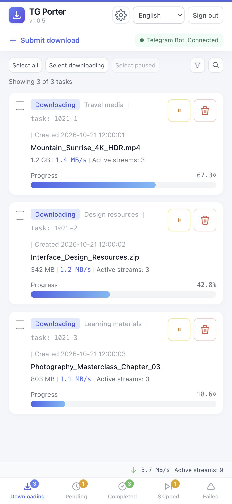

<h1 align="center">TG Porter</h1>

<p align="center">
<strong>TGPorter is an open-source, self-hosted Telegram media downloader with parallel downloads, Docker deployment, MCP integration, and AI agent skills.</strong>
</p>

<p align="center">
<a href="https://github.com/smilekevin/TGPorter/blob/main/LICENSE"></a>
<a href="https://github.com/smilekevin/TGPorter/releases"></a>
<a href="https://www.python.org/downloads/"></a>
<a href="https://github.com/smilekevin/TGPorter/actions/workflows/docker-build.yml"></a>
</p>

<!-- BEGIN CHINESE README -->
<details>
<summary>🇨🇳 展开中文说明 / Chinese documentation</summary>

<p align="center">
  <a href="#features">English</a> ·
  <a href="#界面预览">界面预览</a> ·
  <a href="#功能特性">功能特性</a> ·
  <a href="#快速开始">快速开始</a> ·
  <a href="./DEPLOY_CN.md">部署指南</a> ·
  <a href="#bot-命令">Bot 命令</a> ·
  <a href="#web-api">Web API</a>
</p>

## 界面预览

[下载页与配置页预览](#webui-preview)。

## 功能特性

### 下载

- **单文件多流并行下载** — 可分别设置同时下载的文件数、每文件连接数和分片大小
- **多类型媒体** — audio / document / photo / video / voice / animation / video_note
- **批量下载** — 指定消息 ID 范围 `[start, end]`，支持过滤器
- **单条下载** — 发送 `t.me` 链接或转发媒体消息给 Bot
- **按提交者分目录** — 可选 `from_user_id` 目录字段，与频道、日期组合；无提交者时使用 `shared`。[目录配置](./DEPLOY_CN.md#下载目录)
- **断点续传** — 暂停、断网或重启后继续下载，跳过已完成文件；新临时文件使用最终路径和文件名加 `.temp` 后缀
- **异常恢复** — 连接失败或文件引用过期时自动重试
- **文件清理** — 删除任务时可选择一并删除本地文件和断点

### WebUI

- **交互式配置页面** — 通过网页管理 Telegram 登录、下载、网页访问和 MCP，底部保存按钮显示修改和保存状态。[配置指南](./DEPLOY_CN.md#webui-登录)。
- **响应式界面** — 浅色主题，适配桌面和手机；桌面标签与移动端底部导航使用一致的顺序和线框图标
- **文件命名** — 可选择并排序原文件名、消息 ID、说明和文件大小；详见 [中文部署指南](DEPLOY_CN.md)。
- **任务搜索** — 按任务 ID 或文件名查找任务
- **自动加载** — 五个列表均在滚动接近底部时追加更多记录；批量选择仅作用于已显示记录
- **五个标签页**：
  - 📥 **进行中** — 实时进度、速度和 ETA
  - ⏳ **待执行** — 排队任务和等待时间
  - ✅ **已完成** — 下载成功的历史记录；任务完成或切换标签时及时刷新，读取失败自动重试
  - ⏭ **已跳过** — 查看重复文件、过滤等跳过原因，可重新下载或删除记录；重复文件不计入已完成
  - ❌ **失败** — 失败原因和重试入口
- **批量操作** — 暂停后释放下载名额并移至待下载，重启后保持暂停；在待下载中筛选和恢复，恢复后重新排队；支持删除和重试
- **实时数据** — 总下载速度、当前下载流数和每文件进度
- **密码登录** — 支持可选的“记住登录 7 天”，服务重启后仍有效
- **网页提交** — 通过 `t.me` 消息链接添加下载任务

### 转发

- **跨频道转发** — 支持普通和受保护频道，必要时下载后上传
- **评论区转发** — `/forward_to_comments` 转发媒体到指定帖子评论区
- **实时监听转发** — `/listen_forward` 在频道出现新消息时下载或转发
- **频道监控** — 通过 Bot 管理已保存频道的实时监听

### 广告过滤

- **关键词过滤** — `/add_ad` 和 `/remove_ad` 管理转发时跳过的关键词
- **内容替换** — `/add_replace_ad` 和 `/remove_replace_ad` 管理转发说明文字的替换规则
- **群组广告** — `/set_ad` 为目标群组追加说明文字

### 任务管理

- **任务持久化** — 保存任务与下载历史，重启后恢复未完成任务
- **Bot 消息去重** — 补收离线消息，持久化最近 1,000 条已处理消息的 ID，跳过重启后的重复投递
- **任务 ID** — `MMDD-序号` 格式，如 `0628-1`
- **排队下载** — 在网页查看和管理等待执行的任务
- **配置保存** — 网页设置自动保存，重启后复用。[持久化说明](./DEPLOY_CN.md#docker-数据持久化)

### FLOOD_WAIT 处理

- **自动等待** — Telegram 限流后等待冷却结束，再继续请求
- **保留任务** — 等待期间保留下载进度和排队任务
- **限速提示** — 在网页和 Telegram 提示限流与恢复状态；任务结束后重新计时，避免新任务继承旧的低速时间

### Agent 接入

- **可选 Agent Skill** — 从 Release 下载 `TGPorterSkills.zip`，交给支持 Skill 的 Agent 使用。[安装与使用](./DEPLOY_CN.md#安装可选-skill)
- **MCP 工具** — 提交下载、查询状态、暂停、恢复、重试、删除和调整并发
- **接入方式** — Streamable HTTP，与网页共用端口，使用独立 Token
- **只读模式** — 可仅开放查询工具

### 通知

- **进度通知** — 在 Telegram 查看下载进度
- **结果通知** — 下载完成或失败时通知
- **状态通知** — 提示限流、恢复和重试

### 其他

- **多语言** — Bot 与网页支持英语 / 简体中文 / 繁体中文 / 日语 / 西班牙语 / 法语 / 俄语 / 乌克兰语。
- **rclone 云盘上传** — 下载完成后可选上传到云盘
- **代理支持** — 支持 HTTP、SOCKS4 和 SOCKS5 代理
- **Bot 连接状态** — 显示连接状态和延迟，网络中断后自动尝试恢复连接。[排错指南](./DEPLOY_CN.md#bot-心跳与消息诊断)
- **日志** — 在 `data/log/tdl.log` 查看运行记录

---

## 快速开始

一条命令部署（请替换为宿主机的实际绝对路径）：

```bash
docker run -d \
  --name tgporter \
  --restart unless-stopped \
  -p 5088:5088 \
  -v "/path/to/tgporter/data:/app/data" \
  -v "/path/to/downloads:/app/downloads" \
  ghcr.io/smilekevin/tgporter:latest
```

更多部署方式和配置步骤请参考下表：

| 运行方式 | 说明 | 操作指南 |
|----------|------|----------|
| Docker 镜像 | 直接运行预构建镜像，适合服务器 / NAS | [镜像部署](./DEPLOY_CN.md#docker-镜像部署) |
| Docker Compose | 使用仓库中的 Compose 文件管理服务 | [Compose 部署](./DEPLOY_CN.md#docker-compose-部署) |
| 手动安装 | 使用 Python 3.14 与 Kurigram 运行 | [手动安装](./DEPLOY_CN.md#手动安装) |
| Agent / MCP | 用 MCP Token 提交和管理下载任务 | [MCP 配置与部署](./DEPLOY_CN.md#mcp-agent-接入) |

---

## Bot 命令

### 快捷操作（无需命令）

- **发送 `t.me` 链接** → 下载单条消息，支持带链接预览的公开及私有频道链接
- **转发媒体消息给 Bot** → 下载该媒体（优先从源频道下载）

| 命令 | 说明 | 示例 |
|------|------|------|
| `/download <link> <start> <end> [filter]` | 批量下载消息 | `/download https://t.me/c/123 1 100` |
| `/forward <src> <dst> <start> <end> [filter]` | 转发消息到目标群组 | `/forward https://t.me/c/A https://t.me/c/B 1 500` |
| `/forward_to_comments <src> <dst> <start> <end>` | 转发媒体到评论区 | `/forward_to_comments https://t.me/c/A https://t.me/c/B 1 10` |
| `/listen_forward <src> <dst> [filter]` | 实时监听并自动转发 | `/listen_forward https://t.me/c/A https://t.me/c/B` |
| `/get_info <link>` | 获取群组/频道/消息信息 | `/get_info https://t.me/c/123/456` |
| `/add_filter <filter>` | 添加默认下载过滤规则（OR），与配置页共享保存 | `/add_filter message_date >= 2024-01-01 00:00:00` |
| `/add_ad <keyword>` | 添加广告关键词（转发时跳过） | `/add_ad 推广` |
| `/remove_ad <keyword>` | 移除广告关键词 | `/remove_ad 推广` |
| `/add_replace_ad <msg_link> <keyword>` | 添加替换规则（从 caption 删除） | `/add_replace_ad https://t.me/c/123/456 广告` |
| `/remove_replace_ad <msg_link> <keyword>` | 移除替换规则 | `/remove_replace_ad https://t.me/c/123/456 广告` |
| `/set_ad <msg_link> <ad_text>` | 设置群组追加广告（空文本删除） | `/set_ad https://t.me/c/123 关注我` |
| `/set_language <lang>` | 设置语言（en/zh-cn/zh-tw/ja/es/fr/ru/uk，兼容 zh/ua） | `/set_language zh-cn` |
| `/query [all\|active\|pending\|completed\|failed] [page]` | 仅查询自己提交的任务，可选所有状态、下载中、待下载（含暂停）、已完成或失败；支持分类、翻页和刷新按钮 | `/query pending`、`/query completed 2` |
| `/stop` | 停止下载/转发/监听（交互式按钮） | `/stop` |
| `/help` `/start` | 显示帮助 | — |

向 Bot 发送消息链接或转发媒体后，可用 `/query pending` 查看排队任务。同一消息已有未完成任务时，Bot 回复“任务已存在”和原编号。保存失败时会显示错误；排查时可按任务编号搜索 `data/log/tdl.log`。

---

## Web API

### API 鉴权与 MCP

[网页登录与访问设置](./DEPLOY_CN.md#webui-登录) · [MCP 接入](./DEPLOY_CN.md#mcp-agent-接入) · [MCP 工具参考](./docs/mcp.md)

| 端点 | 方法 | 说明 |
|------|------|------|
| `/` | GET | WebUI 主页 |
| `/api/configuration` | GET / POST | Configuration 设置读取/保存，凭据不回显，需要管理 Session 和 CSRF |
| `/api/configuration/validate-filter` | POST | 校验 `{"expression": "media_file_size >= 100MB"}`，成功返回规范化 `expression`，无效返回 400 和 `error`；需要管理 Session 和 CSRF，不保存、不访问 Telegram |
| `/api/setup` | POST | 一次性初始化码与 CSRF 创建管理密码 |
| `/api/telegram` | POST | 提交 Telegram 登录、重连、取消与退出操作 |
| `/submit_download` | POST | 提交单条 HTTPS `t.me` 消息链接（JSON: `{"url": "https://t.me/channel/123"}`）；返回持久化入队结果，非下载完成 |
| `/get_download_list` | GET | 下载列表（`already_down=true` 已完成，`false` 进行中），每个文件含当前下载流数 `active_streams` |
| `/get_download_list?already_down=true&offset=0&limit=50&search=keyword` | GET | 已完成列表（分页 + 搜索） |
| `/get_pending_list` | GET | 待下载队列（含暂停），支持 `offset` / `limit` 分页、`search` 搜索及 `status=all/pending/paused` 筛选 |
| `/get_failed_downloads` | GET | 失败列表 |
| `/get_skipped_downloads` | GET | 已跳过列表及原因，支持 `offset`、`limit`、`search` |
| `/download_skipped` | POST | 按 `task_id` 入队下载，绕过下载 Filter、媒体类型与格式限制 |
| `/delete_skipped` | POST | 按 `task_id` 删除跳过记录，保留本地文件 |
| `/get_download_status` | GET | 总下载速度及当前下载流数（`active_streams`） |
| `/get_bot_status` | GET | 缓存的 Bot 心跳状态（`status`）、延迟（`rtt_ms`）、最近检查/成功时间（Unix 秒）、连续失败次数、限流剩余秒数及探测间隔 |
| `/get_download_state` | GET | 全局下载状态（downloading / paused） |
| `/get_completed_count` | GET | 已完成数量（轻量轮询） |
| `/get_flood_wait` | GET | FloodWait 冷却状态 + 剩余秒数 |
| `/get_app_version` | GET | 应用版本 |
| `/get_max_workers` | GET | 当前同时下载的文件数 |
| `/set_max_workers` | POST | 设置同时下载的文件数（`n=1`–`6`），立即保存到 `data/settings.json`，重启后保留 |
| `/check_file_exists` | POST | 检查本地文件或活动/失败任务断点，分别返回 `output_exists`、`cache_exists` 和 `cache_paths`；删除确认只提示缓存存在 |
| `/set_download_state` | POST | 全局暂停/恢复（`state=pause` / `state=continue`） |
| `/pause_task` | POST | 持久化暂停单个任务，停止写入后释放下载名额并移至待下载 |
| `/resume_task` | POST | 将暂停任务重新排队，等待空闲下载名额 |
| `/delete_task` | POST | 删除任务（`task_id`，可选 `delete_file=true` 删除文件与临时数据） |
| `/batch_delete` | POST | 批量删除（JSON: `{"task_ids": [...], "delete_file": false}`） |
| `/retry_task` | POST | 重试失败任务 |
| `/batch_retry` | POST | 批量重试（JSON: `{"task_ids": [...]}`） |
| `/remove_pending` | POST | 移除 pending 任务 |

---

## 作者与维护者

本项目 fork 自 [MangoIsIllegal/hermes-telegram-downloader](https://github.com/MangoIsIllegal/hermes-telegram-downloader)。

- **上游作者**：[MangoIsIllegal](https://github.com/MangoIsIllegal)
- **本 fork 维护者**：[smilekevin](https://github.com/smilekevin)
- 更早的基础项目：[tangyoha/telegram_media_downloader](https://github.com/tangyoha/telegram_media_downloader)

---

## License

[MIT](./LICENSE)

---

## 致谢

- 原项目：[tangyoha/telegram_media_downloader](https://github.com/tangyoha/telegram_media_downloader)
- Telegram SDK：[Kurigram](https://github.com/kurigram-org/kurigram)

</details>
<!-- END CHINESE README -->

<p align="center">
  <a href="#webui-preview">WebUI Preview</a> ·
  <a href="#features">Features</a> ·
  <a href="#quick-start">Quick Start</a> ·
  <a href="./DEPLOY.md#prerequisites">Deployment Guide</a> ·
  <a href="#bot-commands">Bot Commands</a> ·
  <a href="#web-api-1">Web API</a>
</p>

---

## WebUI Preview

**Mobile download dashboard**

<a href="./docs/images/webui-mobile-en.jpg"></a>

**Desktop download dashboard**

[](./docs/images/webui-en.jpg)

**Configuration**

[](./docs/images/configuration-en.jpg)

## Features

### Download

- **Parallel streams per file** — configure simultaneous files, connections per file and part size independently
- **Multi-type media** — audio / document / photo / video / voice / animation / video_note
- **Batch download** — specify a message ID range `[start, end]` with an optional filter
- **Single download** — send a `t.me` link or forward media to the Bot
- **Directories by requester** — optional `from_user_id` field combined with chat/date fields; tasks without a requester use `shared`. [Directory settings](./DEPLOY.md#download-directories)
- **Resume downloads** — continue after pauses, network interruptions or restarts; skip completed files; new temporary files use the final path and filename plus `.temp`
- **Automatic recovery** — retry connection failures and expired file references
- **File cleanup** — optionally remove local files and partial data when deleting tasks

### WebUI

- **Interactive configuration page** — manage Telegram login, downloads, web access and MCP in your browser, with a save button that shows the save state. [Setup guide](./DEPLOY.md#webui-login).
- **Responsive interface** — light theme for desktop and mobile, with matching tab order and outline icons in desktop tabs and mobile bottom navigation
- **File naming** — select and order the original filename, message ID, caption, and file size; see the [English deployment guide](DEPLOY.md).
- **Task search** — find tasks by ID or filename
- **Automatic loading** — all five lists append more records near the bottom; bulk selection covers displayed records only
- **Five tabs**:
  - 📥 **Active** — live progress, speed and ETA
  - ⏳ **Pending** — queued tasks and wait time
  - ✅ **Completed** — successful download history; refreshes on completion or tab opening and retries failed reads
  - ⏭ **Skipped** — duplicate-file and filter skip reasons, with download and record deletion actions; duplicate files do not count as completed
  - ❌ **Failed** — failure reasons and retries
- **Batch actions** — pausing frees the file slot and moves the task to Pending, retaining its hold across restarts; filter and resume held tasks in Pending to queue them again; delete and retry are also supported
- **Live statistics** — total speed, active streams and per-file progress
- **Password login** — optional seven-day remember-me setting that survives service restarts
- **Web submissions** — add downloads using `t.me` post links

### Forward

- **Cross-channel forward** — supports normal and protected channels, downloading and uploading when needed
- **Comments forward** — `/forward_to_comments` forwards media to a post's comments
- **Live forwarding** — `/listen_forward` downloads or forwards new channel messages
- **Channel monitoring** — manage saved channel listeners through the Bot

### Ad Filtering

- **Keyword filtering** — `/add_ad` and `/remove_ad` manage keywords to skip when forwarding
- **Content replacement** — `/add_replace_ad` and `/remove_replace_ad` manage caption replacement rules
- **Group ads** — `/set_ad` appends text for a destination group

### Task Management

- **Persistent tasks** — save tasks and download history; recover unfinished tasks after restart
- **Bot message deduplication** — replay offline messages and persist the IDs of the last 1,000 handled messages to skip repeated deliveries after restart
- **Task ID** — `MMDD-N` format, such as `0628-1`
- **Queued downloads** — view and manage waiting tasks in the WebUI
- **Saved settings** — web settings persist across restarts. [Persistence guide](./DEPLOY.md#docker-data-persistence)

### FLOOD_WAIT Handling

- **Automatic waiting** — wait for Telegram's cooldown before continuing requests
- **Preserved tasks** — keep download progress and queued tasks while waiting
- **Throttle notifications** — show rate-limit and recovery status in the WebUI and Telegram; reset the timer when a task ends so new tasks do not inherit an earlier low-speed interval

### Agent Integration

- **Optional agent skill** — download `TGPorterSkills.zip` from a Release and give it to an agent that supports skills. [Installation and usage](./DEPLOY.md#install-the-optional-skill)
- **MCP tools** — submit downloads, query status, pause, resume, retry, delete and adjust concurrency
- **Connection** — Streamable HTTP on the WebUI port with a separate Token
- **Read-only mode** — optionally expose query tools only

### Notifications

- **Progress** — track downloads in Telegram
- **Results** — receive download completion or failure notifications
- **Status** — receive rate-limit, recovery and retry notifications

### Other

- **Multilingual** — Bot and WebUI support English / Simplified Chinese / Traditional Chinese / Japanese / Spanish / French / Russian / Ukrainian.
- **rclone cloud upload** — optionally upload completed files to a cloud drive
- **Proxy support** — HTTP, SOCKS4 and SOCKS5
- **Bot connection status** — view connection health and latency, with automatic recovery attempts after network outages. [Troubleshooting](./DEPLOY.md#bot-heartbeat-and-message-diagnostics)
- **Logs** — view application logs in `data/log/tdl.log`

---

## Quick Start

Deploy by one command (replace the host paths with your actual absolute paths):

```bash
docker run -d \
  --name tgporter \
  --restart unless-stopped \
  -p 5088:5088 \
  -v "/path/to/tgporter/data:/app/data" \
  -v "/path/to/downloads:/app/downloads" \
  ghcr.io/smilekevin/tgporter:latest
```

For more details, please refer to the following deployment matrix:

| Method | Use case | Guide |
|--------|----------|-------|
| Docker image | Run a prebuilt image on a server or NAS | [Image deployment](./DEPLOY.md#docker-image-deployment) |
| Docker Compose | Manage the service with the repository Compose file | [Compose deployment](./DEPLOY.md#docker-compose-deployment) |
| Manual install | Run with Python 3.14 and Kurigram | [Manual install](./DEPLOY.md#manual-install) |
| Agent / MCP | Submit and manage downloads through token-authenticated MCP tools | [MCP configuration and deployment](./DEPLOY.md#mcp-agent-integration) |

---

## Bot Commands

### Shortcuts (no command needed)

- **Send a `t.me` link** → downloads a single message from public or private channels, including links with previews
- **Forward media to Bot** → downloads from source channel

| Command | Description | Example |
|---------|-------------|---------|
| `/download <link> <start> <end> [filter]` | Batch download | `/download https://t.me/c/123 1 100` |
| `/forward <src> <dst> <start> <end> [filter]` | Forward messages | `/forward https://t.me/c/A https://t.me/c/B 1 500` |
| `/forward_to_comments <src> <dst> <start> <end>` | Forward to comments | `/forward_to_comments https://t.me/c/A https://t.me/c/B 1 10` |
| `/listen_forward <src> <dst> [filter]` | Listen and auto-forward | `/listen_forward https://t.me/c/A https://t.me/c/B` |
| `/get_info <link>` | Get chat/message info | `/get_info https://t.me/c/123/456` |
| `/add_filter <filter>` | Add a default download rule (OR), shared with Configuration | `/add_filter message_date >= 2024-01-01 00:00:00` |
| `/add_ad <keyword>` | Add ad keyword (skip during forward) | `/add_ad 推广` |
| `/remove_ad <keyword>` | Remove ad keyword | `/remove_ad 推广` |
| `/add_replace_ad <msg_link> <keyword>` | Add replacement rule (remove from caption) | `/add_replace_ad https://t.me/c/123/456 广告` |
| `/remove_replace_ad <msg_link> <keyword>` | Remove replacement rule | `/remove_replace_ad https://t.me/c/123/456 广告` |
| `/set_ad <msg_link> <ad_text>` | Set group append ad (empty to delete) | `/set_ad https://t.me/c/123 关注我` |
| `/set_language <lang>` | Set language (en/zh-cn/zh-tw/ja/es/fr/ru/uk; zh/ua remain compatible) | `/set_language zh-cn` |
| `/query [all\|active\|pending\|completed\|failed] [page]` | Query only your own submissions across all statuses, or active, pending (including paused), completed or failed tasks; category, paging and refresh buttons | `/query pending`, `/query completed 2` |
| `/stop` | Stop download/forward/listen (interactive) | `/stop` |
| `/help` `/start` | Show help | — |

After sending a post link or forwarding media to the Bot, use `/query pending` to check waiting tasks. Repeating an unfinished submission returns “Task already exists” with its original ID. Check any save error before submitting again, and search `data/log/tdl.log` by task ID when troubleshooting.

---

## Web API

### Authentication and MCP

[Web login and access settings](./DEPLOY.md#webui-login) · [MCP setup](./DEPLOY.md#mcp-agent-integration) · [MCP tool reference](./docs/mcp.md#mcp-tool-reference)

| Endpoint | Method | Description |
|----------|--------|-------------|
| `/` | GET | WebUI page |
| `/api/configuration` | GET / POST | Read/save settings without echoing credentials; requires management session and CSRF |
| `/api/configuration/validate-filter` | POST | Validate `{"expression": "media_file_size >= 100MB"}`; return normalized `expression`, or 400 with `error`; requires management session and CSRF, without saving or Telegram access |
| `/api/setup` | POST | Claim one-time setup with a code and CSRF; create the management password |
| `/api/telegram` | POST | Sign in to Telegram, reconnect, cancel authorization or sign out |
| `/submit_download` | POST | Submit one HTTPS `t.me` post link (JSON: `{"url": "https://t.me/channel/123"}`); returns durable queue acceptance, not completion |
| `/get_download_list` | GET | Download list (`already_down=true` completed, `false` active), with per-file `active_streams` |
| `/get_download_list?already_down=true&offset=0&limit=50&search=keyword` | GET | Completed list (pagination + search) |
| `/get_pending_list` | GET | Pending queue including held tasks; `offset` / `limit` pagination, `search` by ID/filename and `status=all/pending/paused` filtering |
| `/get_failed_downloads` | GET | Failed list |
| `/get_skipped_downloads` | GET | Skipped records and reasons; supports `offset`, `limit`, `search` |
| `/download_skipped` | POST | Queue `task_id` while bypassing download expressions, media types and formats |
| `/delete_skipped` | POST | Delete the skipped record by `task_id`, preserving local files |
| `/get_download_status` | GET | Total download speed and current stream count (`active_streams`) |
| `/get_bot_status` | GET | Cached Bot heartbeat `status`, `rtt_ms`, last check/success times (Unix seconds), consecutive failures, remaining cooldown seconds and probe interval |
| `/get_download_state` | GET | Global state (downloading / paused) |
| `/get_completed_count` | GET | Completed count (lightweight polling) |
| `/get_flood_wait` | GET | FloodWait cooldown status + remaining seconds |
| `/get_app_version` | GET | App version |
| `/get_max_workers` | GET | Current number of simultaneous file downloads |
| `/set_max_workers` | POST | Set simultaneous file downloads (`n=1`–`6`); save immediately to `data/settings.json` for restarts |
| `/check_file_exists` | POST | Check local output or active/failed-task partial data; return `output_exists`, `cache_exists`, and `cache_paths` separately; deletion confirmation only indicates cache presence |
| `/set_download_state` | POST | Global pause/resume (`state=pause` / `state=continue`) |
| `/pause_task` | POST | Persist a task hold, stop writers, release its slot and move it to Pending |
| `/resume_task` | POST | Queue a held task for the next available download slot |
| `/delete_task` | POST | Delete a task (`task_id`; optional `delete_file=true` removes files and partial data) |
| `/batch_delete` | POST | Batch delete (JSON: `{"task_ids": [...], "delete_file": false}`) |
| `/retry_task` | POST | Retry a failed task |
| `/batch_retry` | POST | Batch retry (JSON: `{"task_ids": [...]}`) |
| `/remove_pending` | POST | Remove a pending task |

---

## Authors and Maintainers

This repository is forked from [MangoIsIllegal/hermes-telegram-downloader](https://github.com/MangoIsIllegal/hermes-telegram-downloader).

- **Upstream author**: [MangoIsIllegal](https://github.com/MangoIsIllegal)
- **This fork's maintainer**: [smilekevin](https://github.com/smilekevin)
- Earlier foundation: [tangyoha/telegram_media_downloader](https://github.com/tangyoha/telegram_media_downloader)

---

## License

[MIT](./LICENSE)

---

## Acknowledgements

- Upstream: [tangyoha/telegram_media_downloader](https://github.com/tangyoha/telegram_media_downloader)
- Telegram SDK: [Kurigram](https://github.com/kurigram-org/kurigram)
