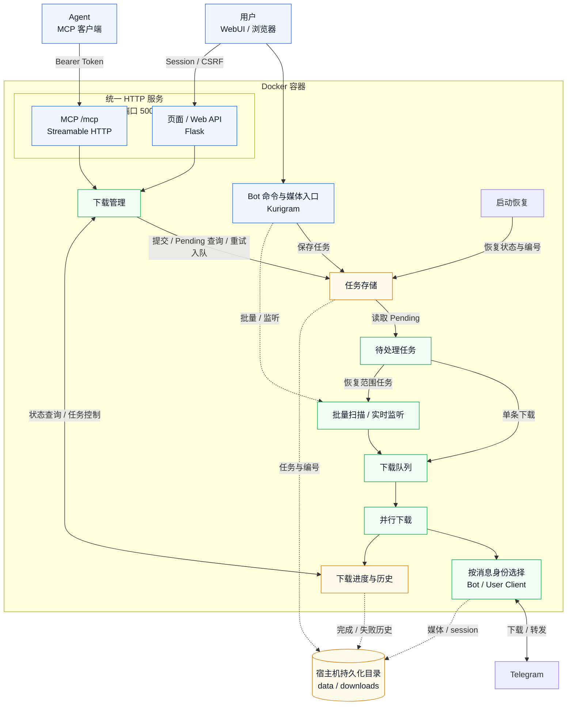
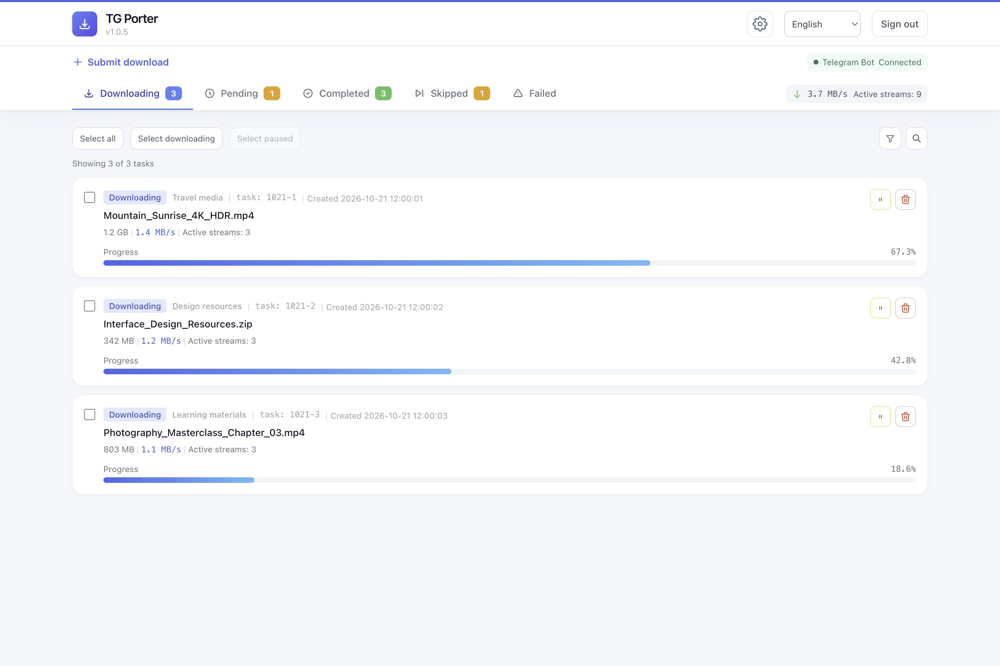
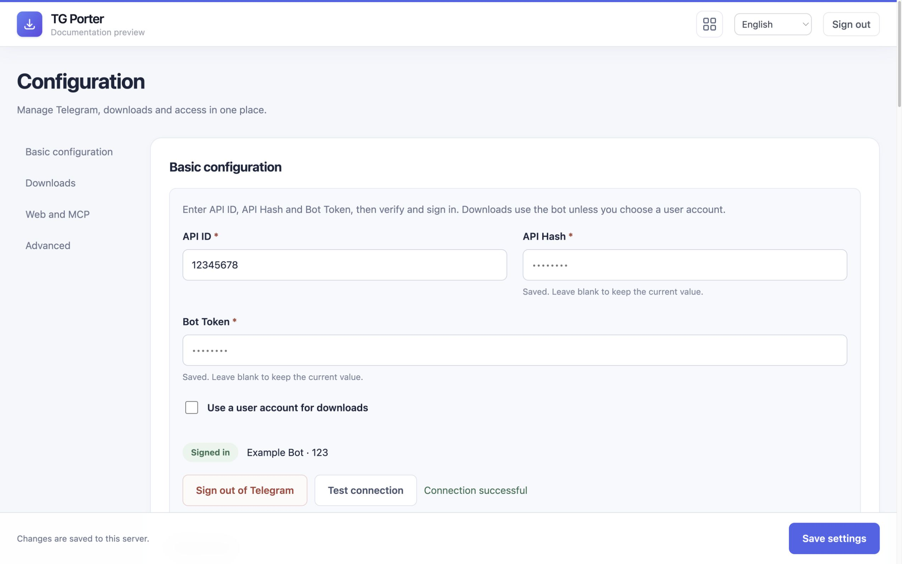
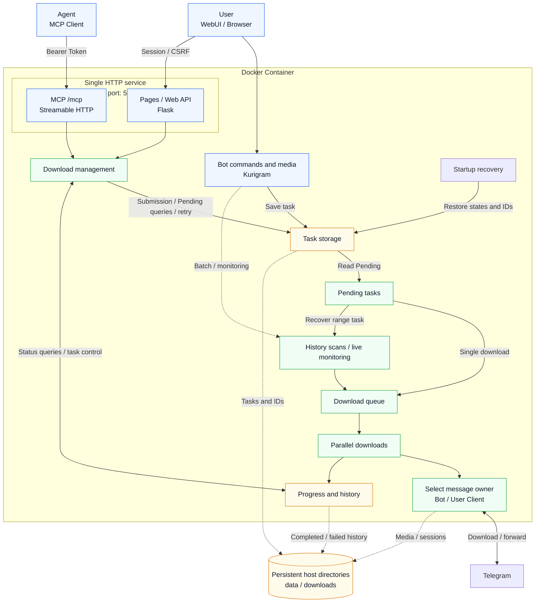

<h1 align="center">TG Porter</h1>

<p align="center">
<strong>Telegram media download / forward / listen tool with task persistence, crash recovery, and modern WebUI</strong>
</p>

<p align="center">
<a href="https://github.com/smilekevin/TGPorter/blob/main/LICENSE"></a>
<a href="https://github.com/smilekevin/TGPorter/releases"></a>
<a href="https://www.python.org/downloads/"></a>
<a href="https://github.com/smilekevin/TGPorter/actions/workflows/docker-build.yml"></a>
</p>

<!-- BEGIN CHINESE README -->
<details>
<summary>🇨🇳 展开中文说明 / Chinese documentation</summary>

<p align="center">
  <a href="#features">English</a> ·
  <a href="#界面预览">界面预览</a> ·
  <a href="#功能特性">功能特性</a> ·
  <a href="#快速开始">快速开始</a> ·
  <a href="./DEPLOY_CN.md">部署指南</a> ·
  <a href="#bot-命令">Bot 命令</a> ·
  <a href="#web-api">Web API</a> ·
  <a href="#架构设计">架构设计</a> ·
  <a href="#相比上游的改动">相比上游的改动</a>
</p>

## 界面预览

[下载页与配置页预览](#webui-preview)。

## 功能特性

### 下载

- **单文件多流并行下载** — 预分配单个临时文件，各连接按 offset 写入，无需合并；文件并发、每文件连接数和分片大小独立设置
- **多类型媒体** — audio / document / photo / video / voice / animation / video_note
- **批量下载** — 指定消息 ID 范围 `[start, end]`，支持过滤器
- **单条下载** — 发送 `t.me` 链接或转发媒体消息给 Bot
- **断点续传** — 暂停、断网或重启后继续下载，跳过已完成文件
- **异常恢复** — 连接失败或文件引用过期时自动重试
- **文件清理** — 删除任务时可选择一并删除本地文件和断点

### WebUI

- **交互式配置页面** — 通过网页管理 Telegram 登录、下载、网页访问和 MCP。[配置指南](./DEPLOY_CN.md#webui-登录)。
- **响应式界面** — 浅色主题，适配桌面和手机
- **任务搜索** — 按任务 ID 或文件名查找任务
- **四个标签页**：
  - 📥 **进行中** — 实时进度、速度和 ETA
  - ⏳ **待执行** — 排队任务和等待时间
  - ✅ **已完成** — 下载历史，包含因文件已完整存在而跳过的记录，并标注跳过原因；过滤、不支持的格式及取消不计入
  - ❌ **失败** — 失败原因和重试入口
- **批量操作** — 暂停、恢复、删除和重试
- **实时数据** — 总下载速度、当前下载流数和每文件进度
- **密码登录** — 支持可选的“记住登录 7 天”，服务重启后仍有效
- **网页提交** — 通过 `t.me` 消息链接添加下载任务

### 转发

- **跨频道转发** — 支持普通和受保护频道，必要时下载后上传
- **评论区转发** — `/forward_to_comments` 转发媒体到指定帖子评论区
- **实时监听转发** — `/listen_forward` 在频道出现新消息时下载或转发
- **频道监控** — 通过 Bot 管理已保存频道的实时监听

### 广告过滤

- **关键词过滤** — `/add_ad` 和 `/remove_ad` 管理转发时跳过的关键词
- **内容替换** — `/add_replace_ad` 和 `/remove_replace_ad` 管理转发说明文字的替换规则
- **群组广告** — `/set_ad` 为目标群组追加说明文字

### 任务管理

- **任务持久化** — 保存任务与下载历史，重启后恢复未完成任务
- **任务 ID** — `MMDD-序号` 格式，如 `0628-1`
- **排队下载** — 在网页查看和管理等待执行的任务
- **配置保存** — 网页设置自动保存，重启后复用。[持久化说明](./DEPLOY_CN.md#docker-数据持久化)

### FLOOD_WAIT 处理

- **自动等待** — Telegram 限流后等待冷却结束，再继续请求
- **保留任务** — 等待期间保留下载进度和排队任务
- **限速提示** — 在网页和 Telegram 提示限流与恢复状态

### Agent 接入

- **可选 Agent Skill** — 从 Release 下载 `TGPorterSkills.zip`，交给支持 Skill 的 Agent 使用。[安装与使用](./DEPLOY_CN.md#安装可选-skill)
- **MCP 工具** — 提交下载、查询状态、暂停、恢复、重试、删除和调整并发
- **接入方式** — Streamable HTTP，与网页共用端口，使用独立 Token
- **只读模式** — 可仅开放查询工具

### 通知

- **进度通知** — 在 Telegram 查看下载进度
- **结果通知** — 下载完成或失败时通知
- **状态通知** — 提示限流、恢复和重试

### 其他

- **多语言** — Bot 与网页支持英语 / 简体中文 / 繁体中文 / 日语 / 西班牙语 / 法语 / 俄语 / 乌克兰语。
- **rclone 云盘上传** — 下载完成后可选上传到云盘
- **代理支持** — 支持 HTTP、SOCKS4 和 SOCKS5 代理
- **本地开发模式** — `run_local.py` 使用 Mock 数据调试 WebUI
- **Bot 连接状态** — 显示连接状态和延迟。[排错指南](./DEPLOY_CN.md#bot-心跳与消息诊断)
- **日志** — 在 `data/log/tdl.log` 查看运行记录

---

## 快速开始

推荐使用镜像 `ghcr.io/smilekevin/tgporter:latest` 部署。启动后打开 `/configuration`，按页面提示设置管理密码并登录 Telegram。

首选[网页配置](./DEPLOY_CN.md#webui-登录)，也支持可选的 [config.yaml 导入](./DEPLOY_CN.md#configyaml-可选)和[命令行登录](./DEPLOY_CN.md#命令行登录)。

| 运行方式 | 说明 | 操作指南 |
|----------|------|----------|
| Docker 镜像 | 直接运行预构建镜像，适合服务器 / NAS | [镜像部署](./DEPLOY_CN.md#docker-镜像部署) |
| Docker Compose | 使用仓库中的 Compose 文件管理服务 | [Compose 部署](./DEPLOY_CN.md#docker-compose-部署) |
| 手动安装 | 使用 Python 3.14 与 Kurigram 运行 | [手动安装](./DEPLOY_CN.md#手动安装) |
| 本地开发 | 使用 Mock 数据调试 WebUI，无需 Telegram 账号 | [本地开发模式](./DEPLOY_CN.md#本地开发模式) |
| Agent / MCP | 用 MCP Token 提交和管理下载任务 | [MCP 配置与部署](./DEPLOY_CN.md#mcp-agent-接入) |

---

## Bot 命令

`/help` 和 `/start` 帮助消息中的 “Join us” 按钮指向 [Telegram 群组](https://t.me/tg_porter)。

| 命令 | 说明 | 示例 |
|------|------|------|
| `/download <link> <start> <end> [filter]` | 批量下载消息 | `/download https://t.me/c/123 1 100` |
| `/forward <src> <dst> <start> <end> [filter]` | 转发消息到目标群组 | `/forward https://t.me/c/A https://t.me/c/B 1 500` |
| `/forward_to_comments <src> <dst> <start> <end>` | 转发媒体到评论区 | `/forward_to_comments https://t.me/c/A https://t.me/c/B 1 10` |
| `/listen_forward <src> <dst> [filter]` | 实时监听并自动转发 | `/listen_forward https://t.me/c/A https://t.me/c/B` |
| `/get_info <link>` | 获取群组/频道/消息信息 | `/get_info https://t.me/c/123/456` |
| `/add_filter <filter>` | 设置下载过滤器 | `/add_filter message_date >= 2024-01-01 00:00:00` |
| `/add_ad <keyword>` | 添加广告关键词（转发时跳过） | `/add_ad 推广` |
| `/remove_ad <keyword>` | 移除广告关键词 | `/remove_ad 推广` |
| `/add_replace_ad <msg_link> <keyword>` | 添加替换规则（从 caption 删除） | `/add_replace_ad https://t.me/c/123/456 广告` |
| `/remove_replace_ad <msg_link> <keyword>` | 移除替换规则 | `/remove_replace_ad https://t.me/c/123/456 广告` |
| `/set_ad <msg_link> <ad_text>` | 设置群组追加广告（空文本删除） | `/set_ad https://t.me/c/123 关注我` |
| `/set_language <lang>` | 设置语言（en/zh-cn/zh-tw/ja/es/fr/ru/uk，兼容 zh/ua） | `/set_language zh-cn` |
| `/query [all\|active\|pending\|completed\|failed] [page]` | 查询所有、下载中（含暂停）、Pending、已完成或失败任务；支持分类、翻页和刷新按钮 | `/query pending`、`/query completed 2` |
| `/stop` | 停止下载/转发/监听（交互式按钮） | `/stop` |
| `/help` `/start` | 显示帮助 | — |

### 快捷操作（无需命令）

- **发送 `t.me` 链接** → 下载单条消息
- **转发媒体消息给 Bot** → 下载该媒体（优先从源频道下载）

### 消息 ID 说明

- `start_id = 1` → 从最早的消息开始
- `end_id = 0` → 直到最新消息
- `[filter]` 可选，由 Lark 解析，支持日期、文件名、正则、大小单位、括号和逻辑运算；例如 `media_file_size > 100MB and media_duration < 60`。日期应包含时间，例如 `2024-01-01 00:00:00`。非法字符会明确报错。

---

## Web API

### API 鉴权与 MCP

[网页登录与访问设置](./DEPLOY_CN.md#webui-登录) · [MCP 接入](./DEPLOY_CN.md#mcp-agent-接入) · [MCP 工具参考](./docs/mcp.md)

| 端点 | 方法 | 说明 |
|------|------|------|
| `/` | GET | WebUI 主页 |
| `/api/configuration` | GET / POST | Configuration 设置读取/保存，凭据不回显，需要管理 Session 和 CSRF |
| `/api/setup` | POST | 一次性初始化码与 CSRF 创建管理密码 |
| `/api/telegram` | POST | 在下载器事件循环提交异步登录、重连、取消与退出操作 |
| `/submit_download` | POST | 提交单条 HTTPS `t.me` 消息链接（JSON: `{"url": "https://t.me/channel/123"}`）；返回持久化入队结果，非下载完成 |
| `/get_download_list` | GET | 下载列表（`already_down=true` 已完成，`false` 进行中），每个文件含当前下载流数 `active_streams` |
| `/get_download_list?offset=0&limit=50&search=keyword` | GET | 已完成列表（分页 + 搜索） |
| `/get_pending_list` | GET | Pending 队列，支持 `offset` / `limit` 分页及 `search` 按任务 ID/文件名搜索 |
| `/get_failed_downloads` | GET | 失败列表 |
| `/get_download_status` | GET | 总下载速度及当前下载流数（`active_streams`） |
| `/get_bot_status` | GET | 缓存的 Bot 心跳状态（`status`）、延迟（`rtt_ms`）、最近检查/成功时间（Unix 秒）、连续失败次数、限流剩余秒数及探测间隔 |
| `/get_download_state` | GET | 全局下载状态（downloading / paused） |
| `/get_completed_count` | GET | 已完成数量（轻量轮询） |
| `/get_flood_wait` | GET | FloodWait 冷却状态 + 剩余秒数 |
| `/get_app_version` | GET | 应用版本 |
| `/get_max_workers` | GET | 当前同时下载的文件数 |
| `/set_max_workers` | POST | 设置同时下载的文件数（`n=1`–`6`），立即保存到 `data/settings.json`，重启后保留 |
| `/check_file_exists` | POST | 检查本地文件或活动/失败任务断点，分别返回 `output_exists`、`cache_exists` 和 `cache_paths`；删除确认只提示缓存存在 |
| `/set_download_state` | POST | 全局暂停/恢复（`state=pause` / `state=continue`） |
| `/pause_task` | POST | 暂停单个任务 |
| `/resume_task` | POST | 恢复单个任务 |
| `/delete_task` | POST | 删除任务（`task_id`，可选 `delete_file=true` 删除文件与临时数据） |
| `/batch_delete` | POST | 批量删除（JSON: `{"task_ids": [...], "delete_file": false}`） |
| `/retry_task` | POST | 重试失败任务 |
| `/batch_retry` | POST | 批量重试（JSON: `{"task_ids": [...]}`） |
| `/remove_pending` | POST | 移除 pending 任务 |

---

## 架构设计



Bot、网页和 MCP 共用下载后端。任务与历史记录保存在 `data/`，下载文件保存在下载目录。

### 核心流程

1. 在 Configuration 完成设置和 Telegram 登录。
2. 通过 Bot、网页或 MCP 提交任务，进入持久化队列。
3. 按设置的并发数下载或转发，在网页和 Telegram 查看进度。
4. 保存完成或失败记录；重启后继续未完成任务。

---

## 相比上游的改动

本 fork 的直接上游是 [MangoIsIllegal/hermes-telegram-downloader](https://github.com/MangoIsIllegal/hermes-telegram-downloader)。下面列出相对该项目的新增功能与修复，并保留它基于 tangyoha v2.2.6 的原有改造说明。

### 本 fork 的新增功能

- **单文件多流并行下载** — 单文件预分配、按 offset 写入，支持新版断点续传。[下载配置](./DEPLOY_CN.md#配置参数说明)
- **MCP Agent 接入** — 通过 Agent 提交和管理下载任务。[MCP 部署](./DEPLOY_CN.md#mcp-agent-接入)
- **多架构镜像** — 提供 amd64 和 arm64 镜像。[镜像部署](./DEPLOY_CN.md#docker-镜像部署)

### 本 fork 的修复

- 修复空任务启动后无法消费新任务的问题。
- 改善重启恢复、批量转发和任务排队，避免任务重复或丢失。
- 修复并发任务计数和重试问题。
- 修复 Bot 媒体下载身份和文件引用刷新问题。

#### 回归测试

使用临时数据和模拟 Telegram 响应进行离线测试；工作流脚本测试还需 Node.js 24。

```bash
python -m pip install -r requirements.txt
python -m unittest discover -s tests -v
```

CI 自动运行测试并检查 amd64、arm64 镜像构建。

### MangoIsIllegal 的原有改造（相比 tangyoha v2.2.6）

<details>
<summary>查看上游历史改动</summary>

以下内容保留自 [MangoIsIllegal/hermes-telegram-downloader](https://github.com/MangoIsIllegal/hermes-telegram-downloader) 的 README，说明其相对 tangyoha 的改造；这些功能由本 fork 继承。

基于 [tangyoha/telegram_media_downloader](https://github.com/tangyoha/telegram_media_downloader) v2.2.6 深度改造。

#### 新增模块

| 模块 | 说明 |
|------|------|
| `module/task_store.py` | 任务持久化 + 崩溃恢复，JSON 存储，原子写入，线程安全 |
| `run_local.py` | 本地开发模式，Mock 数据，无需 Telegram |

#### 核心改动

| 改动 | tangyoha v2.2.6 | MangoIsIllegal 的改造 |
|------|------|--------|
| **任务持久化** | 无（重启丢任务） | `bot_tasks.json` + `task_counter.json`，崩溃后自动恢复 |
| **下载历史** | 无 | `download_history.json`，完成/失败记录持久化 |
| **任务 ID** | 纯递增整数 | `MMDD-序号` 格式，每日重置，持久化计数器 |
| **Web UI** | layui 框架 | 纯原生 HTML/CSS/JS，浅色主题，响应式 |
| **WebUI 功能** | 基础列表 | 4 标签页 + 暂停/恢复 + 删除 + 重试 + 搜索 + 无限滚动 |
| **Pending 队列** | 无 | 重启任务统一入 pending，逐个消费，防 FLOOD_WAIT 风暴 |
| **FLOOD_WAIT** | 阻塞 sleep | 非阻塞冷却时间戳，不卡死队列 |
| **静默限速** | 不检测 | 速度 < 200 KB/s 持续 120 秒 → WebUI 横幅 + TG 通知（触发和解除各一次） |
| **并发任务数** | 固定（config） | WebUI 下拉框调整 1-6，立即生效并保存到运行数据，重启后保留 |
| **进度通知** | 定时轮询 | 约 10 秒更新 + 完成立即通知 + FLOOD_WAIT 倒计时 |
| **失败处理** | 仅日志 | 失败列表持久化 + 错误原因 + 源链接 + WebUI 重试 |
| **停止任务** | 直接停止 | 未完成文件记入失败列表（手动终止），不留残留 |
| **TCP 超时** | 10s（默认） | 900s，防止限速时 reconnect 风暴 |
| **下载重试** | 3 次 5s 间隔 | 分片由剩余连接接管；最后一个连接连续失败 3 次才失败 |
| **大小不匹配** | 直接覆盖 | 备份 .bak 后重下，成功删备份 |
| **文件引用过期** | 日志记录 | 自动 fetch_message 刷新引用 |
| **Queue 初始化** | 模块导入时 | 事件循环启动后，避免 loop 不匹配 |
| **日志** | 单文件 | `tdl.log` 统一日志，10MB 轮转，30 天保留 |
| **Bot 通知** | 简单状态 | 下载进度 + 完成文件列表 + 失败原因 + 限速暂停 + 恢复通知 |
| **Docker** | 单阶段 | 多阶段构建（alpine），rclone 内置 |
| **版本号** | v2.2.6 | v1.0.0（独立版本线） |

</details>

---

## 作者与维护者

本项目 fork 自 [MangoIsIllegal/hermes-telegram-downloader](https://github.com/MangoIsIllegal/hermes-telegram-downloader)。

- **上游作者**：[MangoIsIllegal](https://github.com/MangoIsIllegal)
- **本 fork 维护者**：[smilekevin](https://github.com/smilekevin)
- 更早的基础项目：[tangyoha/telegram_media_downloader](https://github.com/tangyoha/telegram_media_downloader)

---

## License

[MIT](./LICENSE)

---

## 致谢

- 原项目：[tangyoha/telegram_media_downloader](https://github.com/tangyoha/telegram_media_downloader)
- Telegram SDK：[Kurigram](https://github.com/kurigram-org/kurigram)（提供 `pyrogram` 导入命名空间）

</details>
<!-- END CHINESE README -->

<p align="center">
  <a href="#webui-preview">WebUI Preview</a> ·
  <a href="#features">Features</a> ·
  <a href="#quick-start">Quick Start</a> ·
  <a href="./DEPLOY.md#prerequisites">Deployment Guide</a> ·
  <a href="#bot-commands">Bot Commands</a> ·
  <a href="#web-api-1">Web API</a> ·
  <a href="#architecture">Architecture</a> ·
  <a href="#changes-from-upstream">Changes from Upstream</a>
</p>

---

## WebUI Preview

**Download dashboard**

[](./docs/images/webui-en.jpg)

**Configuration**

[](./docs/images/configuration-en.jpg)

## Features

### Download

- **Parallel streams per file** — write ranges directly into one preallocated temporary file without merging; configure files, connections and part size independently
- **Multi-type media** — audio / document / photo / video / voice / animation / video_note
- **Batch download** — specify a message ID range `[start, end]` with an optional filter
- **Single download** — send a `t.me` link or forward media to the Bot
- **Resume downloads** — continue after pauses, network interruptions or restarts; skip completed files
- **Automatic recovery** — retry connection failures and expired file references
- **File cleanup** — optionally remove local files and partial data when deleting tasks

### WebUI

- **Interactive configuration page** — manage Telegram login, downloads, web access and MCP in your browser. [Setup guide](./DEPLOY.md#webui-login).
- **Responsive interface** — light theme for desktop and mobile
- **Task search** — find tasks by ID or filename
- **Four tabs**:
  - 📥 **Active** — live progress, speed and ETA
  - ⏳ **Pending** — queued tasks and wait time
  - ✅ **Completed** — download history, including files skipped because a complete local file already exists, with the skip reason shown; excludes filtered, unsupported and cancelled downloads
  - ❌ **Failed** — failure reasons and retries
- **Batch actions** — pause, resume, delete and retry
- **Live statistics** — total speed, active streams and per-file progress
- **Password login** — optional seven-day remember-me setting that survives service restarts
- **Web submissions** — add downloads using `t.me` post links

### Forward

- **Cross-channel forward** — supports normal and protected channels, downloading and uploading when needed
- **Comments forward** — `/forward_to_comments` forwards media to a post's comments
- **Live forwarding** — `/listen_forward` downloads or forwards new channel messages
- **Channel monitoring** — manage saved channel listeners through the Bot

### Ad Filtering

- **Keyword filtering** — `/add_ad` and `/remove_ad` manage keywords to skip when forwarding
- **Content replacement** — `/add_replace_ad` and `/remove_replace_ad` manage caption replacement rules
- **Group ads** — `/set_ad` appends text for a destination group

### Task Management

- **Persistent tasks** — save tasks and download history; recover unfinished tasks after restart
- **Task ID** — `MMDD-N` format, such as `0628-1`
- **Queued downloads** — view and manage waiting tasks in the WebUI
- **Saved settings** — web settings persist across restarts. [Persistence guide](./DEPLOY.md#docker-data-persistence)

### FLOOD_WAIT Handling

- **Automatic waiting** — wait for Telegram's cooldown before continuing requests
- **Preserved tasks** — keep download progress and queued tasks while waiting
- **Throttle notifications** — show rate-limit and recovery status in the WebUI and Telegram

### Agent Integration

- **Optional agent skill** — download `TGPorterSkills.zip` from a Release and give it to an agent that supports skills. [Installation and usage](./DEPLOY.md#install-the-optional-skill)
- **MCP tools** — submit downloads, query status, pause, resume, retry, delete and adjust concurrency
- **Connection** — Streamable HTTP on the WebUI port with a separate Token
- **Read-only mode** — optionally expose query tools only

### Notifications

- **Progress** — track downloads in Telegram
- **Results** — receive download completion or failure notifications
- **Status** — receive rate-limit, recovery and retry notifications

### Other

- **Multilingual** — Bot and WebUI support English / Simplified Chinese / Traditional Chinese / Japanese / Spanish / French / Russian / Ukrainian.
- **rclone cloud upload** — optionally upload completed files to a cloud drive
- **Proxy support** — HTTP, SOCKS4 and SOCKS5
- **Local dev mode** — preview WebUI with mock data using `run_local.py`
- **Bot connection status** — view connection health and latency. [Troubleshooting](./DEPLOY.md#bot-heartbeat-and-message-diagnostics)
- **Logs** — view application logs in `data/log/tdl.log`

---

## Quick Start

Deploy with `ghcr.io/smilekevin/tgporter:latest`, then open `/configuration` to set a management password and sign in to Telegram.

[Web configuration](./DEPLOY.md#webui-login) is preferred; optional [config.yaml import](./DEPLOY.md#configyaml-optional) and [command-line login](./DEPLOY.md#command-line-login) are also available.

| Method | Use case | Guide |
|--------|----------|-------|
| Docker image | Run a prebuilt image on a server or NAS | [Image deployment](./DEPLOY.md#docker-image-deployment) |
| Docker Compose | Manage the service with the repository Compose file | [Compose deployment](./DEPLOY.md#docker-compose-deployment) |
| Manual install | Run with Python 3.14 and Kurigram | [Manual install](./DEPLOY.md#manual-install) |
| Local development | Debug WebUI with mock data, without a Telegram account | [Local dev mode](./DEPLOY.md#local-dev-mode) |
| Agent / MCP | Submit and manage downloads through token-authenticated MCP tools | [MCP configuration and deployment](./DEPLOY.md#mcp-agent-integration) |

---

## Bot Commands

The “Join us” button in `/help` and `/start` messages opens the [Telegram group](https://t.me/tg_porter).

| Command | Description | Example |
|---------|-------------|---------|
| `/download <link> <start> <end> [filter]` | Batch download | `/download https://t.me/c/123 1 100` |
| `/forward <src> <dst> <start> <end> [filter]` | Forward messages | `/forward https://t.me/c/A https://t.me/c/B 1 500` |
| `/forward_to_comments <src> <dst> <start> <end>` | Forward to comments | `/forward_to_comments https://t.me/c/A https://t.me/c/B 1 10` |
| `/listen_forward <src> <dst> [filter]` | Listen and auto-forward | `/listen_forward https://t.me/c/A https://t.me/c/B` |
| `/get_info <link>` | Get chat/message info | `/get_info https://t.me/c/123/456` |
| `/add_filter <filter>` | Set download filter | `/add_filter message_date >= 2024-01-01 00:00:00` |
| `/add_ad <keyword>` | Add ad keyword (skip during forward) | `/add_ad 推广` |
| `/remove_ad <keyword>` | Remove ad keyword | `/remove_ad 推广` |
| `/add_replace_ad <msg_link> <keyword>` | Add replacement rule (remove from caption) | `/add_replace_ad https://t.me/c/123/456 广告` |
| `/remove_replace_ad <msg_link> <keyword>` | Remove replacement rule | `/remove_replace_ad https://t.me/c/123/456 广告` |
| `/set_ad <msg_link> <ad_text>` | Set group append ad (empty to delete) | `/set_ad https://t.me/c/123 关注我` |
| `/set_language <lang>` | Set language (en/zh-cn/zh-tw/ja/es/fr/ru/uk; zh/ua remain compatible) | `/set_language zh-cn` |
| `/query [all\|active\|pending\|completed\|failed] [page]` | Query all, active (including paused), pending, completed or failed tasks; category, paging and refresh buttons | `/query pending`, `/query completed 2` |
| `/stop` | Stop download/forward/listen (interactive) | `/stop` |
| `/help` `/start` | Show help | — |

### Shortcuts (no command needed)

- **Send a `t.me` link** → downloads single message
- **Forward media to Bot** → downloads from source channel

### Message IDs

- `start_id = 1` → from the earliest message
- `end_id = 0` → up to the latest message
- `[filter]` is optional and parsed by Lark. It supports dates, filenames, regexes, byte units, parentheses and logical operators, for example `media_file_size > 100MB and media_duration < 60`. Dates include a time, such as `2024-01-01 00:00:00`. Illegal characters are reported as errors.

---

## Web API

### Authentication and MCP

[Web login and access settings](./DEPLOY.md#webui-login) · [MCP setup](./DEPLOY.md#mcp-agent-integration) · [MCP tool reference](./docs/mcp.md#mcp-tool-reference)

| Endpoint | Method | Description |
|----------|--------|-------------|
| `/` | GET | WebUI page |
| `/api/configuration` | GET / POST | Read/save settings without echoing credentials; requires management session and CSRF |
| `/api/setup` | POST | Claim one-time setup with a code and CSRF; create the management password |
| `/api/telegram` | POST | Submit async login/reconnect/cancel/logout on the downloader loop |
| `/submit_download` | POST | Submit one HTTPS `t.me` post link (JSON: `{"url": "https://t.me/channel/123"}`); returns durable queue acceptance, not completion |
| `/get_download_list` | GET | Download list (`already_down=true` completed, `false` active), with per-file `active_streams` |
| `/get_download_list?offset=0&limit=50&search=keyword` | GET | Completed list (pagination + search) |
| `/get_pending_list` | GET | Pending queue with `offset` / `limit` pagination and `search` by task ID/filename |
| `/get_failed_downloads` | GET | Failed list |
| `/get_download_status` | GET | Total download speed and current stream count (`active_streams`) |
| `/get_bot_status` | GET | Cached Bot heartbeat `status`, `rtt_ms`, last check/success times (Unix seconds), consecutive failures, remaining cooldown seconds and probe interval |
| `/get_download_state` | GET | Global state (downloading / paused) |
| `/get_completed_count` | GET | Completed count (lightweight polling) |
| `/get_flood_wait` | GET | FloodWait cooldown status + remaining seconds |
| `/get_app_version` | GET | App version |
| `/get_max_workers` | GET | Current number of simultaneous file downloads |
| `/set_max_workers` | POST | Set simultaneous file downloads (`n=1`–`6`); save immediately to `data/settings.json` for restarts |
| `/check_file_exists` | POST | Check local output or active/failed-task partial data; return `output_exists`, `cache_exists`, and `cache_paths` separately; deletion confirmation only indicates cache presence |
| `/set_download_state` | POST | Global pause/resume (`state=pause` / `state=continue`) |
| `/pause_task` | POST | Pause a task |
| `/resume_task` | POST | Resume a task |
| `/delete_task` | POST | Delete a task (`task_id`; optional `delete_file=true` removes files and partial data) |
| `/batch_delete` | POST | Batch delete (JSON: `{"task_ids": [...], "delete_file": false}`) |
| `/retry_task` | POST | Retry a failed task |
| `/batch_retry` | POST | Batch retry (JSON: `{"task_ids": [...]}`) |
| `/remove_pending` | POST | Remove a pending task |

---

## Architecture



The Bot, WebUI and MCP share the download backend. Tasks and history are stored in `data/`; media files go to the download directory.

### Core Flow

1. Complete setup and Telegram login in Configuration.
2. Submit tasks through the Bot, WebUI or MCP to the persistent queue.
3. Download or forward with the configured concurrency and track progress in WebUI or Telegram.
4. Save completed or failed results; resume unfinished tasks after restart.

---

## Changes from Upstream

This fork is based directly on [MangoIsIllegal/hermes-telegram-downloader](https://github.com/MangoIsIllegal/hermes-telegram-downloader). The sections below describe added features and fixes relative to that project, followed by its original changes relative to tangyoha v2.2.6.

### Features Added in This Fork

- **Parallel streams per file** — preallocated random-access downloads with resume support for new checkpoints. [Download settings](./DEPLOY.md#parameters)
- **MCP agent integration** — submit and manage tasks through agents. [MCP setup](./DEPLOY.md#mcp-agent-integration)
- **Multi-platform images** — prebuilt amd64 and arm64 images. [Image deployment](./DEPLOY.md#docker-image-deployment)

### Fixes in This Fork

- Start task consumption correctly when there are no saved tasks.
- Improve restart recovery, batch forwarding and queue handling to avoid lost or duplicate tasks.
- Fix concurrency accounting and retries.
- Fix Bot media ownership and file-reference refresh.

#### Regression Tests

Offline tests use temporary data and mocked Telegram responses. Workflow script tests also need Node.js 24.

```bash
python -m pip install -r requirements.txt
python -m unittest discover -s tests -v
```

CI runs the tests and checks amd64 and arm64 image builds.

### MangoIsIllegal's Original Changes (Compared with tangyoha v2.2.6)

<details>
<summary>View inherited changes</summary>

The following content is retained from the README of [MangoIsIllegal/hermes-telegram-downloader](https://github.com/MangoIsIllegal/hermes-telegram-downloader). It describes that project's changes relative to tangyoha, inherited by this fork.

Based on [tangyoha/telegram_media_downloader](https://github.com/tangyoha/telegram_media_downloader) v2.2.6, heavily modified.

#### New Modules

| Module | Description |
|--------|-------------|
| `module/task_store.py` | Task persistence + crash recovery, JSON storage, atomic writes, thread-safe |
| `run_local.py` | Local dev mode with mock data, no Telegram needed |

#### Core Changes

| Change | tangyoha v2.2.6 | MangoIsIllegal's Changes |
|--------|---------|--------------|
| **Task persistence** | None (lost on restart) | `bot_tasks.json` + `task_counter.json`, auto-recovery |
| **Download history** | None | `download_history.json`, completed/failed records |
| **Task ID** | Incrementing int | `MMDD-N` format, daily reset, persistent counter |
| **Web UI** | layui framework | Pure HTML/CSS/JS, light theme, responsive |
| **WebUI features** | Basic list | 4 tabs + pause/resume + delete + retry + search + infinite scroll |
| **Pending queue** | None | Restart tasks enter pending, consumed one by one, prevents FLOOD_WAIT storm |
| **FLOOD_WAIT** | Blocking sleep | Non-blocking cooldown timestamp |
| **Silent throttle** | Not detected | Speed < 200 KB/s for 120s → WebUI banner + TG notification (trigger & recovery) |
| **Worker count** | Fixed (config) | WebUI dropdown 1-6, applies and saves immediately; survives restarts |
| **Progress notification** | Timed polling | Updates about every 10s + immediate completion + FLOOD_WAIT countdown |
| **Failure handling** | Log only | Failed list persisted + error reason + source link + WebUI retry |
| **Stop task** | Direct stop | Incomplete files recorded as failed (manually stopped) |
| **TCP timeout** | 10s (default) | 900s, prevents reconnect storm during throttling |
| **Download retry** | 3x 5s interval | Surviving connections take over parts; only the last worker failing 3 consecutive attempts fails the download |
| **Size mismatch** | Overwrite | Backup .bak, re-download, delete backup on success |
| **File reference** | Log only | Auto fetch_message to refresh |
| **Queue init** | Module import time | After event loop starts, avoids loop mismatch |
| **Logging** | Single file | Unified `tdl.log`, 10MB rotation, 30-day retention |
| **Bot notifications** | Simple status | Progress + completed file list + failure reasons + rate limit + recovery |
| **Docker** | Single stage | Multi-stage build (alpine), rclone built-in |
| **Version** | v2.2.6 | v1.0.0 (independent line) |

</details>

---

## Authors and Maintainers

This repository is forked from [MangoIsIllegal/hermes-telegram-downloader](https://github.com/MangoIsIllegal/hermes-telegram-downloader).

- **Upstream author**: [MangoIsIllegal](https://github.com/MangoIsIllegal)
- **This fork's maintainer**: [smilekevin](https://github.com/smilekevin)
- Earlier foundation: [tangyoha/telegram_media_downloader](https://github.com/tangyoha/telegram_media_downloader)

---

## License

[MIT](./LICENSE)

---

## Acknowledgements

- Upstream: [tangyoha/telegram_media_downloader](https://github.com/tangyoha/telegram_media_downloader)
- Telegram SDK: [Kurigram](https://github.com/kurigram-org/kurigram) (provides the `pyrogram` import namespace)
