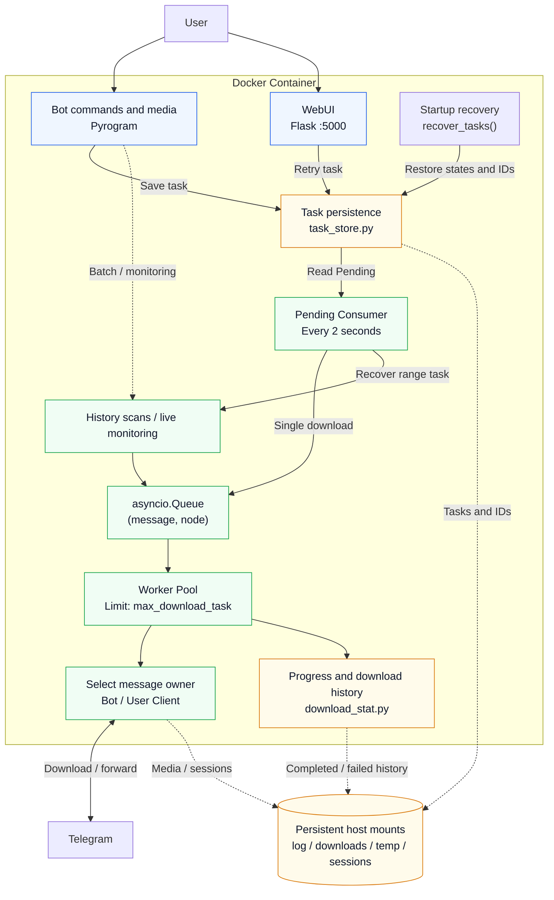
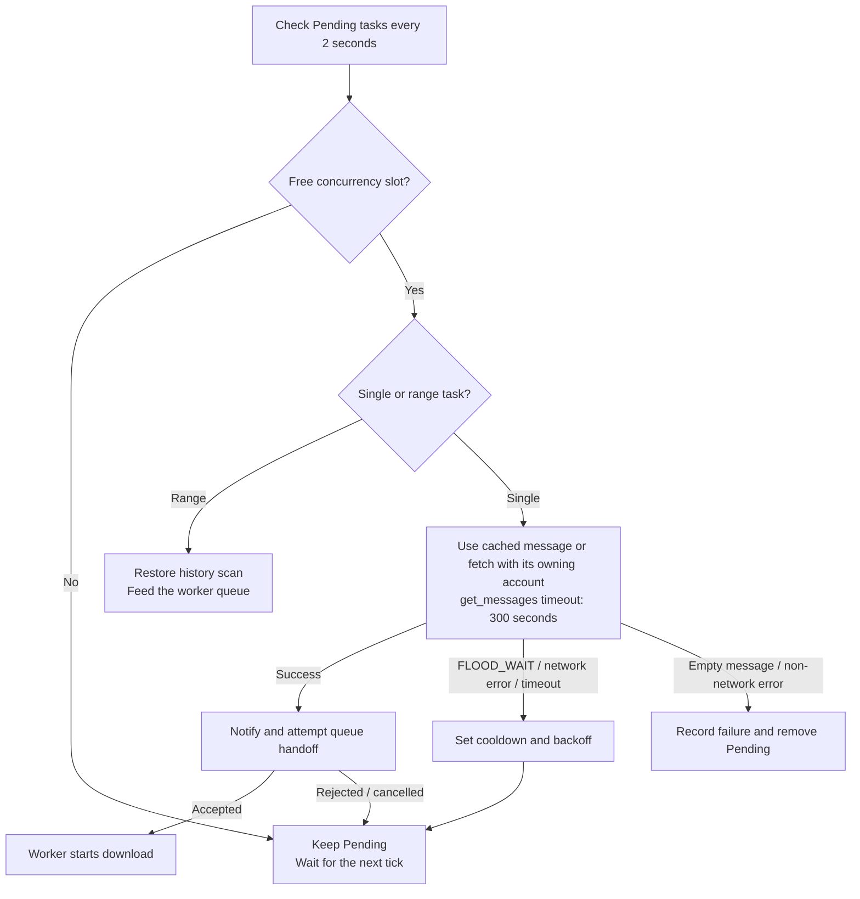

<h1 align="center">Telegram Media Downloader</h1>

<p align="center">
<strong>Telegram media download / forward / listen tool with task persistence, crash recovery, and modern WebUI</strong>
</p>

<p align="center">
<a href="https://github.com/smilekevin/telegram-media-downloader/blob/master/LICENSE"></a>
<a href="https://github.com/smilekevin/telegram-media-downloader/releases"></a>
<a href="https://www.python.org/downloads/"></a>
<a href="https://github.com/smilekevin/telegram-media-downloader/actions/workflows/docker-build.yml"></a>
</p>

<p align="center">
  <a href="./README.md">中文</a> ·
  <a href="#features">Features</a> ·
  <a href="#architecture">Architecture</a> ·
  <a href="#quick-start">Quick Start</a> ·
  <a href="#docker-images-from-this-fork">Docker Images</a> ·
  <a href="#configuration">Configuration</a> ·
  <a href="#bot-commands">Bot Commands</a> ·
  <a href="#web-api">Web API</a> ·
  <a href="#changes-from-upstream">Changes from Upstream</a>
</p>

---

## Authors and Maintainers

This repository is forked from [MangoIsIllegal/hermes-telegram-downloader](https://github.com/MangoIsIllegal/hermes-telegram-downloader).

- **Upstream author**: [MangoIsIllegal](https://github.com/MangoIsIllegal)
- **This fork's maintainer**: [smilekevin](https://github.com/smilekevin)
- Earlier foundation: [tangyoha/telegram_media_downloader](https://github.com/tangyoha/telegram_media_downloader)

## Fixes in This Fork

- **Pending consumer lifecycle**: start one periodic consumer even with an empty store, cancel and await it at shutdown, and restore states and task IDs before registering Bot handlers.
- **Recovery and queue handoff**: exclude tasks being consumed or already queued; release reservations on rejected or cancelled handoffs so Pending tasks can retry. Bound notifications to 30 seconds.
- **Batch downloads and forwards**: restore history-range tasks without a single message_id. Rescan download ranges to recover files lost from the in-memory queue; existing files are skipped by download history. Resume normal forwards from their checkpoint and use download/upload for protected channels, preserving destination, topic and display ID.
- **Worker accounting**: share active counts with the consumer, avoid decrements for idle cancellation or resize sentinels, count worker entry/exit once, and reserve requeued retries.
- **Dependencies**: pin `PyTgCrypto==1.2.12`, which includes Python 3.11 Alpine wheels for x86_64 and ARM64.
- **Bot media identity and reference refresh**: download and refresh Bot inbox media with the Bot account, persist ownership for new tasks, and restore it for legacy inbox tasks and WebUI retries. Empty responses record a normal failure reason instead of raising `NoneType.id`.
- **Docker builds**: CI tests and publishes SHA verification images for PRs, master pushes and manual runs, with pull references in its Summary. **Build Release Docker Image** runs only when a GitHub Release is published, publishing version tags and updating `latest`.

For branch verification, this repository's PRs automatically run **Telegram Media Downloader CI**. You can also select a branch and run CI manually in Actions. After success, copy the `docker pull` command or Compose `image:` configuration from **CI image for verification** in the Summary. CI publishes only SHA tags; only the Release workflow updates `latest`.

### Regression Tests

The tests need no Telegram account or network access. They use temporary persistence files and mocked Telegram responses with the real consumer and worker queue code.

```bash
python -m pip install -r requirements.txt
python -m unittest discover -s tests -v
```

PR checks run the tests and build the Alpine Docker image for amd64 and arm64. Live Telegram downloads and NAS container restarts still need deployment validation.

---

## Features

### Download

- **Multi-type media** — audio / document / photo / video / voice / animation / video_note
- **Batch download** — specify message ID range `[start, end]` with optional filter
- **Single download** — send a `t.me` link to the Bot
- **Forwarded media** — forward a media message to the Bot, downloads from source channel
- **Skip detection** — file size ≥ downloaded size = already complete, skip
- **Size mismatch** — backs up existing file (.bak), re-downloads, deletes backup on success
- **3 retries** — per file, with exponential backoff for connection errors (10s/20s/40s)
- **File reference refresh** — auto fetch_message on BadRequest
- **Temp file cleanup** — failed downloads clean up `.temp` files, stale files removed on startup

### Forward

- **Cross-channel forward** — normal and protected channels (has_protected_content)
- **Protected channels** — auto-switch to download-then-upload mode
- **Comments forward** — `/forward_to_comments` forwards media to a post's comment section
- **Listen forward** — `/listen_forward` uses NewMessage event-driven, triggers download/forward immediately on new channel messages (not polling)
- **Config.yaml monitoring** — chats in config file also auto-monitor new messages, real-time updates after startup

### Ad Filtering

- **Keyword filtering** — `/add_ad` adds ad keywords, auto-skips messages containing these keywords during forwarding
- **Keyword removal** — `/remove_ad` removes ad keywords
- **Content replacement** — `/add_replace_ad` adds replacement rules, auto-removes matching ad text from caption
- **Replacement removal** — `/remove_replace_ad` removes replacement rules
- **Group ads** — `/set_ad` sets appended ad text for specific groups, auto-added to caption during forwarding

### Task Management

- **Task persistence** — all download/forward tasks written to `log/bot_tasks.json`, survive container restarts
- **Crash recovery** — incomplete tasks re-enter pending queue on restart, consumed one by one
- **Task ID** — `MMDD-N` format (e.g. `0628-1`), resets daily, persistent counter
- **Pending queue** — tasks enter pending state first, fed to workers by consumer loop; in-memory reservations distinguish tasks waiting for worker pickup
- **Download progress persistence** — auto-saves `last_read_message_id` every 50 messages, no progress loss on interruption
- **Download history** — completed/failed records in `log/download_history.json`
- **Manual stop** — stopped tasks' incomplete files recorded as failed (reason: manually stopped)

### FLOOD_WAIT Handling

- **Non-blocking** — sets a cooldown timestamp instead of sleeping, doesn't block the queue
- **Pending consumer throttling** — get_messages FloodWait triggers global cooldown, task stays pending
- **Download throttling** — cumulative FloodWait > 600s = skip file
- **Message edit throttling** — edit_message FloodWait sets node-level cooldown
- **User notification** — sends Telegram message when rate-limited
- **Silent throttle detection** — detects TG silent rate-limiting (speed < 200 KB/s for 120s) without explicit FloodWait error, shows WebUI banner with elapsed timer + sends TG notification (trigger & recovery, once each)

### WebUI

- **Modern light theme** — no layui, pure HTML/CSS/JS, responsive
- **Four tabs**:
  - 📥 **Active** — live progress / speed / ETA
  - ✅ **Completed** — infinite scroll, server-side search
  - ❌ **Failed** — error reason + source link, retry supported
  - ⏳ **Pending** — queue with wait time
- **Actions** — pause/resume, delete (single/batch), retry (single/batch)
- **Real-time** — total speed = sum of active task speeds, 3s stale check
- **Sticky nav** — tabs stay visible while scrolling

### Notifications

- **Progress** — Bot message update at every 20% milestone
- **Completion** — immediate final status (re-counted from _download_result to avoid races)
- **Failure** — lists each failed file with specific error reason
- **Rate limit** — FLOOD_WAIT pause notification with wait duration
- **Silent throttle** — TG silent rate-limit detection (speed < 200 KB/s for 120s), WebUI banner with elapsed timer + TG notification (trigger & recovery, once each)
- **Recovery** — notifies user when interrupted/pending tasks are restored on restart
- **Retry** — notifies user when a retried task enters the download queue

### Other

- **Multilingual** — Chinese / English / Russian / Ukrainian
- **rclone cloud upload** — optional post-download cloud drive upload
- **Proxy** — Pyrogram native proxy + Docker environment variable proxy
- **Local dev mode** — `run_local.py` with mock data, no Telegram account needed
- **Log separation** — `tdl.log` + `download.log`, 10MB rotation, 30-day retention

---

## Architecture



Solid edges show task and media processing. Dashed edges show persistence or batch/monitoring entry points. Single downloads are persisted before the consumer feeds the worker queue; history scans and live monitoring feed the same queue. Progress and history also supply WebUI views and Bot notifications.

### Core Flow

1. **User submits a single download** → Bot handler creates TaskNode → `save_task()` persists Pending → consumer fetches message → `add_download_task()` enqueues
2. **Worker dequeues** → `download_task()` → `download_media()` → Pyrogram download
3. **Progress callback** → `update_download_status()` updates `_download_result` → 20% milestone triggers Bot notification
4. **Download complete** → `complete_task()` removes from store → `save_downloads()` writes history
5. **Download failed** → `add_failed_download()` records to failed list → WebUI retry available
6. **Container restart** → `recover_tasks()` reads incomplete tasks → resets all to pending → consumer loop feeds workers

### Pending Consumer

On restart, all incomplete tasks enter the pending queue instead of resuming directly. This prevents FLOOD_WAIT storms from 100+ tasks resuming simultaneously.



Active workers and fetching/queued reservations share the concurrency limit; each task is consumed once. Network errors leave tasks Pending for retry after cooldown. Rejected or cancelled queue handoffs release their reservations.

### TCP Timeout Patch

Pyrogram's default `TCP.TIMEOUT=10s` causes reconnect storms when Telegram throttles downloads. Patched to 900s:

```python
from pyrogram.connection.transport.tcp import TCP as _TCP
_TCP.TIMEOUT = 900
```

---

## Docker Images from This Fork

The upstream [MangoIsIllegal/hermes-telegram-downloader](https://github.com/MangoIsIllegal/hermes-telegram-downloader) does not provide prebuilt Docker images. This fork adds GitHub Actions builds and GHCR publishing for `linux/amd64` and `linux/arm64`.

The project, repository and GHCR image path now use the **Telegram Media Downloader** name. The Compose service/container name remains `hermes-telegram-downloader` to simplify migration of existing deployments.

- **Image**: `ghcr.io/smilekevin/telegram-media-downloader`
- **CI verification images**: [Telegram Media Downloader CI](https://github.com/smilekevin/telegram-media-downloader/actions/workflows/tests.yml)
- **Release publishing**: [Build Release Docker Image](https://github.com/smilekevin/telegram-media-downloader/actions/workflows/docker-build.yml)
- **Default branch image**: every merge or push to master runs only CI, publishing `:sha-FULL_COMMIT` after tests pass without updating `latest`. Scheduled builds are disabled.
- **Release images**: publishing a GitHub Release builds its tagged commit. A Release tagged `v1.0.1` publishes `:v1.0.1`, `:sha-FULL_COMMIT` and updates `:latest`. Different Releases on the same commit still build. Creating a tag alone or saving a Release draft does not trigger publishing. Use Docker-compatible version names; `latest` and `sha-*` are reserved for the workflow.
- **PR/branch verification**: `:sha-FULL_COMMIT`. PR CI publishes verification images automatically; manual branch CI runs also publish. **CI image for verification** in the Summary includes the package link, tags, digest, pull command and Compose configuration. PRs build their current merge-preview source; Source commit identifies the actual tested and built commit. External fork and Dependabot PRs validate the build without publishing, and their summary states this explicitly.

```bash
docker pull ghcr.io/smilekevin/telegram-media-downloader:latest
```

For prebuilt images, set the Compose `image` and remove `build` and source-code mounts. Keep existing configuration, downloads, logs, sessions and temporary-file mounts. Use the branch build's digest when verifying a PR.

### Migrate from the Previous Image Path

New builds publish to `ghcr.io/smilekevin/telegram-media-downloader`. Historical images remain at `ghcr.io/smilekevin/hermes-telegram-downloader`. Keep using the old path with old digests; when switching to the new path, use a version tag or digest from a new build's summary.

Merging this change publishes a SHA image at the new path. The new `latest` tag is created by the first successful Release build. After publishing the new package for the first time, set its visibility to **Public** in [Package settings](https://github.com/users/smilekevin/packages/container/telegram-media-downloader/settings) so a NAS can pull without authentication.

In an existing Compose configuration, set `image` to a version or digest at the new path, remove `build` and source-code mounts, and retain configuration and data mounts. Then run:

```bash
docker-compose pull
docker-compose up -d --force-recreate
```

### Publish a Version with GitHub Releases

After merging this workflow change, open this repository's [Releases](https://github.com/smilekevin/telegram-media-downloader/releases) and click **Draft a new release**:

1. Under **Choose a tag**, enter a new version such as `v1.0.1` and select the option to create that tag.
2. Set **Target** to master or a commit containing this workflow change.
3. Enter the title and release notes, then click **Publish release**.

Publishing automatically builds amd64/arm64 images. The **Build Release Docker Image** Summary lists version tags and the digest. After the build succeeds, pull the pinned version or use `latest` for the most recently published Release image whose build succeeded:

```bash
docker pull ghcr.io/smilekevin/telegram-media-downloader:v1.0.1
docker pull ghcr.io/smilekevin/telegram-media-downloader:latest
```

## Quick Start

### Docker (Recommended)

```bash
git clone https://github.com/smilekevin/telegram-media-downloader.git
cd telegram-media-downloader

cp config.yaml.example config.yaml
# Edit config.yaml with your api_id / api_hash / bot_token

# Pull a published Release image
docker-compose pull

# First run (foreground, for Telegram login)
docker-compose run --rm hermes-telegram-downloader

# Subsequent runs (background)
docker-compose up -d

# View logs
docker-compose logs -f
```

### Manual Install

```bash
git clone https://github.com/smilekevin/telegram-media-downloader.git
cd telegram-media-downloader
pip install -r requirements.txt

cp config.yaml.example config.yaml
# Edit config.yaml...

python media_downloader.py
```

### Local Dev Mode

```bash
# No Telegram account needed, mock data for WebUI debugging
python run_local.py
# Open http://localhost:5000
```

---

## Configuration

### config.yaml

```yaml
# Telegram API credentials (required)
api_id: your_api_id
api_hash: your_api_hash
bot_token: your_bot_token

# Media types
media_types:
  - audio
  - document
  - photo
  - video
  - voice
  - animation

# File format filter (all = all formats)
file_formats:
  audio:
    - all
  document:
    - pdf
    - epub
  video:
    - mp4

# Download settings
save_path: /app/downloads
file_path_prefix:
  - chat_title
  - media_datetime
file_name_prefix:
  - file_name
hide_file_name: false

# Concurrency
max_download_task: 5  # number of workers

# WebUI
web_host: 0.0.0.0
web_port: 5000
web_login_secret: 123

# Permissions
allowed_user_ids:
  - 'me'  # 'me' = currently logged-in account

# Other
language: ZH
date_format: '%Y_%m'
enable_download_txt: false
log_level: DEBUG

# Proxy (Docker: access host proxy)
proxy:
  scheme: http
  hostname: 172.17.0.1
  port: 20172
```

### Parameters

| Parameter | Description | Default |
|-----------|-------------|---------|
| `api_id` | Telegram API ID ([my.telegram.org](https://my.telegram.org/apps)) | — |
| `api_hash` | Telegram API Hash | — |
| `bot_token` | Bot Token ([@BotFather](https://t.me/BotFather)) | — |
| `media_types` | Media types to download | — |
| `file_formats` | Format filter per type | — |
| `save_path` | File save path | `./downloads` |
| `max_download_task` | Concurrent download workers | `5` |
| `web_port` | WebUI port | `5000` |
| `allowed_user_ids` | Allowed Bot users (`'me'` = self) | `[]` |
| `language` | UI language (`ZH` / `EN` / `RU` / `UA`) | `EN` |
| `proxy` | Proxy config (scheme / hostname / port) | `{}` |
| `log_level` | Log level | `INFO` |
| `hide_file_name` | Hide filenames in UI | `false` |
| `enable_download_txt` | Save text-only messages as .txt | `false` |
| `date_format` | Date directory format | `%Y_%m` |

---

## Bot Commands

| Command | Description | Example |
|---------|-------------|---------|
| `/download <link> <start> <end> [filter]` | Batch download | `/download https://t.me/c/123 1 100` |
| `/forward <src> <dst> <start> <end> [filter]` | Forward messages | `/forward https://t.me/c/A https://t.me/c/B 1 500` |
| `/forward_to_comments <src> <dst> <start> <end>` | Forward to comments | `/forward_to_comments https://t.me/c/A https://t.me/c/B 1 10` |
| `/listen_forward <src> <dst> [filter]` | Listen and auto-forward | `/listen_forward https://t.me/c/A https://t.me/c/B` |
| `/get_info <link>` | Get chat/message info | `/get_info https://t.me/c/123/456` |
| `/add_filter <filter>` | Set download filter | `/add_filter message_date >= 2024-01-01` |
| `/add_ad <keyword>` | Add ad keyword (skip during forward) | `/add_ad 推广` |
| `/remove_ad <keyword>` | Remove ad keyword | `/remove_ad 推广` |
| `/add_replace_ad <msg_link> <keyword>` | Add replacement rule (remove from caption) | `/add_replace_ad https://t.me/c/123/456 广告` |
| `/remove_replace_ad <msg_link> <keyword>` | Remove replacement rule | `/remove_replace_ad https://t.me/c/123/456 广告` |
| `/set_ad <msg_link> <ad_text>` | Set group append ad (empty to delete) | `/set_ad https://t.me/c/123 关注我` |
| `/set_language <lang>` | Set language (en/ru/zh/ua) | `/set_language zh` |
| `/stop` | Stop download/forward/listen (interactive) | `/stop` |
| `/help` `/start` | Show help | — |

### Shortcuts (no command needed)

- **Send a `t.me` link** → downloads single message
- **Forward media to Bot** → downloads from source channel

### Message IDs

- `start_id = 1` → from the earliest message
- `end_id = 0` → up to the latest message
- `[filter]` is optional

---

## Web API

| Endpoint | Method | Description |
|----------|--------|-------------|
| `/` | GET | WebUI page |
| `/get_download_list` | GET | Download list (`already_down=true` completed, `false` active) |
| `/get_download_list?offset=0&limit=50&search=keyword` | GET | Completed list (pagination + search) |
| `/get_pending_list` | GET | Pending queue |
| `/get_failed_downloads` | GET | Failed list |
| `/get_download_status` | GET | Total download speed |
| `/get_download_state` | GET | Global state (downloading / paused) |
| `/get_completed_count` | GET | Completed count (lightweight polling) |
| `/get_flood_wait` | GET | FloodWait cooldown status + remaining seconds |
| `/get_app_version` | GET | App version |
| `/check_file_exists` | POST | Check if local file exists for a completed task |
| `/set_download_state` | POST | Global pause/resume (`state=pause` / `state=continue`) |
| `/pause_task` | POST | Pause a task |
| `/resume_task` | POST | Resume a task |
| `/delete_task` | POST | Delete a task (active or failed) |
| `/batch_delete` | POST | Batch delete (JSON: `{"task_ids": [...]}`) |
| `/retry_task` | POST | Retry a failed task |
| `/batch_retry` | POST | Batch retry (JSON: `{"task_ids": [...]}`) |
| `/remove_pending` | POST | Remove a pending task |

---

## Docker Management

```bash
# Build
docker-compose build

# Start
docker-compose up -d

# Logs
docker-compose logs -f

# Stop
docker-compose down

# Restart
docker-compose restart

# Update
git pull && docker-compose build && docker-compose up -d
```

### Data Persistence

| Path | Description |
|------|-------------|
| `./downloads/` | Downloaded files |
| `./config.yaml` | Config file |
| `./data.yaml` | Runtime data (ids_to_retry, etc.) |
| `./log/` | Logs + task persistence (bot_tasks.json / task_counter.json / download_history.json) |
| `./sessions/` | Telegram session files |
| `./temp/` | Download temp files |

---

## Changes from Upstream

Based on [tangyoha/telegram_media_downloader](https://github.com/tangyoha/telegram_media_downloader) v2.2.6, heavily modified.

### New Modules

| Module | Description |
|--------|-------------|
| `module/task_store.py` | Task persistence + crash recovery, JSON storage, atomic writes, thread-safe |
| `run_local.py` | Local dev mode with mock data, no Telegram needed |

### Core Changes

| Change | Upstream | This Project |
|--------|---------|--------------|
| **Task persistence** | None (lost on restart) | `bot_tasks.json` + `task_counter.json`, auto-recovery |
| **Download history** | None | `download_history.json`, completed/failed records |
| **Task ID** | Incrementing int | `MMDD-N` format, daily reset, persistent counter |
| **Web UI** | layui framework | Pure HTML/CSS/JS, light theme, responsive |
| **WebUI features** | Basic list | 4 tabs + pause/resume + delete + retry + search + infinite scroll |
| **Pending queue** | None | Restart tasks enter pending, consumed one by one, prevents FLOOD_WAIT storm |
| **FLOOD_WAIT** | Blocking sleep | Non-blocking cooldown timestamp |
| **Silent throttle** | Not detected | Speed < 200 KB/s for 120s → WebUI banner + TG notification (trigger & recovery) |
| **Worker count** | Fixed (config) | WebUI dropdown 1-6, dynamically adjusts concurrency |
| **Progress notification** | Timed polling | 20% milestone + immediate completion + re-counted from _download_result |
| **Failure handling** | Log only | Failed list persisted + error reason + source link + WebUI retry |
| **Stop task** | Direct stop | Incomplete files recorded as failed (manually stopped) |
| **TCP timeout** | 10s (default) | 900s, prevents reconnect storm during throttling |
| **Download retry** | 3x 5s interval | 3x, OSError exponential backoff (10s/20s/40s) |
| **Size mismatch** | Overwrite | Backup .bak, re-download, delete backup on success |
| **File reference** | Log only | Auto fetch_message to refresh |
| **Queue init** | Module import time | After event loop starts, avoids loop mismatch |
| **Logging** | Single file | `tdl.log` + `download.log`, 10MB rotation, 30-day retention |
| **Bot notifications** | Simple status | Progress + completed file list + failure reasons + rate limit + recovery |
| **Docker** | Single stage | Multi-stage build (alpine), rclone built-in |
| **Version** | v2.2.6 | v1.0.0 (independent line) |

---

## License

[MIT](./LICENSE)

## Acknowledgements

- Upstream: [tangyoha/telegram_media_downloader](https://github.com/tangyoha/telegram_media_downloader)
- Pyrogram: [pyrogram](https://github.com/pyrogram/pyrogram)
